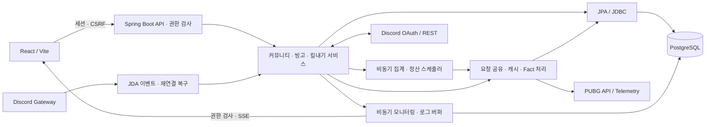

# GuildUp

**Discord 커뮤니티 운영과 PUBG 경기 집계를 연결하는 서비스**

개인 개발·운영 프로젝트입니다. 외부 API에서 가져오는 데이터가 늦게 도착하거나 여러 작업이 동시에 실행되어도, 커뮤니티 활동과 이벤트 결과를 일관되게 반영하도록 설계했습니다.

**[서비스 바로가기](https://guild-up.com)** · [핵심 설계](#engineering) · [테스트](#validation) · [한계와 개선](#limitations)

**트랜잭션 경계 · 동시성·정합성 · 요청 공유·캐싱 · UUID 작업 소유권 · 장애 관측**

| 설계 과제 | 구현한 제어 | 보여주는 백엔드 역량 |
|---|---|---|
| [빙고 집계](#bingo) | 입력이 바뀐 오래된 작업의 반영 거부 | 트랜잭션 분리, 버전 검증, 잠금 |
| [PUBG 수집](#pubg) | 동일 요청 공유와 경기 데이터 재사용 | 외부 API 비용·동시성·실패 제어 |
| [킬내기 정산](#settlement) | 유효한 UUID 소유권을 가진 작업만 확정 | 중복 처리 방지, 원자적 저장, 복구 |

## 프로젝트 정보

Discord의 멤버·역할·음성 활동과 PUBG 경기 기록을 연결해 클랜 관리와 이벤트 집계를 웹에서 처리합니다. **사용자, 커뮤니티 멤버십, 실제 클랜원, 외부 게임 계정을 구분**하여 가입·권한·활동의 경계를 설계했습니다.

| 항목 | 내용 |
|---|---|
| 형태 | 실제 서비스로 운영하는 개인 개발 프로젝트 |
| 목적 | 분리된 Discord·게임 데이터를 연결하고 커뮤니티 활동·이벤트 결과를 일관되게 관리 |
| 담당 역할 | 백엔드 API·도메인·DB 설계, 외부 연동, 프론트엔드, 테스트, 운영 관리 기능 구현 |
| 주요 기능 | 커뮤니티·권한 관리, Discord 멤버·음성 활동, PUBG Kakao/Steam 연동, 빙고·킬내기·출석·랭킹 |

| 영역 | 기술 |
|---|---|
| 백엔드·데이터 | Java 21, Spring Boot 4.1.1, Spring MVC, PostgreSQL, JPA, JDBC |
| 프론트엔드·연동 | React, Vite, Discord OAuth/JDA, PUBG API·Telemetry |
| 테스트·운영 | JUnit, Mockito, MockMvc, H2, 조건부 PostgreSQL 테스트, Node test runner/jsdom, Maven, Logback/MDC, SSE, Spring Scheduling |

## 시스템 아키텍처

활동·빙고 집계는 웹 요청과 별도 실행기에서 처리하고, 킬내기 발표는 DB 상태를 스케줄러가 확인합니다. 외부 데이터 수집과 결과 반영의 경계를 분리하고 요청·작업 문맥을 모니터링에 연결합니다.

## 핵심 기술적 문제 해결

현재 구현과 테스트에서 확인한 실패 조건을 기준으로 정리했습니다. 실제 장애 발생 이력이나 미측정 개선 수치를 주장하는 사례는 아닙니다.

### A. 빙고 집계 — 늦게 끝난 작업으로부터 최신 결과 보호

외부 수집 중 입력이 바뀌어도 최신 진행도를 보호하도록 **준비·수집·반영을 분리**했습니다. 반영 직전에 버전과 입력 스냅샷을 검사하고, 잠금과 처리 이력으로 동시 실행·중복 반영을 제어합니다.

**[상세 문서: 빙고 집계의 동시성 제어와 데이터 정합성](docs/cases/bingo-consistency.md)**

문제 → 원인 → 설계 → 구현 → 검증 → 한계

| 단계 | 내용 |
|---|---|
| **문제** | 경기 수집 중 계정·참가자·미션 설정이 바뀌거나 새 집계가 먼저 끝나면 이전 작업이 최신 진행도를 덮어쓸 수 있습니다. |
| **원인** | 외부 호출의 완료 순서는 요청 순서와 다릅니다. 수집 시작 시점의 입력이 저장 시점에도 유효하다는 보장이 없습니다. |
| **설계** | **준비 트랜잭션 → 외부 수집 → Fact 저장 → 계산 트랜잭션**으로 나누고, 반영 직전에 현재 입력을 재검증합니다. |
| **구현** | 이벤트 버전 증가와 입력 스냅샷 비교, 이벤트·참가자 행 잠금, 처리 경기 유일성 제약을 적용합니다. 불완전 수집의 최종 확정은 보류합니다. |
| **검증** | 입력 변경 후 이전 작업 거부, 개인·전체 집계 경쟁, 반복 집계, 부분 실패 후 재시도와 완료 상태 재계산을 검사하는 테스트가 있습니다. |
| **한계** | 동일 이벤트의 DB 반영은 직렬화됩니다. 작업 상태는 인메모리이며, 대규모 참가자의 계산·저장 비용은 추가 측정이 필요합니다. |

외부 호출 중 긴 DB 잠금을 유지하는 대신, 준비와 반영 시점의 짧은 트랜잭션에서 일관성을 검사합니다. 버전만 비교하지 않고 참가자·계정·미션 입력도 대조해 수집에 사용한 조건이 달라진 작업을 거부합니다.

- **구현:** `BingoAggregationPreparationService`, `BingoAggregationGuard`, `BingoAggregationCalculationService`. `PESSIMISTIC_FORCE_INCREMENT`와 행 잠금으로 집계 세대와 반영 순서를 제어합니다.
- **테스트:** `BingoAggregationConcurrencyFlowTests`는 수집 중 입력 변경과 새 집계 이후 이전 작업의 반영을 재현합니다. `BingoAggregationConsistencyFlowTests`는 부분 실패·재계산의 진행도와 완료 시각을 검사합니다.

### B. PUBG API — 중복 수집을 줄이는 요청 공유와 데이터 재사용

같은 경기를 요청하는 작업이 **진행 중 결과·캐시·저장 데이터를 재사용**하도록 설계했습니다. 공통 수집 경로에서 동시성을 제한하고 Rate Limit·부분 실패에 대응합니다.

**[상세 문서: PUBG API 중복 요청 최적화와 경기 데이터 재사용](docs/cases/pubg-request-reuse.md)**

문제 → 원인 → 설계 → 구현 → 검증 → 한계

| 단계 | 내용 |
|---|---|
| **문제** | 여러 참가자와 기능이 같은 경기를 조회하면 외부 호출·파싱·저장이 반복됩니다. 동시 작업은 API 제한과 수집 실패의 영향을 함께 받습니다. |
| **원인** | 참가자별 경기 목록이 겹치며, 요청별 제한만으로는 전체 작업의 동시 호출 수를 제어하기 어렵습니다. |
| **설계** | 경기 ID 중복 제거, 플랫폼별 캐시, 진행 중 요청 공유, 공통 동시성 제한과 영속 Fact 저장을 조합합니다. |
| **구현** | `CompletableFuture`로 동일 요청을 공유하고 가상 스레드·`Semaphore`로 수집 동시성을 제한합니다. 빙고는 저장 Fact를, 활동·킬내기는 공통 Match 조회를 재사용합니다. 조절 대상 요청에는 Rate Limit 헤더와 제한된 재시도를 적용합니다. |
| **검증** | 동일 경기의 동시 요청 공유, 저장 데이터의 재조회 생략, 플랫폼별 키 분리, 공통 동시성 제한, Telemetry 실패 격리·재수집을 검사합니다. |
| **한계** | 캐시와 요청 제어는 프로세스 단위입니다. 외부 API의 최근 경기 목록에서 최초 수집 전에 누락된 기록까지 항상 복구할 수는 없습니다. |

키에 shard와 경기 ID를 함께 사용해 Kakao/Steam을 구분합니다. 완료된 경기와 미존재 응답의 캐시 수명을 구분하고, 미완료 Telemetry는 저장된 경기에서 다시 수집합니다. Player의 최신 목록 조회는 계속 수행합니다.

- **구현:** `PubgMatchService`, `PubgMatchSyncService`, `PubgMatchFactWriter`, `PubgApiRequestGovernor`, `PubgApiClient`. Match의 동시성 제어와 Telemetry 처리는 요청 간격 조절 대상과 구분됩니다.
- **테스트:** `PubgMatchServiceTests.concurrentRequestsShareOneInFlightCall`과 `PubgMatchSyncServiceTests.storedMatchSkipsBothMatchAndTelemetryApis`가 요청 공유·재사용의 기대값을 검사합니다. 운영 호출 감소율을 측정한 결과는 아닙니다.

### C. 킬내기 정산 — UUID 소유권으로 중복 확정 방지

발표 작업의 소유권을 시간값과 분리한 **UUID로 관리**합니다. 현재 소유자인 작업만 경기 결과·점수·완료 상태를 함께 저장하도록 검증해, 재시도 후 늦게 끝난 작업의 확정을 거부합니다.

문제 → 원인 → 설계 → 구현 → 검증 → 한계

| 단계 | 내용 |
|---|---|
| **문제** | 결과 발표의 중복 실행이나 재시도 이후 늦게 완료된 작업이 결과·우승 점수를 다시 반영할 수 있습니다. |
| **원인** | 작업 만료와 실행 완료가 경쟁하며, 시각을 작업 식별자로 사용하면 Java·DB의 시간 정밀도 차이도 영향을 줍니다. |
| **설계** | 발표 예정 시각·상태를 DB에 저장하고, 행 잠금 아래 UUID claim을 발급합니다. 현재 소유권이 유효한 작업만 최종 반영합니다. |
| **구현** | 외부 수집 후 UUID를 재검사하고 경기 결과·점수 원장·완료 상태를 같은 트랜잭션에서 갱신합니다. 실패 상태를 기록해 재시도하며, 클랜원 잠금 아래 중복 점수 지급을 검사합니다. |
| **검증** | 동시 작업의 중복 소유 방지, 교체된 claim의 이전 작업 거부, PostgreSQL 시각 정밀도 차이, 지연 발표·실패 복구·중복 지급을 검사합니다. |
| **한계** | 스케줄러 주기와 외부 수집 때문에 실제 확정 시각은 달라질 수 있습니다. claim 만료 후 수집이 겹칠 수 있지만 이전 작업의 최종 반영은 거부합니다. |

시간은 실행 가능 여부와 만료 판단에, UUID는 현재 작업의 식별에 사용합니다. 정산 획득·외부 수집·확정을 분리해 네트워크 대기와 DB 변경의 책임을 구분합니다.

- **구현:** `KillCompetitionSettlementStore`, `KillCompetitionResultScheduler`, `CommunityScoreService`. 점수 지급의 대회 중복과 서울 날짜 기준 제한을 함께 검사합니다.
- **테스트:** `KillCompetitionFlowTests`에 `staleWorkerCannotFinishAfterAReplacementClaimWasIssued`, `concurrentWorkersCannotOwnTheSameFinalization`이 있습니다. `KillCompetitionPostgresClaimIntegrationTests`는 DB에 저장된 시각이 달라져도 UUID로 확정하는 상황을 재현합니다.

## 추가로 설계한 경계와 복구

| 주제 | 구현한 내용 |
|---|---|
| 커뮤니티별 데이터 격리 | 활성 멤버십·운영진 권한, 게임 소유 관계·플랫폼을 서버에서 검사합니다. 웹 사용자와 클랜원·게임 계정을 분리합니다. |
| Discord 이벤트·재연결 | 동일 Guild/User 이벤트의 순서 제어, 전체 동기화와의 잠금 조율, 연결 상태 확인 후 캐시·멤버·음성 상태 복구를 구현했습니다. |
| 세션 인증·권한 | 로그인 시 세션 ID·CSRF 교체, 인증 버전 검사, 비밀번호 해싱, 계정/IP 제한을 적용합니다. 커뮤니티 권한과 시스템 권한을 구분합니다. |
| 비동기 모니터링·로그 | 제한된 큐와 독립 저장 트랜잭션, 메타데이터 크기 제한·마스킹, 로그 버퍼·SSE와 구독 권한 검사를 적용합니다. |

## 테스트 및 검증

**확인 범위: 테스트 코드의 검증 시나리오. README 재작성일인 2026-10-14에는 테스트를 실행하지 않았습니다.** 현재 통과 여부·커버리지·성능 수치를 제시하지 않습니다.

| 검증 관점 | 실제 테스트에서 검사하는 내용 |
|---|---|
| 동시성·정합성 | 이전 빙고 작업의 반영 거부, 요청 공유·수집 동시성, 정산 claim 경쟁 |
| 트랜잭션 | 커뮤니티·게임·OWNER 생성 실패 시 롤백, 활동 저장 실패 시 기존 스냅샷 보존 |
| 권한·중복 처리 | 다른 커뮤니티 게임·다른 세션 CSRF 거부, 반복 집계·정산·점수 지급 제어 |
| 실패·복구 | Telemetry 재수집, 정산 재시도, Discord 복구, 모니터링 writer 지연·큐 포화의 격리 |

JUnit·Mockito·MockMvc와 H2 통합 테스트를 사용합니다. PostgreSQL의 잠금·시간 정밀도 검증은 조건부 테스트로 분리합니다. 주요 추가 근거는 `CommunityFlowTests`, `SessionCsrfFlowTests`, `CommunityDiscordReconnectFlowTests`, `MonitoringAsyncIsolationTests`입니다.

## 운영을 고려한 구현

- **외부 연동 실패:** API 오류·재시도·Rate Limit 복구를 구분하고, 봇 연결 상태 변화에 맞춰 멤버·음성 데이터를 복구합니다.
- **장애 관측:** 요청 ID·작업 ID·처리 단계로 로그와 이벤트를 연결하고 관리자 화면에서 확인하도록 구현했습니다.
- **변경 관리:** 백엔드와 프론트엔드 빌드를 구분하고, DB 제약 변경 SQL과 PostgreSQL 검증 시나리오를 관리합니다.

이는 운영 서비스의 코드로 확인되는 대응 구조입니다. 실제 장애 해결 사례·정량 성과는 실행 날짜와 버전·환경이 확인되는 기록을 확보한 뒤 추가할 예정입니다.

## 기술적 한계와 개선 방향

| 현재 한계 | 다음 검토 방향 |
|---|---|
| 일부 작업 상태·캐시·OAuth 상태·잠금이 프로세스에 종속 | 다중 인스턴스 운영 시 공유 저장소와 작업 소유권·재시도 모델 검토 |
| 외부 API의 기록 제공 범위와 수집 시점에 따라 누락 가능 | 수집 주기와 누락 탐지·재수집 기준 정리 |
| 동일 빙고의 반영 직렬화, 모니터링 큐 포화 시 이벤트 유실 | 합성 데이터로 저장 구간 비용 측정, 이벤트 중요도에 따른 보존 정책 검토 |

## 상세 문서 방향

[빙고 집계의 동시성 제어와 데이터 정합성](docs/cases/bingo-consistency.md)을 상세 문서로 정리했습니다. 트랜잭션 경계, 경쟁 상황별 제어 순서, 실제 테스트의 검증 범위와 기술적 한계를 설명합니다. [PUBG API 중복 요청 최적화와 경기 데이터 재사용](docs/cases/pubg-request-reuse.md)에서는 요청 공유·캐싱, API별 호출 제어, 영속 Fact 재사용과 부분 실패 처리를 설명합니다. **정산 소유권**은 향후 상세 문서와 합성 데이터 재현 예제로 분리할 계획이며, 현재는 해당 사례의 접힌 설명에서 구현·테스트 근거를 확인할 수 있습니다.

---

이 저장소는 공개 포트폴리오입니다. 운영 소스는 별도의 Private 저장소에서 관리하며, 현재 공개 범위는 README와 빙고 집계·PUBG API 기술 문서입니다. 기술 근거의 클래스·테스트명은 운영 소스 기준입니다.
