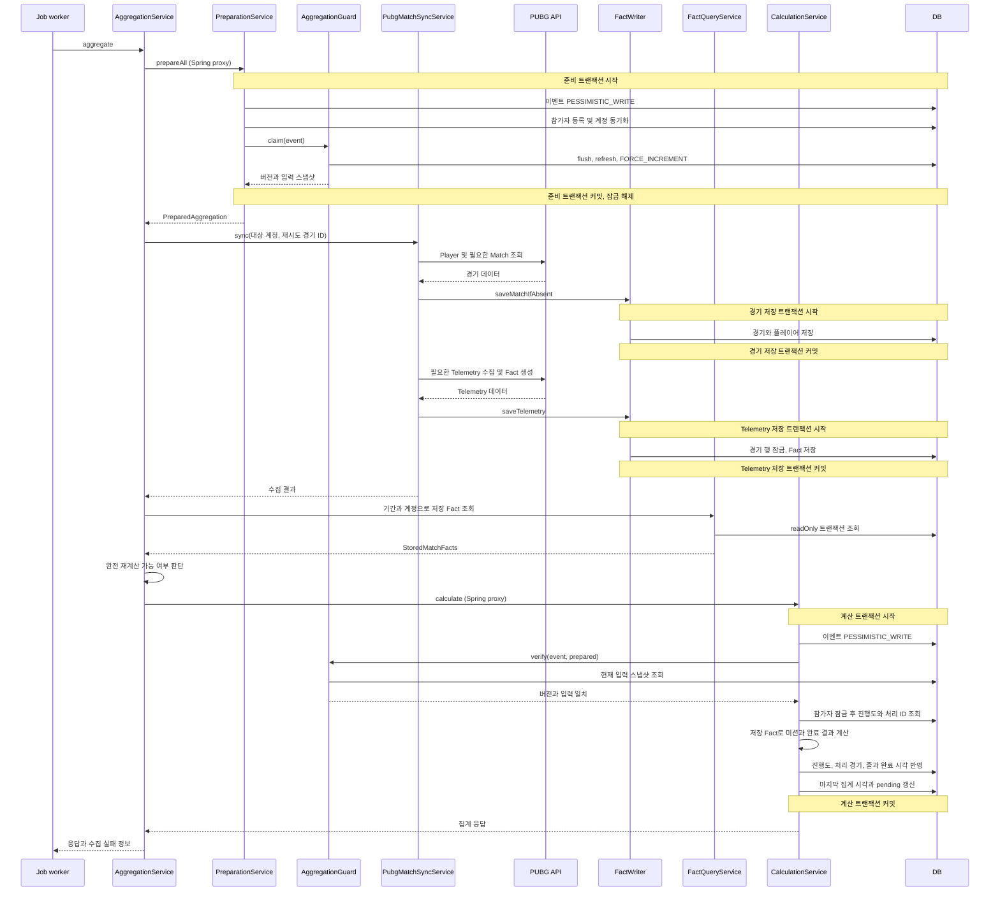
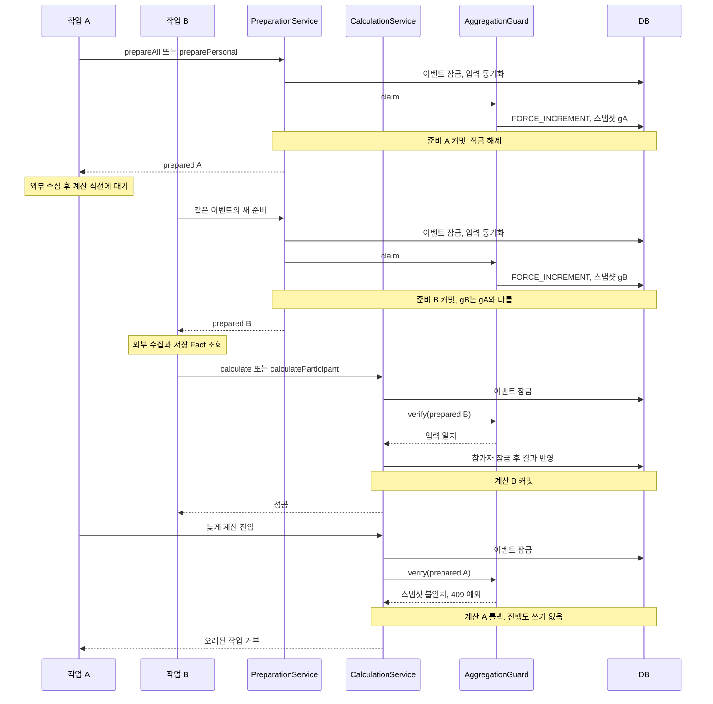
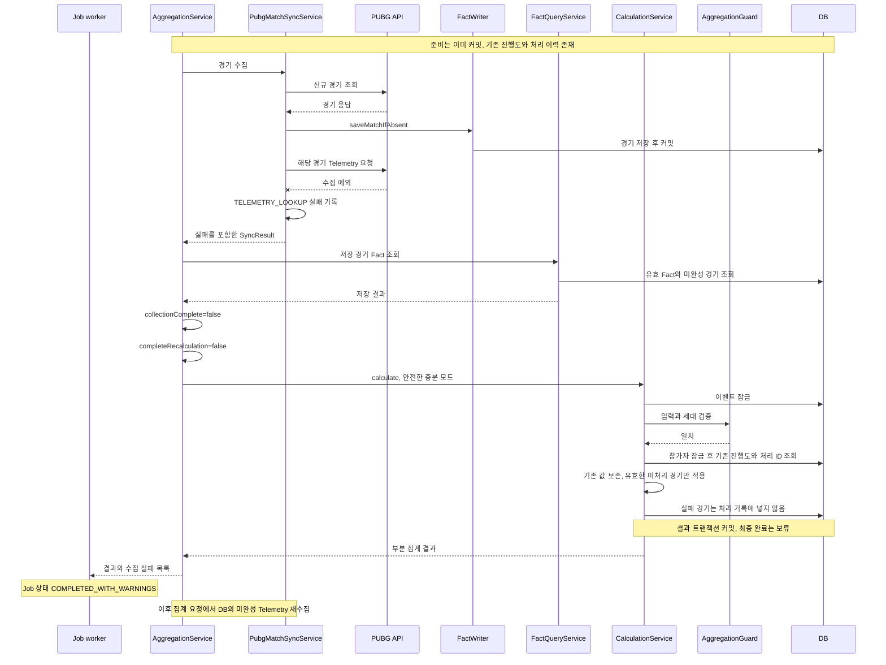

# 빙고 집계의 동시성 제어와 데이터 정합성

> 외부 API 수집과 DB 결과 반영을 분리하고, 입력 스냅샷·작업 세대·행 잠금으로 오래된 집계의 반영을 차단한 사례입니다.

[프로젝트 README](../../README.md) · [실행 가능한 빙고 동시성 예제](../../examples/bingo-concurrency/README.md)

> 공개 예제는 핵심 정합성 설계를 Java 21·Spring Data JPA·H2로 재구성한 독립 구현입니다. 운영 소스 전체나 동일 구현이 아닙니다. 이 문서의 운영 구현은 완전한 수집에서 전체 재계산을 지원하지만, 공개 예제는 단순 증분 누적만 수행하고 불완전한 배치를 전부 보류합니다. 차이와 실제 테스트 결과, H2의 검증 범위는 예제 README에 구분했습니다.

| 핵심 질문 | 구현에서 확인한 답 |
| --- | --- |
| 수집하는 동안 DB 잠금을 계속 유지하는가? | 일반 Job 실행 경로에서는 준비 트랜잭션을 끝내고 외부 API를 호출합니다. |
| 먼저 시작한 작업이 나중에 결과를 덮어쓸 수 있는가? | 동일 이벤트의 버전과 입력을 계산 직전에 검증하고, 일치하지 않으면 진행도 쓰기 전에 거부합니다. |
| API 일부 실패를 진행도 감소로 오인하지 않는가? | 완전한 재계산이 가능한지 판단하고, 불완전하면 기존 진행도에 새 경기만 반영합니다. |
| 같은 경기를 다시 수집하면 누적값이 중복되는가? | 참가자 잠금 안에서 처리 경기 기록을 읽고, 증분 계산에서 이미 처리한 경기를 제외합니다. 완전 재계산은 0부터 재생합니다. |

**분석 기준:** 2026-10-15의 로컬 Private 소스와 테스트 코드. 이번 문서 작성 과정에서는 애플리케이션 테스트를 실행하지 않았습니다. 아래 검증 내용은 테스트에 작성된 조건과 assertion을 설명하며, 현재 통과 결과를 의미하지 않습니다. 운영 장애 기록과 성능 측정 자료를 근거로 삼지 않았으므로 장애 해결 실적이나 성능 개선 수치는 제시하지 않습니다.

## 1. 기술 개요

GuildUp의 PUBG 빙고는 참가자의 경기 기록으로 미션 진행도, 완성한 줄, 목표 줄 달성 시각, 블랙아웃 완료 시각을 계산합니다. 외부 API의 응답 시간이 일정하지 않고, 수집 도중 참가자·계정·이벤트 정책이 변경될 수 있어 **수집 시점의 입력이 결과 반영 시점에도 유효한지** 확인해야 합니다.

이 구현의 핵심은 다음 세 가지입니다.

1. **단계 분리:** 집계 준비 → 외부 수집과 공통 Fact 저장 → 저장된 Fact 조회 → 입력 검증과 빙고 결과 반영.
2. **경쟁 제어:** 전체·개인 집계가 같은 이벤트 행을 잠그고, 준비에서 확보한 이벤트 버전과 입력 스냅샷을 반영 직전에 비교.
3. **실패 시 보존:** 수집이 불완전하면 기존 진행도를 지우는 전체 재계산과 최종 정산을 보류하고, 재시도 가능한 경기 정보를 유지.

여기서 **Fact**는 외부 경기·Telemetry를 가공하여 DB에 저장한 경기, 플레이어 통계, 킬 등 계산용 데이터입니다. **작업 세대**는 별도 작업 테이블의 번호가 아니라 `BingoEvent`의 `@Version` 값을 준비 단계에서 강제로 증가시켜 사용하는 개념입니다.

## 2. 문제 정의

| 상황 | 발생 가능한 데이터 오류 | 실제 방어 방법 |
| --- | --- | --- |
| 전체 집계와 개인 집계의 동시 실행 | 같은 참가자의 진행도를 서로 다른 기준으로 덮어쓰거나 같은 경기를 중복 누적 | 동일 이벤트 행 잠금, 준비 세대 검증, 참가자 행 잠금, 처리 경기 기록 |
| 수집 중 참가자·계정·참가 인정 시점 변경 | 이전 계정의 경기를 현재 참가자에게 반영하거나 참여 기간 밖 경기를 포함 | 참가자 목록·버전·계정·`eligibleFrom`·연결 멤버 상태와 계정 목록 스냅샷 비교 |
| 수집 중 집계 정책 변경 | 봇 제외·클랜 플레이 조건·기간이 다른 입력으로 결과 확정 | 이벤트 버전 및 기간·정책·셀 설정 비교 |
| 새 작업이 먼저 완료되고 이전 작업이 나중에 완료 | 최신 결과를 과거 입력으로 되돌림 | 준비에서 강제 증가시킨 이벤트 버전이 일치하지 않으면 `409 CONFLICT` 예외 |
| Player·Match·Telemetry·Fact 저장 일부 실패 | 없는 데이터를 0으로 해석해 진행도·완료 시각을 삭제하거나 불완전한 정산 확정 | 수집 완전성 판단, 안전한 증분 계산, 최종 완료 보류, 실패 단계와 재시도 대상 유지 |
| 동일 경기 반복 집계 | 누적 미션 값과 처리 이력 중복 | 증분 계산의 처리 ID 제외, 완전 재계산의 초기화 후 재생, 복합 유일 제약 |

위 표는 구현과 테스트에서 재현하는 **경쟁·실패 가능성**입니다. 실제 서비스에서 각 문제가 운영 장애로 발생했다는 의미는 아닙니다.

### 미션 변경의 실제 지원 범위

`BingoEventService.update`는 `ACTIVE` 상태에서 설명, 종료 시각 연장, 봇 제외 정책, 클랜 플레이 정책을 갱신합니다. 개별 셀 미션·목표값·보드 구성 교체는 진행 전 상태의 수정 경로에 있으며, 진행 중인 빙고의 셀을 자유롭게 편집하는 API 동작은 확인되지 않았습니다. `SETTLING` 상태의 수정도 거부합니다.

따라서 현재 수집 중 변경 시나리오의 직접 근거는 **종료 시각과 집계 정책 변경**입니다. Guard가 셀의 미션·목표·옵션까지 스냅샷에 담는 것은 확인되지만, 우선 확인한 동시성 테스트에 셀 미션 자체를 변경하는 사례는 없습니다. 향후 다른 쓰기 경로가 생기면 이 검증 범위를 별도로 시험해야 합니다.

## 3. 기존 구조에서 발생할 수 있는 실패

아래는 보호 장치가 없다면 발생할 수 있는 구조적 실패입니다. 과거 버전이 실제로 모두 이렇게 구현되었다고 주장하는 비교가 아닙니다.

| 단순한 접근 | 실패가 발생하는 순서 | 현재 구조의 대응 |
| --- | --- | --- |
| 조회한 입력으로 끝까지 계산 | 계정 A 조회 → 계정 B로 변경 → A의 기록을 반영 | 반영 직전 DB 입력과 수집 입력을 함께 검증 |
| DB 쓰기만 순서대로 잠금 | 오래된 작업이 늦게 잠금을 얻어 최신 결과 뒤에 반영 | 잠금 획득 후 작업 세대도 비교하여 오래된 작업 거부 |
| 처리 ID를 잠금 전에 조회 | 두 계산이 모두 미처리라고 판단 → 같은 경기 누적 | 참가자 잠금 후 진행도와 처리 ID 조회 |
| 응답받은 경기만 항상 0부터 재계산 | 이전에 반영한 경기 조회 실패 → 진행도·완료 이력 감소 | 기존 경기 확보 여부와 수집 실패 여부를 확인하여 계산 모드 선택 |
| 외부 API까지 하나의 쓰기 트랜잭션 | 느린 수집 내내 잠금·연결 점유 → 다른 집계·설정 변경 대기 | 정상 Job 경로에서 외부 호출 전후로 트랜잭션 분리 |

## 4. 해결 아키텍처

| 구성 요소 | 책임 |
| --- | --- |
| `BingoController` → `BingoAggregationJobService` | 요청을 비동기 작업으로 넘기고 상태 제공. 같은 프로세스의 동일 작업 키 중복 실행 억제 |
| `BingoAggregationService` | 준비·수집·Fact 조회·계산 호출을 조율. 자체 `@Transactional` 없음 |
| `BingoAggregationPreparationService` | 권한·상태·쿨다운 검사, 참가자/계정 동기화, 준비 입력 생성 |
| `BingoAggregationGuard` | 준비 세대 확보, DB 입력 스냅샷 생성, 반영 전 일치 여부 검사 |
| `PubgMatchSyncService` | 외부 경기/Telemetry 수집, 중복 수집 공유, 단계별 실패 수집 |
| `PubgMatchFactWriter` / `PubgMatchFactQueryService` | 공통 Fact의 트랜잭션 저장 / 저장된 Fact 조회 |
| `BingoAggregationCalculationService` | 이벤트·참가자 잠금 후 미션 계산과 결과를 한 쓰기 트랜잭션으로 반영 |
| `BingoProgressCompletionService` | 완성 줄과 목표·블랙아웃 완료 시각 갱신 또는 재구축 |

### A. 정상 집계 처리 과정

다음은 **상위 트랜잭션이 없는 비동기 Job의 전체 집계**를 기준으로 한 흐름입니다. Fact 저장 단계는 경기별로 반복되며, Telemetry 수집은 정상 경로에서 별도 worker들로 실행될 수 있습니다. 다이어그램에서는 이를 한 경기의 순서로 표현합니다.



**원자성의 범위는 마지막 빙고 계산 트랜잭션입니다.** 최종 결과가 거부되어도 먼저 커밋한 준비 상태와 공통 PUBG Fact는 남습니다. 외부 데이터 저장과 빙고 결과 확정을 하나의 전역 트랜잭션으로 취급하지 않습니다.

## 5. 트랜잭션 설계

### 확인한 경계

| 단계 / 메서드 | 선언 | 정상 Job 호출에서 시작·종료되는 지점 |
| --- | --- | --- |
| `PreparationService.prepareAll`, `preparePersonal` | `@Transactional` | 다른 Bean의 proxy 진입에서 시작. 검증·동기화·`claim` 후 메서드가 반환될 때 커밋 |
| `Guard.claim`, `verify` | 자체 선언 없음 | 각각 준비 / 계산 트랜잭션에 참여. 별도 커밋 없음 |
| `AggregationService.aggregate*`, `PubgMatchSyncService.sync` | 자체 선언 없음 | 전체 오케스트레이션을 감싸는 트랜잭션 없음 |
| 외부 Player·Match·Telemetry 수집 | 이 호출 경로에 상위 트랜잭션 없음 | 준비 커밋 이후, Fact writer 진입 이전에 수행 |
| `FactWriter.saveMatchIfAbsent` | `@Transactional` | writer proxy 진입에서 시작. 경기·플레이어 저장 후 반환 시 커밋 |
| `FactWriter.saveTelemetry` | `@Transactional` | writer proxy 진입에서 시작. 저장 경기 잠금·Fact 완전성 검사·갱신 후 반환 시 커밋 |
| `FactQueryService.findBetween`, `existingMatchIds` 등 조회 | `@Transactional(readOnly = true)` | 각 조회 proxy 진입과 반환 사이. 이후 계산 트랜잭션과 별도 |
| `CalculationService.calculate`, `calculateParticipant` | `@Transactional` | proxy 진입에서 시작. 이벤트 잠금 → Guard → 참가자 잠금 → 계산·반영 후 반환 시 커밋 |
| 참가자 등록·줄 완성 helper | 자체 트랜잭션 경계 없음 | 준비 또는 계산을 호출한 트랜잭션에 참여 |

여기서 `@Transactional`은 명시적으로 `REQUIRES_NEW`를 지정한 것이 아니라 **기본 `REQUIRED`**입니다. 상위 트랜잭션이 없을 때 각 proxy 호출이 새 물리 트랜잭션을 만들고, 이미 있다면 참여합니다. 따라서 “어떤 호출자에서도 독립 트랜잭션을 강제한다”는 설명은 정확하지 않습니다. [Spring 트랜잭션 전파 문서](https://docs.spring.io/spring-framework/reference/data-access/transaction/declarative/tx-propagation.html)

`PreparationService.prepare`가 내부에서 `prepareAll`을 호출하는 wrapper도 존재합니다. 같은 객체 내부 호출 자체가 추가 트랜잭션을 만드는 것은 아닙니다. 실제 오케스트레이션은 별도 Bean의 `prepareAll` / `preparePersonal`과 `calculate*`를 호출합니다. [Spring proxy와 기본 설정 문서](https://docs.spring.io/spring-framework/reference/data-access/transaction/declarative/annotations.html)

### flush와 commit의 구분

`Guard.claim`의 `flush()`는 참가자 등록과 계정·상태 변경을 DB에 전달하고, 이어지는 `refresh()`는 DB에 저장되는 시간 정밀도의 값을 다시 읽습니다. **flush는 커밋이 아닙니다.** 준비 트랜잭션의 최종 성공 여부는 proxy 반환 시점에 결정됩니다. Fact writer의 `saveAndFlush()` / `flush()`도 해당 저장 트랜잭션의 커밋과 구분해야 합니다.

계산 중 Guard의 `ResponseStatusException`이나 미션 계산을 감싼 `IllegalStateException`이 전파되면 정상 경로의 계산 트랜잭션은 롤백 대상입니다. 이때 진행도, 처리 경기 기록, 줄 완성, 참가자 완료 상태, 해당 계산의 이벤트 갱신이 함께 묶입니다. **이미 종료한 준비와 Fact 저장까지 되돌리는 것은 아닙니다.** 미션 계산 중간 실패의 실제 DB 롤백 범위를 확인하는 독립 트랜잭션 테스트는 추가 검증 대상으로 남깁니다.

### 외부 API를 전체 쓰기 트랜잭션에 포함하지 않는 이유

소스 주석은 준비를 “외부 API 전에 필요한 검증/동기화만 짧게” 수행하고, 계산을 “저장된 PUBG fact를 재생”하는 쓰기 단계로 설명합니다. 실제 호출 경로도 이 분리를 확인할 수 있습니다.

**기술적 해석:** 외부 응답을 기다리는 동안 이벤트 잠금과 DB 연결을 점유하지 않으면 집계·설정 변경의 대기 범위를 DB 작업 구간으로 줄일 수 있습니다. 대신 수집 중 입력이 바뀔 수 있으므로, 반영 직전 검증이 필요합니다. 이 선택의 정량적인 잠금 대기 감소 효과는 측정하지 않았습니다. 계산 단계도 참가자·미션·경기 수에 비례하여 길어질 수 있으므로 “항상 짧은 트랜잭션”이라고 단정하지 않습니다.

### 상위 트랜잭션이 있는 호출의 예외

`PubgMatchSyncService`에는 이미 트랜잭션이 활성화되어 있으면 Telemetry를 호출 스레드에서 순차 처리하는 분기가 있습니다. `BingoAggregationConsistencyFlowTests`는 클래스에 `@Transactional`이 있어 이 경로를 사용하며, `REQUIRED` 메서드들이 테스트의 상위 트랜잭션에 참여할 수 있습니다.

즉, 소스는 `NOT_SUPPORTED`로 외부 호출의 트랜잭션 부재를 강제하지 않습니다. 단계 분리는 **현재 비동기 Job의 상위 트랜잭션 없는 진입 경로**를 기준으로 설명해야 하며, 이를 확인하는 별도의 독립 트랜잭션 테스트가 중요합니다.

## 6. 동시성 제어 전략

### 6.1 비관적 잠금과 낙관적 검증의 역할 분리

| 장치 | 적용 위치 | 막는 경쟁 / 보장 범위 |
| --- | --- | --- |
| `PESSIMISTIC_WRITE` 이벤트 잠금 | Event Repository의 `findForUpdate`; 준비와 계산 모두 사용 | 같은 이벤트의 준비·결과 반영 구간이 동시에 진행되는 것을 막음 |
| `PESSIMISTIC_FORCE_INCREMENT` | Guard의 `claim` | 준비마다 이벤트 버전을 변경하여 이전 준비 결과를 무효화할 기준 확보 |
| 이벤트·참가자 `@Version` 및 스냅샷 equality | Guard의 반영 전 `verify` | 수집 중 변경된 버전·입력을 가진 작업을 거부 |
| 참가자 `PESSIMISTIC_WRITE` | 계산에서 참가자별 `findForUpdate` | 잠금 후 최신 진행도·처리 ID를 읽어 동일 참가자의 누적 경쟁 방지 |
| 처리 경기 Set와 복합 유일 제약 | 참가자 계산 및 `BingoProcessedMatch` | 같은 이벤트·참가자·경기의 처리 이력 중복 방지 |
| 프로세스 내 Job key | `JobService`의 map과 동기화 구간 | 동일 scope의 중복 클릭으로 같은 프로세스에 RUNNING 작업을 다시 등록하는 것 억제 |

`PESSIMISTIC_FORCE_INCREMENT`는 비관적 쓰기 잠금과 버전 증가를 결합하는 JPA 잠금 모드입니다. 여기서는 변경 검증용 이벤트 버전을 **작업 세대**로도 사용합니다. [Jakarta Persistence LockModeType 문서](https://jakarta.ee/specifications/persistence/3.2/apidocs/jakarta.persistence/jakarta/persistence/lockmodetype)

이 문서에서 “낙관적 검증”은 수집 중 계속 잠그지 않고 나중에 버전·스냅샷을 비교한다는 뜻입니다. Guard가 `LockModeType.OPTIMISTIC`을 호출하는 구현은 아닙니다. 검증 시점에는 이미 이벤트 비관적 잠금을 잡고 있습니다. 또한 버전은 다른 엔티티 갱신으로도 증가할 수 있어, 작업 하나마다 정확히 1만 증가한다고 전제하지 않습니다.

### 6.2 오래된 작업을 차단하는 순서

1. A가 이벤트 잠금 아래 입력을 준비하고, 강제 증가시킨 버전 `gA`를 포함한 스냅샷을 확보한 뒤 준비를 커밋합니다.
2. A는 이벤트 잠금 없이 외부 데이터를 수집합니다.
3. B가 같은 이벤트로 준비를 커밋하면 이벤트 버전은 A의 버전과 달라집니다. B도 전체 또는 개인 집계일 수 있습니다.
4. B가 계산 트랜잭션에서 잠금 → 검증 → 반영을 마칩니다.
5. A가 뒤늦게 계산 잠금을 얻어도 스냅샷이 일치하지 않아 **진행도 쓰기 전에** 거부됩니다.

핵심 기준은 HTTP 요청 도착 시각이 아니라 **DB에서 준비를 수행하고 커밋한 순서**입니다. 새 작업이 결과를 완료하기 전이라도 준비 세대가 변경되면 이전 작업은 무효입니다. 새 작업이 이후 실패해도 이전 작업의 자격을 되살리는 구현은 확인되지 않았습니다.

### B. 오래된 작업과 새로운 작업의 경쟁



이 시퀀스의 독립 트랜잭션·스레드 경쟁 근거는 `newerAggregationCommitsBeforeOldWorkAndCannotBeOverwritten`입니다. 테스트는 전체/전체, 전체/개인, 개인/전체, 개인/개인 조합을 구성합니다. 그림의 `gA`, `gB`는 설명용 기호입니다.

### 6.3 입력 스냅샷은 무엇을 비교하는가?

| 입력 그룹 | 실제 포함하는 정보 |
| --- | --- |
| 이벤트 | ID·버전, 커뮤니티 게임·플랫폼, 상태, 시작/종료 시각, 봇 제외, 클랜 플레이 요구, 보드 크기, 목표 줄, 블랙아웃, 중도 참가 허용 |
| 참가자 | ID·버전, PUBG 계정 ID, `eligibleFrom`, 커뮤니티 사용자와 연결 멤버 ID·멤버 상태 |
| 게임 계정 | 해당 커뮤니티·플랫폼의 계정 행 ID, 연결 멤버·상태, 외부 계정 ID |
| 셀 | ID·위치, 미션 종류, 집계 방식, 연산자, 목표값, 횟수 목표, 옵션 |

개인 집계도 **이벤트 전체 참가자와 계정·셀 스냅샷**을 비교합니다. 수집 대상은 한 명이어도 공동 입력이 바뀌면 결과를 거부하는 보수적 구조입니다.

`claim`은 먼저 준비 중 변경을 flush하고 이벤트와 참가자를 refresh합니다. 참가자는 ID 순서, 계정은 ID 정렬, 셀은 엔티티의 `@OrderBy("position asc")` 순서를 사용하고, 셀 목표 `BigDecimal`은 `stripTrailingZeros()`로 정규화합니다. DB 시간 정밀도와 소수 스케일 차이 때문에 변경이 없는 작업을 불일치로 오인하는 위험을 줄입니다.

`verify`의 비교는 두 층입니다.

1. **준비 스냅샷 ↔ 현재 DB 스냅샷:** 수집 도중 이벤트·참가자·계정·셀 입력이 바뀌었는지 확인합니다.
2. **스냅샷 ↔ 실제 PreparedAggregation 입력:** `consistentInputs`가 수집 대상의 ID·계정·참가 시점, 커뮤니티 계정 Set, 플랫폼·기간·상태·봇 제외 값을 대조합니다. 준비 중 읽은 계정과 이후 확보한 스냅샷이 서로 어긋난 경우도 거부합니다.

이 검증은 **관찰한 입력의 일치 여부**를 확인합니다. 이벤트 행 잠금만으로 모든 연결 계정·멤버·셀의 쓰기 경로까지 자동 잠금하는 것은 아닙니다. 관련 한계는 9절에서 구분합니다.

### 6.4 처리 경기 중복 방지

계산은 이벤트 잠금 → 참가자 잠금 → 해당 참가자의 진행도와 처리 ID 조회 순서입니다. 전체 집계의 참가자는 ID 오름차순으로 처리합니다.

증분 모드에서는 이미 처리된 경기 ID를 미션 계산에서 제외합니다. 반영한 경기 기록은 진행도와 **같은 계산 트랜잭션**에서 저장하며, 엔티티에 선언한 `(bingo_event_id, participant_id, match_id)` DB 유일 제약이 중복 행을 추가로 막습니다. 진행도에도 `(participant_id, bingo_cell_id)` 유일 제약과 `@Version`이 있습니다. 실제 운영 DB에 제약이 적용되어 있는지는 이번 읽기 전용 소스 분석에서 직접 조회하지 않았습니다.

완전 재계산에서는 처리 이력이 있는 경기도 다시 읽지만, 미션 상태를 0에서 시작하여 전체 Fact를 재생하므로 이전 누적값에 다시 더하지 않습니다. 처리 이력은 새로운 경기만 추가합니다. 이는 계산 경로의 중복 반영 방어이며, 모든 분산 작업에 대한 포괄적 exactly-once 보장을 의미하지 않습니다.

## 7. 실제 구현 분석

### 7.1 준비 입력과 집계 범위

`prepareAll`은 커뮤니티 관리자 권한을 검사하고 참가 자격을 갖춘 사용자를 등록한 뒤 현재 계정으로 참가자 스냅샷을 동기화합니다. `preparePersonal`은 로그인 사용자의 참가자만 선택하며 활성 멤버 연결과 PUBG 계정을 요구합니다. 두 경로 모두 `ACTIVE` / `SETTLING` 상태만 허용하고 이벤트 잠금을 사용합니다.

쿨다운은 전체 집계의 이벤트 마지막 집계 시각과 개인 집계의 참가자 마지막 집계 시각을 각각 사용합니다. Job 키도 전체와 개인을 구분하므로, Job map만으로 전체/개인 간 경쟁을 막는 구조가 아닙니다.

| 항목 | 전체 집계 | 개인 집계 |
| --- | --- | --- |
| 수집·계산 대상 | 연결 계정을 가진 전체 참가자; 완전 재계산에서는 계정이 해제된 참가자도 결과 재구축 | 인증된 사용자의 한 참가자 |
| Guard 비교 범위 | 이벤트 전체 입력 | 이벤트 전체 입력 |
| 결과 잠금 | 이벤트 후 참가자별 잠금 | 이벤트 후 대상 참가자 잠금 |
| 마지막 집계 시각 | 이벤트와 계산 대상 참가자 갱신 | 대상 참가자 갱신; 이벤트 `aggregated` 호출 없음 |
| 최종 이벤트 완료 | 완전 수집·재계산·정산 조건 충족 시 가능 | `event.complete` 호출 없음 |
| 재시도 경기 | 이벤트의 pending 경기 갱신 | 동일 이벤트의 pending 경기 갱신 |

### 7.2 경기 Fact 저장과 재사용

수집은 기존 처리 경기 ID와 이벤트의 pending 경기 ID를 재시도 후보에 포함합니다. 새 경기만 조회·저장하고, DB에 있으나 Telemetry가 미완성인 경기를 다시 찾습니다. 공통 경기 저장의 `(shard, match_id)` 유일 제약 충돌 중 알려진 동일 경기 삽입 경쟁은 재사용 가능한 중복으로 다루며, 다른 저장 오류는 실패로 기록합니다.

`FactWriter.saveTelemetry`는 저장 경기 행을 잠그고, 필요한 모든 플레이어 Fact가 존재하는지 확인한 뒤 플레이어 통계·킬 정보를 갱신합니다. 필요한 Fact가 빠지면 `IncompleteFactsException`을 발생시킵니다. 해당 경기의 Telemetry 저장은 하나의 writer 트랜잭션입니다.

마지막 빙고 계산은 외부 API를 다시 호출하지 않고 조회한 `StoredMatchFacts`를 사용합니다. 경기 플랫폼·경기 유형·이벤트 기간·참가자의 `eligibleFrom`·해당 계정의 경기 참여 여부로 대상을 제한합니다.

### 7.3 완전 재계산과 안전한 증분 계산

오케스트레이터는 기존 처리 경기 Fact가 확보되어 있는지(`legacyComplete`)와 이번 수집 실패가 없는지(`collectionComplete`)를 확인합니다. 두 조건이 모두 참일 때만 `completeRecalculation`을 선택합니다. 이 완전성은 **알고 있는 경기 ID와 수집 결과를 기준으로 한 것**이며, API 밖의 모든 과거 경기까지 확보했다는 뜻은 아닙니다.

| 구분 | 완전 재계산 `FULL` | 안전한 증분 `SAFE_INCREMENTAL` |
| --- | --- | --- |
| 선택 조건 | 기존 처리 경기 확보 + 이번 수집 실패 없음 | 어느 한 조건이라도 불충족 |
| 시작값 | 미션 상태 0 | 현재 저장 진행도 |
| 경기 적용 | 기간 내 적용 가능한 Fact 전체를 시간·경기 ID 순서로 재생 | Telemetry 준비가 된 미처리 경기만 추가 |
| 값 감소·완료 취소 | 교정된 Fact 또는 계정 해제를 반영할 수 있음 | 데이터 부재만으로 기존 결과를 지우지 않음 |
| 줄·완료 시각 | `rebuildLines`로 오래된 줄 제거 및 완료 시각 재구축 | `updateLines`로 추가 반영 |
| 최종 이벤트 확정 | 전체 집계이며 정산 상태·유예 시각 조건까지 충족하면 가능 | 보류 |

실제 재계산 대상은 `PUBG_MATCH` 소스의 미션입니다. 다른 소스의 미션 진행도를 이 경기 재생 경로에서 전부 다시 계산하는 것은 아닙니다.

### 7.4 부분 수집 실패는 전체 롤백과 다르다

Player 조회, Match 조회/저장, Telemetry 조회/저장, Fact 생성 실패는 실패 단계로 구분합니다. 일반적인 불완전 수집에서는 이미 저장된 유효 Fact로 증분 계산을 수행하고 경고를 응답에 포함할 수 있습니다. 이전 진행도를 보존하면서 새로 확보한 경기만 반영하며, 실패한 미완성 경기는 처리 완료로 기록하지 않습니다.

전체 집계에서 최종 `COMPLETED` 전환은 다음 조건을 모두 요구합니다.

- 수집 실패가 없는 `collectionComplete`.
- 기존 처리 경기까지 확보한 `completeRecalculation`.
- 이벤트가 `SETTLING` 상태.
- 경기 시작 허용 상한 이후 `SETTLEMENT_GRACE`를 지난 시각.

봇 제외 정책이 켜져 있고 **조회된 관련 경기**에 미완성 또는 이전 버전의 Telemetry Fact가 남아 있으면, 오케스트레이터는 계산 Bean 호출 전에 예외로 중단합니다. 따라서 모든 수집 실패가 동일하게 증분 반영되는 것은 아닙니다. 이 경우에도 앞선 준비와 별도 Fact 커밋이 없어지는 것은 아닙니다.

### C. 외부 API 수집 실패 후 기존 결과 보호

아래는 봇 제외에 필요한 Fact 완전성 예외가 없고 입력 검증도 통과하는 **전체 집계의 부분 Telemetry 실패** 경로입니다. 실패 때문에 새 유효 경기가 없는 경우 기존 진행도는 그대로 유지됩니다. 새 유효 경기가 있으면 그 경기만 추가될 수 있습니다.



`pendingMatchIds`에는 **Match 조회·저장 실패 ID**만 들어갑니다. Telemetry 실패는 DB의 미완성/업그레이드 필요 경기 조회로 다시 찾고, Player 실패는 다음 fresh 조회에서 다시 수집합니다. 이 재시도는 다음 집계 요청에서 수행되는 경로이며, 빙고 전용 자동 재시도 스케줄러가 있다고 설명하지 않습니다.

부분 성공도 참가자 마지막 집계 시각을 갱신하고, 전체 집계라면 이벤트 마지막 집계 시각도 갱신합니다. 따라서 다음 요청에는 쿨다운이 적용될 수 있습니다. “API 하나가 실패하면 DB 전체와 집계 시각이 모두 그대로”라는 설명은 실제 코드와 다릅니다.

### 7.5 이해를 위한 의사코드

다음은 실제 분기와 책임을 요약한 **설명용 의사코드**입니다. 원본 Java 코드를 복사한 것이 아니며 repository 호출·개인/전체 차이·예외 세부 처리는 축약했습니다.

```text
prepared = prepareAndCommitInputSnapshot()
syncResult = collectExternalDataAndCommitFactsPerWriterCall(prepared)
storedFacts = readStoredFacts(prepared)

if botExclusionRequiresFactsThatAreNotReady(storedFacts):
    rejectBeforeCalculation()

fullReplay = allKnownPreviouslyCountedFactsAvailable(storedFacts)
             and noCollectionFailures(syncResult, storedFacts)

begin calculation transaction
    lock event
    verify prepared generation, current snapshot, actual collection inputs
    for each target participant in stable order:
        lock participant
        read progress and processed match IDs
        if fullReplay:
            replay all eligible ready facts from zero
            rebuild lines and completion timestamps
        else:
            apply only unprocessed ready facts to existing progress
            add newly completed lines
        persist progress and newly processed match IDs together
    update aggregation metadata and retry information
    if full aggregation and complete settlement conditions:
        finalize event
commit calculation transaction
```

## 8. 테스트 및 검증

**테스트 코드 확인일: 2026-10-15. 실행 상태: 이번 작업에서는 실행하지 않음.** 과거 테스트 실행 기록을 이 문서의 통과 근거로 사용하지 않았습니다. 아래 수치는 합성 테스트 fixture의 기대값이며 운영 성과 수치가 아닙니다.

### 8.1 독립 트랜잭션의 경쟁 재현

`BingoAggregationConcurrencyFlowTests`는 클래스 전체를 `@Transactional`로 감싸지 않고, fixture와 변경을 `TransactionTemplate`로 커밋합니다. 실제 worker 스레드와 `CountDownLatch`로 이전 작업을 `CALCULATE_BINGO` 단계에서 멈춘 뒤 변경 또는 새 집계를 실행합니다. 이 listener는 **계산 Bean 진입 전**에 호출되므로, 잠금을 유지한 채 임의로 멈추는 테스트가 아닙니다.

| 테스트 메서드 | 사전 조건·재현 | 코드의 기대 결과 / assertion |
| --- | --- | --- |
| `unchangedInputsCommitAcrossIndependentTransactionsAndPermitAnotherReplay` | DB 시간 정밀도·목표 소수 스케일을 가진 fixture로 전체 집계 후 쿨다운을 넘겨 재집계 | 최초와 반복 집계의 진행도 모두 5. fresh Player mock에서 트랜잭션 비활성 확인 |
| `freshlyEnrolledLateParticipantDoesNotMakeAnUnchangedSnapshotStale` | 참여 자격을 가진 늦은 사용자를 커밋한 뒤 준비에서 등록 | 참가자 2명, 진행도 5. 준비의 등록·refresh가 허위 stale을 만들지 않는 시나리오 |
| `externalCollectionCannotCommitAfterConcurrentInputChange` | 전체/개인 작업을 멈추고 별도 트랜잭션에서 취소·기간·봇/클랜 정책·계정·참가 시점·멤버 상태·참가자 목록 중 하나 변경 | Future의 원인 예외가 `ResponseStatusException`; 진행도 0, 처리 ID 없음, 참가자 마지막 집계 시각 없음 |
| `newerAggregationCommitsBeforeOldWorkAndCannotBeOverwritten` | 이전 작업을 멈추고 추가 Fact를 저장하여 새 전체/개인 집계 완료. 네 가지 scope 조합 | 이전 작업 예외, 새 진행도 12 유지. 이후 재집계도 12로 중복 누적 없음 |

마지막 경쟁 테스트의 12는 테스트 경기 값 5와 7의 합입니다. `externalCollectionCannotCommitAfterConcurrentInputChange` 자체는 예외 타입을 검사하고, 아래 일관성 테스트가 HTTP 409까지 명시적으로 검사합니다.

### 8.2 결과 일관성과 실패 경로

`BingoAggregationConsistencyFlowTests`는 클래스에 `@Transactional`이 있습니다. 다음은 **결과 분기·스냅샷·재계산 로직의 검증**이며, 이 클래스만으로 생산 경로의 독립 커밋이나 네트워크 호출 중 트랜잭션 부재를 입증할 수는 없습니다.

| 테스트 메서드 | 사전 조건·재현 | 코드의 기대 결과 / assertion |
| --- | --- | --- |
| `changedInputsRejectOldWorkBeforeAnyProgressWrite` | 계산 직전 callback에서 8종 입력 변경; 전체/개인 경로 | `409 CONFLICT`, 처리 ID 없음, 진행도 0, 참가자 집계 시각 없음 |
| `accountChangeDuringPreparationCannotProduceAnInternallyStaleSnapshot` | Spy가 실제 Guard claim 직전에 계정을 교체하여 준비 입력과 스냅샷의 불일치 생성 | 거부 예외, 처리 ID·집계 시각 없음. `consistentInputs`의 필요성을 검증 |
| `fullReplayRevokesPartialTargetAndBlackoutAndRecreatesCorrectTimes` | 전체/개인 집계 후 저장 Fact를 5 → 1 → 0 → 5로 교정 | 완성 줄 8 → 1 → 0 → 8, 목표·블랙아웃 완료 취소와 새 증거 시각 재구축, 반복 결과 동일 |
| `disconnectingAccountRebuildsPreviouslyCompletedProgress` / `decreasingReplayRemovesObsoleteLinesAndCompletionTimestamps` | 계정 해제 또는 Fact 감소 후 완전 재계산 | 이전 진행도·줄·완료 시각이 현재 Fact 기준으로 교정 |
| `finalSettlementWaitsForEveryRequiredStageAndRetryCompletes` | 정산 유예 시각 후 Player 누락/예외, Match 누락/예외, Telemetry 예외, Match/Telemetry 저장 예외, 빈 Fact 중 하나 주입 | 기대 실패 단계 기록, `SETTLING` 유지, 완료 시각 없음, 기존 값 보존, 실패 경기 미처리. 복구 후 재요청하면 `COMPLETED` |
| `missingPreviouslyCountedMatchRetriesOutsideTheLatestPlayerWindowWithoutErasingProgress` | 이전 경기 Fact를 제거하고 최신 Player 응답에서도 빠뜨린 뒤 복구 | 진행도 보존, pending 경기 유지, 다음 집계에서 복구·최종 완료·pending 해제 |
| `completeCollectionFinalizesSettlement` | 수집 완전성 및 정산 조건 충족 | 최종 완료 전환 |

이 클래스의 `newerFullOrPersonalAggregationWinsEvenWhenOlderWorkFinishesLast`는 callback에서 새 집계를 호출하여 순서 역전을 재현합니다. 같은 상위 테스트 트랜잭션의 중첩 호출이므로, **독립 트랜잭션의 진짜 동시 실행 근거는 8.1의 latch 테스트**로 구분합니다. 저장 실패 주입 역시 실제 DB 제약 오류를 끝까지 발생시키는 실험과 같다고 보지 않습니다.

### 8.3 보조 검증과 PostgreSQL 적용 범위

| 테스트 파일 | 확인한 검증 내용 | 해석 범위 |
| --- | --- | --- |
| `BingoAggregationFlowTests` | `aggregatesOnlyActualMatchTimeOnceAndCompletesLinesAndBlackout`: 반복 집계의 신규 처리 수 1 → 0; `failedTelemetryMatchStaysRetryableAndIsNotMarkedProcessed`: 실패 경기 미처리; `failedTelemetryRetryDoesNotErasePreviouslyCountedProgress`: 기존 값 보존 | 클래스의 상위 테스트 트랜잭션을 고려한 계산·실패 분기 검증 |
| `PubgMatchSyncServiceTests` | `newMatchIsFetchedParsedAndStoredOnceOutsideATransaction`, `participantsSharingAMatchProduceOneMatchRequest`, `failedStoredMatchRetriesTelemetryWithoutCallingMatchApiAgain`, `concurrentMatchInsertRaceDoesNotFailTheWholeSync` | 외부 호출 orchestration과 중복·실패 처리. writer mock을 사용하므로 실제 저장 트랜잭션 커밋 증거는 아님 |
| `BingoAggregationJobServiceTests` | 같은 키 중복 클릭 억제, 다른 참가자 및 전체/개인 키 분리, 부분 실패의 `COMPLETED_WITH_WARNINGS`, worker 실패의 `FAILED` | 제어한 TaskExecutor와 mock을 사용하는 Job 상태 검증 |
| `BingoAggregationConcurrencyPostgresTests` / `BingoAggregationConsistencyPostgresTests` | 각 FlowTests를 상속하여 PostgreSQL에서 같은 시나리오를 실행하는 조건부 클래스 | `TEST_POSTGRES_URL`이 있을 때 활성화. 이번 작업에서는 실행하지 않음. 상위 테스트 트랜잭션 유무도 각 부모 클래스와 동일 |

PostgreSQL 클래스는 `ddl-auto=create-drop`을 사용하므로 향후 실행은 **삭제 가능한 전용 테스트 DB**에서 해야 합니다. H2 테스트의 존재만으로 PostgreSQL의 잠금 SQL, timeout, deadlock, commit 동작까지 검증되었다고 표현하지 않습니다.

### 공개 전 추가 검증 대상으로 남긴 항목

- PostgreSQL 전용 테스트 DB에서 경쟁 테스트를 실행하고 날짜·소스 기준·결과를 기록.
- 여러 참가자 중 앞선 참가자 진행도를 변경한 뒤 미션 계산 실패를 주입하여, 계산 전체의 진행도·처리 이력·완료 상태가 함께 롤백되는지 독립 트랜잭션으로 확인.
- Guard 검증 직후 연결 계정/멤버 쓰기가 발생하는 경계 경쟁과 서로 다른 서버의 작업 경쟁 재현.
- 필요하다면 셀 설정 변경을 포함한 별도 스냅샷 테스트 추가. 현재 진행 중 수정 API의 제한을 전제로 검증.

위 항목은 향후 검증 제안이며 이번 작업에서 테스트나 운영 DB 작업을 수행한 결과가 아닙니다.

## 9. 기술적 한계

| 코드에서 확인한 현재 범위·한계 | 기술적 해석과 향후 개선 제안 |
| --- | --- |
| Job 상태와 중복 억제는 프로세스의 `ConcurrentHashMap`에 저장 | 재시작 후 작업 상태 복구, 여러 서버의 같은 요청 dedup은 보장하지 않음. 필요 시 영속 Job 상태, 작업 소유권·재시도 정책 도입 |
| 준비·계산은 동일 DB의 이벤트 잠금과 버전을 사용 | DB 수준의 반영 제어는 다른 프로세스에도 적용 가능한 구조. 다만 분산 환경의 요청 공유·중단 복구·실제 경쟁은 추가 통합 검증 필요 |
| 개인 집계도 이벤트 전체 세대와 스냅샷을 사용 | 서로 다른 참가자의 새 준비도 이전 작업을 무효화할 수 있음. 공통 정책 버전과 참가자 작업 세대를 분리하는 방안은 정확성 조건을 먼저 정의한 뒤 검토 |
| 이벤트 잠금 아래 전체 참가자의 계산을 수행 | 같은 이벤트의 반영 직렬화 비용 존재. 참가자·셀마다 경기 목록을 순회하는 완전 재생 비용이 커질 수 있으므로 참가자/미션/경기 수별 시간과 잠금 대기 측정 필요 |
| 이벤트 잠금이 모든 계정·멤버 쓰기를 자동 차단하지 않음 | 현재 스냅샷은 읽어 관찰한 입력을 검사하는 구조. 모든 쓰기 경로가 이벤트 잠금/세대 변경 규칙을 따르는지 점검하고, 필요하면 공통 입력 revision 또는 관련 잠금 정책 도입 |
| Guard 스냅샷에 공통 경기 Fact의 revision은 없음. Fact 조회와 계산은 별도 단계 | 입력 설정의 일치와 공통 Fact 내용의 불변성은 다른 문제. 조회 후 Fact 교정이 가능한 경로를 점검하고 필요하면 Fact revision 검증 또는 불변 Fact 버전 도입 |
| 알려진 처리·pending 경기와 Player가 반환한 최근 경기에서 수집 | 처음 수집 전에 최근 경기 창 밖으로 사라진 경기는 완전성 조건만으로 발견할 수 없음. `firstUnaggregatedGapOfThirtyThreeMatchesLosesTheOldestMatch`가 이 한계를 fixture로 표현. 지속 수집·누락 감지의 필요성 검토 |
| 부분 성공에서도 마지막 집계 시각이 갱신됨 | 수집 복구가 쿨다운만큼 지연될 수 있음. 실패 단계별 재시도와 사용자 상태 설명을 분리하는 정책 검토 |
| 더 새 준비가 커밋되면 이전 작업은 새 작업의 성공 여부와 관계없이 무효 | 최신 작업 실패 시 다음 집계가 필요. 오래된 결과를 임의로 되살리기보다 명시적인 작업 실패·재시도 정책 검토 |
| `REQUIRED` 경계는 상위 트랜잭션에 참여할 수 있음 | 새 호출자가 집계 전체를 트랜잭션으로 감싸면 분리 효과가 달라짐. 비트랜잭션 진입 계약과 회귀 테스트 유지 |

성능 개선율, 최대 참가자 수, 평균 응답 시간, 잠금 대기 시간을 측정한 기록은 이 분석에서 확인하지 않았습니다. 개선 제안은 현재 구현된 기능이나 달성한 운영 성과로 소개하지 않습니다.

## 10. 핵심 정리

이 사례에서 설명할 수 있는 설계 판단은 **잠금으로 DB 반영 순서를 제어하고, 버전·입력 비교로 반영 자격을 제어한 것**입니다. 외부 수집 중에는 잠금을 유지하지 않기 때문에 나중에 다시 잠금을 얻는 것만으로 충분하지 않습니다. 준비 단계의 이벤트 버전과 실제 수집 입력까지 비교해야 이전 작업이 최신 결과를 덮어쓰는 것을 차단할 수 있습니다.

또한 수집 실패는 데이터가 실제로 0이라는 뜻이 아닙니다. 기존 경기까지 준비되면 전체 재생으로 교정하고, 불완전하면 기존 값과 처리 이력을 기준으로 새 경기만 반영합니다. 진행도와 처리 경기 기록을 같은 트랜잭션에 넣어 중복 누적을 막고, 수집·재계산이 완전할 때만 전체 정산을 확정합니다.

면접에서는 다음 구분이 중요합니다.

- **확인된 구현:** proxy 경계의 단계 분리, 이벤트 세대와 입력 검증, 이벤트→참가자 잠금 순서, 처리 ID·유일 제약, 계산 모드 분기, 최종 정산 조건.
- **작성된 테스트:** 독립 트랜잭션 경쟁, 입력 변경 거부, 재생에 따른 완료 취소·복구, 단계별 실패와 다음 요청의 복구. 이번 문서 작성에서의 통과 결과는 없음.
- **추가 검증 영역:** PostgreSQL 실행 결과, 계산 중간 롤백, 모든 관련 쓰기 경로의 경쟁, 다중 서버 복구, 부하와 잠금 대기 측정.

### 소스 근거 위치

아래는 분석한 **Private 저장소 기준 상대 경로**입니다. 공개 저장소에 해당 파일이 있다고 오해하지 않도록 소스 링크를 만들지 않았습니다. 원본 전체 소스와 Git 이력은 이 문서에 포함하지 않습니다.

| 근거 | 상대 경로 / 메서드 |
| --- | --- |
| 준비·입력 검증 | `src/main/java/com/guildup/bingo/service/BingoAggregationPreparationService.java` — `prepareAll`, `preparePersonal`; `src/main/java/com/guildup/bingo/service/BingoAggregationGuard.java` — `claim`, `verify`, `snapshot`, `consistentInputs` |
| 오케스트레이션·결과 반영 | `src/main/java/com/guildup/bingo/service/BingoAggregationService.java` — `aggregatePrepared`; `src/main/java/com/guildup/bingo/service/BingoAggregationCalculationService.java` — `calculate`, `calculateParticipant`, `calculateLockedParticipant` |
| 참가·줄·설정 변경 | `src/main/java/com/guildup/bingo/service/BingoParticipantEnrollmentService.java`; `src/main/java/com/guildup/bingo/service/BingoProgressCompletionService.java`; `src/main/java/com/guildup/bingo/service/BingoEventService.java` — `update` |
| 잠금과 처리 이력 조회 | `src/main/java/com/guildup/bingo/repository/BingoEventRepository.java`; `src/main/java/com/guildup/bingo/repository/BingoParticipantRepository.java`; `src/main/java/com/guildup/bingo/repository/BingoProcessedMatchRepository.java` |
| 버전·유일 제약·파생 결과 | `src/main/java/com/guildup/bingo/domain/BingoEvent.java`; `src/main/java/com/guildup/bingo/domain/BingoParticipant.java`; `src/main/java/com/guildup/bingo/domain/BingoProgress.java`; `src/main/java/com/guildup/bingo/domain/BingoProcessedMatch.java`; `src/main/java/com/guildup/bingo/domain/BingoLineCompletion.java` |
| 공통 경기 Fact 수집·저장·조회 | `src/main/java/com/guildup/pubg/service/PubgMatchSyncService.java`; `src/main/java/com/guildup/pubg/service/PubgMatchFactWriter.java`; `src/main/java/com/guildup/pubg/service/PubgMatchFactQueryService.java`; `src/main/java/com/guildup/pubg/repository/PubgStoredMatchRepository.java` |
| 비동기 작업 키와 상태 | `src/main/java/com/guildup/bingo/service/BingoAggregationJobService.java`; `src/main/java/com/guildup/bingo/config/BingoAggregationTaskConfig.java` |
| 핵심 경쟁·일관성 테스트 | `src/test/java/com/guildup/bingo/BingoAggregationConcurrencyFlowTests.java`; `src/test/java/com/guildup/bingo/BingoAggregationConsistencyFlowTests.java` |
| PostgreSQL 조건부 테스트 | `src/test/java/com/guildup/bingo/BingoAggregationConcurrencyPostgresTests.java`; `src/test/java/com/guildup/bingo/BingoAggregationConsistencyPostgresTests.java` |
| 보조 흐름·수집·Job 테스트 | `src/test/java/com/guildup/bingo/BingoAggregationFlowTests.java`; `src/test/java/com/guildup/pubg/service/PubgMatchSyncServiceTests.java`; `src/test/java/com/guildup/bingo/service/BingoAggregationJobServiceTests.java` |

문서의 그림과 의사코드는 구조를 설명하기 위한 재작성입니다. 인증정보, 운영 사용자 정보, 운영 DB 데이터, 로그 원문, 서버 접속 정보는 포함하지 않았습니다.
