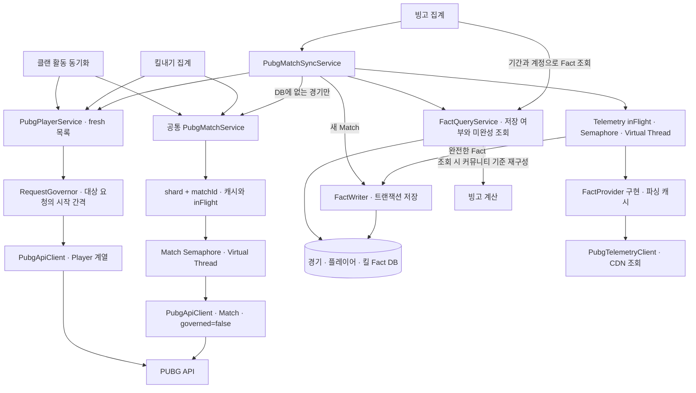
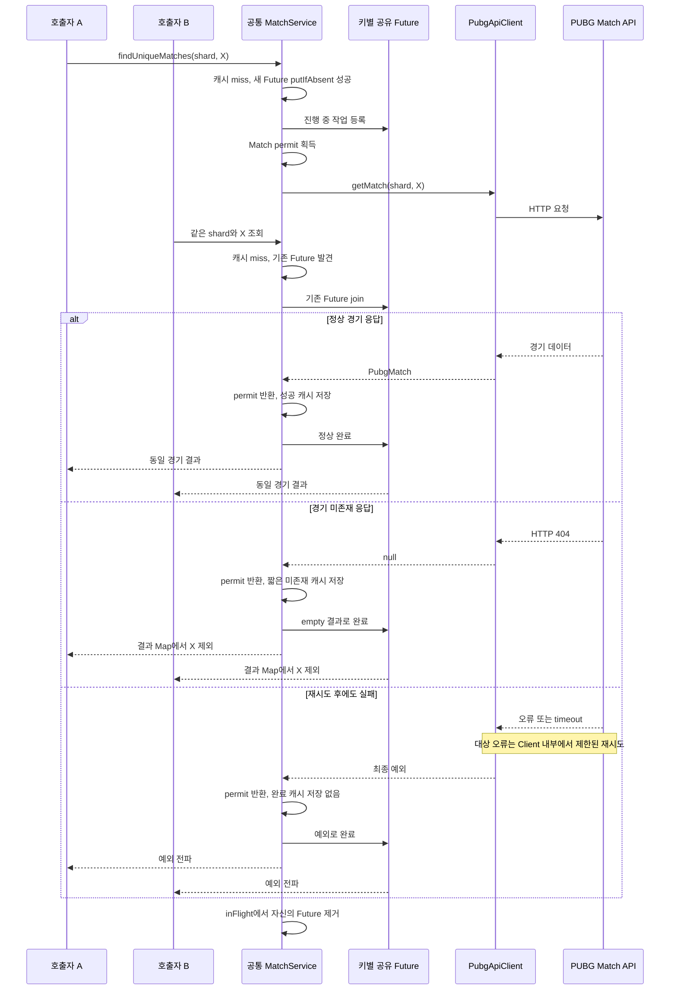
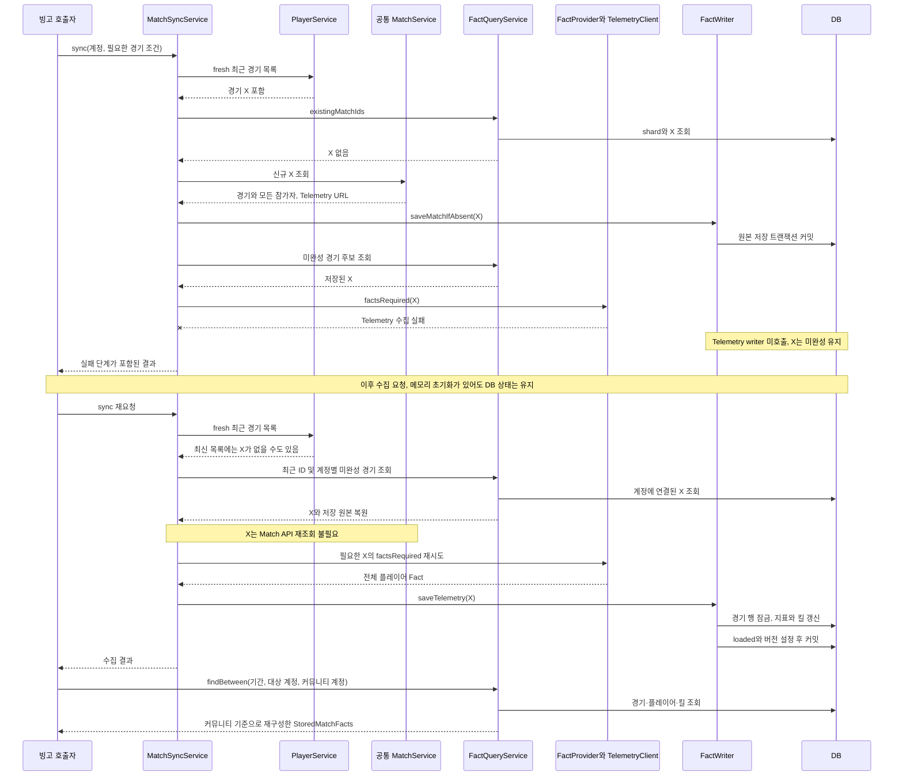

# PUBG API 중복 요청 최적화와 경기 데이터 재사용

> 같은 경기의 수집을 요청 목록·진행 중 작업·메모리 캐시·영속 Fact 단계에서 나누어 재사용하고, API별 제한과 부분 실패의 영향을 제어한 사례입니다.

[프로젝트 README](../../README.md) · [관련 사례: 빙고 집계의 동시성 제어와 데이터 정합성](bingo-consistency.md)

| 핵심 질문 | 구현에서 확인한 답 |
| --- | --- |
| 참가자 여러 명이 같은 경기를 요청하면? | 경기 ID를 중복 제거하고, 같은 프로세스에서 같은 키의 진행 중 Match 조회를 `CompletableFuture`로 공유합니다. |
| 활동·빙고·킬내기는 무엇을 공유하는가? | 공통 Match 서비스의 캐시·진행 중 요청·동시성 제한을 공유합니다. 영속 Fact 조회는 별도의 빙고 수집 경로입니다. |
| 모든 PUBG 호출을 같은 방식으로 제한하는가? | Player 계열은 Governor의 간격 조절 대상입니다. Match는 별도 Semaphore와 공통 재시도 루프를 사용하며, Telemetry는 별도 수집·실패 처리 경로입니다. |
| Telemetry 실패 후 Match까지 다시 받아야 하는가? | DB에 저장한 경기와 참가자·Telemetry URL로 미완성 경기만 재수집할 수 있습니다. |

**분석 기준:** 2026-10-15 로컬 Private 소스와 테스트 코드. 이번 문서 작성 과정에서는 애플리케이션·DB 테스트와 성능 벤치마크를 실행하지 않았습니다. 아래 assertion과 호출 횟수는 작성된 테스트의 기대값이며 현재 통과 결과나 운영 성과가 아닙니다. 실제 운영 장애 기록을 근거로 한 사례로 표현하지 않습니다.

## 1. 기술 개요

GuildUp은 Discord 커뮤니티의 클랜 활동, 빙고, 킬내기에 PUBG 경기 데이터를 사용합니다. 참가자마다 최근 경기 목록을 조회하면 같은 경기 ID가 반복되며, 서로 다른 기능도 같은 종료 경기를 요청할 수 있습니다. 단순 병렬 호출만 늘리면 중복 네트워크 요청·응답 변환·Telemetry 파싱·DB 저장이 함께 증가합니다.

구현은 재사용의 수명과 목적을 나누었습니다.

| 단계 | 장치 | 해결하는 문제 |
| --- | --- | --- |
| 한 번의 수집 입력 | 계정·경기 ID의 `LinkedHashSet` | 같은 목록에 포함된 중복 작업 제거 |
| 동시에 실행 중인 조회 | 키별 `CompletableFuture` map | 동일 원본을 기다리는 호출자 사이의 수집 공유 |
| 한 서버에서 완료된 조회 | 만료 시각과 용량 제한이 있는 메모리 캐시 | 다른 요청·기능에서 같은 원본 재조회 회피 |
| 수집 이후·프로세스 재시작 이후 | 경기·플레이어·킬 Fact DB | 빙고의 재집계, 다른 참가자에 대한 재사용, 미완성 Telemetry 복구 |

`CompletableFuture`는 완료 결과나 예외를 전달하는 수단이고, Virtual Thread는 blocking 수집 작업을 실행하는 수단입니다. 실제 작업 수 제한은 Semaphore가 담당합니다. **진행 중 요청 공유, 동시 작업 수 제한, 요청 시작 간격 조절은 서로 다른 제어**입니다.

소스에서 확인한 값은 기본값·상수입니다. 실제 운영 환경의 override 값이나 처리 용량으로 해석하지 않습니다.

## 2. 문제 정의

| 상황 | 발생 가능한 문제 | 확인한 대응과 범위 |
| --- | --- | --- |
| 여러 참가자가 같은 경기 X에 참여 | 참가자 수만큼 같은 Match 조회·변환 반복 | 최근 목록에서 경기 ID를 합집합으로 만들고 공통 Match 서비스에 전달 |
| 활동·빙고·킬내기가 동시에 X 요청 | 요청별 중복 제거만으로 기능 사이 중복을 막지 못함 | 공통 Bean의 `(shard, matchId)` 캐시와 진행 중 요청 공유 |
| Player 계열 요청이 API 제한에 도달 | 429 반복·동시 재시도 집중 | Governor의 시작 시각 예약, Rate Limit 헤더 관찰, 제한된 재시도·backoff |
| Match는 저장됐으나 Telemetry 실패 | 미완성 Fact를 완료 데이터로 오인하거나 Match부터 다시 수집 | 경기 원본 저장과 Telemetry 저장 분리, 미완성 상태 유지, 다음 수집에서 재시도 |
| 메모리 캐시가 재시작으로 초기화 | 이전 네트워크·파싱 결과 유실 | 빙고 Sync가 DB에 저장된 경기와 완료 Fact를 재사용. 활동·킬내기의 일반 Match 조회에는 DB fallback 없음 |
| Kakao와 Steam에 같은 경기 ID 존재 | 다른 플랫폼 데이터를 잘못 재사용 | Match 키에 shard, Telemetry 공유 키·Fact 캐시에 platform, DB 식별에 shard 포함 |

이 표는 코드에서 대응하는 **실패 가능성**입니다. 각 상황이 실제 운영 장애로 발생했다는 기록은 이 분석에서 확인하지 않았습니다.

## 3. 기존 구조에서 발생할 수 있는 실패

다음 비교는 보호 장치가 없는 설계의 위험을 설명합니다. 과거 GuildUp이 실제로 모두 이렇게 동작했다는 변경 이력 주장이 아닙니다.

| 단순한 접근 | 실패가 생기는 이유 | 현재의 대응 |
| --- | --- | --- |
| 참가자별로 모든 Match 호출 | 경기 목록이 서로 겹침 | 입력 경기 Set + 기능 간 공통 Match 서비스 |
| 완료 응답만 캐시 | 동시에 시작한 두 요청은 둘 다 cache miss | 진행 중 Future의 `putIfAbsent`로 수집 주체 선정 |
| 경기 ID만 캐시 키로 사용 | 같은 ID의 플랫폼 출처를 구분하지 못함 | shard/platform을 포함한 키 |
| 404와 서버 오류를 같은 실패 캐시로 취급 | 일시적 장애를 장시간 미존재로 오인 | 404는 짧은 negative cache, 예외는 완료 캐시에 저장하지 않음 |
| Virtual Thread만 추가 | 수집량과 DB 쓰기량에 별도 상한이 없음 | Match·Telemetry별 공정 Semaphore |
| Match 존재만 확인하고 수집 종료 | 저장 경기라도 Telemetry가 미완성일 수 있음 | `telemetryLoaded`와 Fact 버전, 미완성 계정 조회 |
| 일부 Telemetry 실패를 수집 전체 실패로 전파 | 다른 정상 경기의 처리까지 중단 | 경기별 outcome을 모아 실패 단계와 정상 결과를 함께 반환 |

Match batch와 Telemetry batch의 예외 처리 강도는 다릅니다. Telemetry는 경기별 실패를 outcome으로 분리하지만, Match 서비스의 batch는 하나의 Future에서 예외를 만나면 호출 전체가 예외로 끝날 수 있습니다. 이 차이를 6절과 9절에서 구분합니다.

## 4. 전체 수집 아키텍처

### A. 기능별 수집 경로와 공유 범위



화살표는 구성 요소의 호출·데이터 관계입니다. 캐시 적중 시 외부 호출은 생략하며, Telemetry는 필요한 경기라는 predicate를 통과한 후보만 처리합니다.

| 기능 / 실제 진입 클래스 | Player / Match | 영속 Fact DB 사용 |
| --- | --- | --- |
| 활동: `CommunityMemberActivitySyncWorker` | 최신 Player 목록과 `findUniqueMatchesFresh`; 공통 Match 캐시·진행 중 작업·Semaphore 사용 | 이 일반 활동 계산 경로에서 `PubgMatchFactQueryService` 조회는 확인되지 않음. 활동 스냅샷 저장은 별도 도메인 데이터 |
| 빙고: `BingoAggregationService` → `PubgMatchSyncService` | fresh Player → 기존 DB 경기 제외 → 필요한 Match 조회 | `PubgMatchFactWriter`로 저장하고 `FactQueryService.findBetween`으로 재사용 |
| 킬내기: `KillCompetitionPubgAggregator` | fresh Player와 `findUniqueMatchesFresh`; 공통 Match 서비스 사용 | 이 집계 경로의 원본 경기 조회에는 Fact DB fallback 없음. 대회별 결과·점수 저장과 구분 |

공통 Match 캐시 키에는 community ID가 없습니다. 원본 경기 데이터는 공유하고, 커뮤니티별 기간·참가자·계정·정책은 각 계산 경로에서 적용합니다. community ID를 받는 Match 서비스 overload도 동일한 캐시 경로로 위임합니다. 반면 **커뮤니티별 진행도·활동 스냅샷·킬내기 결과를 공통 캐시로 공유하는 구조는 아닙니다.**

## 5. 중복 요청 제거와 캐싱

### 5.1 Match 조회의 순서

`PubgMatchService.findUniqueMatches*`는 입력 ID를 중복 제거한 뒤 각 경기 작업을 Virtual Thread executor에 제출합니다. 각 작업의 `findOne`은 다음 순서로 실행됩니다.

1. `(shard, matchId)`로 만료되지 않은 완료 캐시 확인.
2. miss이면 새 Future를 만들고 `inFlight.putIfAbsent` 호출.
3. 기존 Future가 있으면 그 결과를 `join`; 이 호출자는 Match permit을 추가로 얻지 않음.
4. 새 Future를 등록한 주체만 permit을 획득해 `PubgApiClient.getMatch` 호출.
5. 정상 응답 또는 미존재 결과를 캐시에 넣고 Future 완료. 예외라면 Future를 예외 완료.
6. `finally`에서 자신이 등록한 Future를 조건부 제거.

이 Future는 작업 실행용 `Future`와 역할이 다릅니다. executor가 돌려주는 `Future`는 batch의 결과를 모으는 데 쓰이고, map 안의 `CompletableFuture`는 **동일 키 호출자에게 한 수집 결과를 전달**하는 데 쓰입니다.

### B. A와 B가 같은 경기 X를 요청하는 경우

아래는 같은 서버·같은 shard에서 A가 등록한 Future가 살아 있는 동안 B가 같은 키를 조회하는 순서입니다. X와 A/B는 설명용 기호이며 실제 경기·사용자 정보가 아닙니다.



정상 응답 한 번으로 끝나는 이 순서에서는 Client 호출과 HTTP 요청이 각각 한 번입니다. **Client 호출 한 번이 항상 HTTP 한 번이라는 의미는 아닙니다.** Client 내부 재시도는 같은 수집 주체가 수행하며, 참여한 호출자는 최종 결과를 기다립니다. 완료 이후 요청은 Future 대신 캐시를 사용할 수 있습니다. 캐시 조회와 Future 등록 사이의 경계 경쟁은 9절의 제한 사항입니다.

### 5.2 성공·미존재·예외의 캐시 정책

| 대상 | 키 | 소스의 기본 정책 | fresh 의미 |
| --- | --- | --- | --- |
| Match 성공 | `(shard, matchId)` | 저장 시점부터 24시간; 최대 10,000개; access-order `LinkedHashMap`에서 오래 사용하지 않은 항목 제거 | 성공 캐시는 재사용 |
| Match 미존재 | 동일 키 | Client가 404를 `null`로 변환 → `Optional.empty`; 1분 저장 | 미존재 캐시만 우회 |
| Match 예외 | 동일 키의 진행 중 Future | 429 재시도 소진·5xx·timeout 등 최종 예외는 완료 캐시에 저장하지 않음 | 다음 호출에서 다시 수집 가능 |
| Player | `(shard, 이름/계정 조회 구분, 정규화한 값)` | 성공·미조회 모두 1분 캐시, 10명씩 batch; 이름과 계정 alias 저장 | `findByAccountIdsFresh`는 이전 경기 목록 캐시를 우회 |
| 파싱한 빙고 Fact | `(platform, matchId, 정렬한 communityAccounts)` | `PubgBingoFactService`의 30분·최대 2,000개 캐시 | `factsRequired`는 Telemetry 미완성 fallback 캐시를 완료 Fact로 인정하지 않음 |

Match 캐시는 조회·저장 시 만료 항목을 정리합니다. `expiresAt <= now`이면 제거하고 재조회하며, hit 시 만료 시각을 연장하는 sliding TTL은 아닙니다. Player 캐시는 method 전체가 `synchronized`이며 API 호출도 그 안에서 수행합니다. Match의 키별 Future 구조와 동일하지 않습니다.

**설계 해석:** 종료 경기 성공 응답은 길게 재사용하고, 아직 발견되지 않은 경기의 404는 짧게 보관하면 재조회 비용과 반영 지연을 조절할 수 있습니다. fresh 경로가 성공 캐시를 유지하면서 404만 다시 확인하는 것도 같은 구분입니다. 이 TTL이 운영 workload에 최적인지는 측정하지 않았습니다.

### 5.3 Telemetry 공유와 파싱 캐시의 구분

`PubgMatchSyncService`의 Telemetry 공유 키는 `PubgMatchKey(platform, matchId)`입니다. 같은 키의 선행 작업이 있으면 Future 완료를 기다리고 새 저장 건수는 0으로 반환합니다. 이 Future는 파싱 결과 Map 자체보다 **수집·Fact 저장이 끝났다는 완료 여부**를 공유합니다. 선행 작업 실패 시 기다리던 작업에도 예외가 전달되고, map 항목은 제거됩니다.

이 동시 공유는 Sync 내부에 있으며 parser 자체의 캐시 전체를 감싸는 범용 single-flight가 아닙니다. parser를 직접 호출하는 다른 경로까지 모든 동시 파싱이 한 번이라고 단정할 수 없습니다.

Sync는 `factsRequired(platform, match, Set.of())`를 호출해 특정 커뮤니티에 종속되지 않는 참가자 Fact를 저장합니다. Fact 조회에서는 현재 `communityAccounts`로 팀 내 클랜원 수와 커뮤니티 관련 지표를 재구성합니다. parser 캐시의 커뮤니티 계정 키와, DB에 저장하는 공통 Fact를 구분한 구조입니다.

### 5.4 설명용 의사코드

다음은 실제 제어 순서를 요약한 **의사코드**이며 원본 Java 코드가 아닙니다. 예외 변환·통계·로그 문맥 처리는 축약했습니다.

```text
key = (shard, matchId)
if unexpiredCompletedCacheContains(key, refreshMissingPolicy):
    return cachedResult

mine = new completion
existing = registerIfAbsent(key, mine)
if existing exists:
    return await existing result or exception

try:
    acquire shared Match permit
    try:
        result = Client.getMatchWithInternalRetries(key)
    finally:
        release permit
    cache success or missing result with different TTL
    complete mine with result
    return result
catch runtime failure:
    complete mine exceptionally
    rethrow
finally:
    remove only mine from inFlight
```

## 6. 동시성 및 Rate Limit 처리

### 6.1 실제 적용 범위

| 제어 | Player 계열 | Match | Telemetry |
| --- | --- | --- | --- |
| 시작 간격 Governor | `requestBody`의 기본 `governed=true` | `getMatch`가 명시적으로 `false` 전달 | `PubgTelemetryClient`가 별도 호출하므로 적용 없음 |
| 서버 내 작업 수 제한 | Player 서비스의 동기화된 batch 조회; Match/Telemetry permit과 별도 | Match 서비스 Bean의 공정 Semaphore, 기본 3 | Sync Bean의 공정 Semaphore, 기본 3 |
| 비동기 실행 | Player batch 자체는 동기 호출 | 경기별 Virtual Thread | 상위 트랜잭션이 없는 일반 경로에서 Virtual Thread + `ExecutorCompletionService` |
| 진행 중 결과 공유 | Match 방식의 Future map 없음 | `(shard, matchId)`별 결과·예외 공유 | `(platform, matchId)`별 수집·저장 완료 공유 |
| 같은 Client 호출의 재시도 | `PubgApiClient` 공통 루프 사용 | 동일 루프 사용; Governor는 우회 | Client 내부 retry 루프 없음. 실패를 기록하고 다음 Sync에서 재시도 |

두 Semaphore는 서버의 해당 singleton Bean을 공유하는 호출들에 적용됩니다. 한 Job마다 새 limit을 만드는 것이 아니며, 다른 JVM의 호출 수까지 합산하는 전역 제한도 아닙니다. Match permit은 Client의 내부 재시도·대기까지 포함한 `getMatch` 호출 동안 유지됩니다. Telemetry permit은 fetch·parse뿐 아니라 **`saveTelemetry`가 반환할 때까지** 유지되어 DB 저장 동시성도 제한합니다.

`Executors.newThreadPerTaskExecutor(Thread.ofVirtual().factory())`는 작업마다 가상 스레드를 만드는 구조입니다. 작업 제출 수 자체를 유한하게 만드는 API가 아니므로 permit 대기 작업의 수·메모리에는 별도 고려가 필요합니다. [Java 21 Executors 문서](https://docs.oracle.com/en/java/javase/21/docs/api/java.base/java/util/concurrent/Executors.html#newThreadPerTaskExecutor(java.util.concurrent.ThreadFactory))

**선택 이유에 대한 기술적 해석:** blocking HTTP 코드와 예외 흐름을 유지하면서 여러 경기의 대기를 처리하고, 외부 호출·DB 쓰기의 실제 동시 구간은 Semaphore로 제한한 조합입니다. 가상 스레드만으로 CPU 파싱이 빨라지거나 처리량이 증가했다고 측정한 결과는 없습니다. worker에는 `LogContext`를 전달해 요청·작업 문맥을 이어 갑니다.

상위 트랜잭션이 이미 활성화된 경우 Sync는 Telemetry를 호출 스레드에서 순차 처리합니다. 모든 호출자가 항상 병렬 경로를 타거나 외부 호출이 항상 비트랜잭션이라고 설명하면 부정확합니다.

### 6.2 Governor는 무엇을 조절하는가?

`acquire`는 synchronized 구간에서 다음 요청 시작 시각을 예약한 뒤 lock 밖에서 대기합니다. 예약 시각은 현재 시각, 다음 허용 시각, cooldown 종료 중 가장 늦은 값입니다. 기본 최소 간격은 250ms이며, 응답의 `X-RateLimit-Remaining`과 `X-RateLimit-Reset`으로 남은 시간 창을 나눠 간격을 갱신합니다. 헤더로 늘리는 간격에는 60초 상한이 있고, remaining이 0 이하이면 reset까지 cooldown을 둡니다.

이는 해당 Governor를 사용하는 요청 사이의 **시작 간격과 예약**을 조절합니다. 동시에 실행 중인 HTTP 요청 수를 직접 세는 Semaphore와 같지 않으며, 운영 API key의 실제 허용량을 이 기본값만으로 알 수는 없습니다. `X-RateLimit-Limit`은 진단 정보로 기록되지만 이 간격 계산식의 입력은 아닙니다.

Match는 Governor의 `acquire`, 성공 헤더 `observe`, 429의 공유 `cooldownUntil`을 우회합니다. 공식 PUBG 문서도 `/matches`와 Telemetry를 API key의 Rate Limit 계산에서 구분합니다. 이 외부 정책과 소스의 `governed=false` 선택은 일치하지만, Match의 네트워크·메모리 비용까지 무제한이라는 뜻은 아닙니다. [PUBG 공식 Rate Limits 문서](https://documentation.pubg.com/en/rate-limits.html)

### 6.3 429·서버 오류·timeout 재시도

`PubgApiClient.requestWithRetries`는 Player·Match에 공통으로 최대 4회 시도합니다. 이는 최초 요청을 포함한 수이며 최대 4회 추가 재시도가 아닙니다.

| 응답/오류 | 실제 처리 |
| --- | --- |
| 429 | reset 시각 우선, 없거나 해석 불가하면 `Retry-After` 초/HTTP-date 해석. 이 값에 안전 여유를 더한 대기와 지수 backoff 중 큰 값 사용. governed 요청에는 공유 cooldown도 반영 |
| 500·502·503·504 | 재시도 대상. 다른 모든 5xx가 일괄 대상인 것은 아님 |
| 네트워크 `ResourceAccessException` | timeout 경로의 제한된 재시도 |
| 404 Match | 재시도 없이 외부 예외를 `getMatch`에서 `null`로 바꾸고 짧은 미존재 캐시 대상으로 전달 |
| 403 등 그 외 HTTP 오류 | 위 transient 목록에 없으면 즉시 전파 |
| 일반 응답 처리/변환 오류 | retry loop의 일반 `RestClientException` 분기에서 전파 |

backoff는 500ms를 시작으로 증가하며 운영 생성자에 0~250ms jitter가 있습니다. 계산한 retry 대기에는 61초 상한이 있습니다. 소진 후 Rate Limit·선택 서버 오류·timeout은 오류 코드와 upstream 상태를 가진 예외로 바꾸며, 소진된 오류를 다시 즉시 retryable로 내보내는 구조가 아닙니다.

한 번의 대기 상한은 전체 호출 deadline과 다릅니다. Governor 대기, HTTP 연결·읽기, 여러 시도의 backoff가 합쳐질 수 있습니다. `PubgApiConfig`의 연결 timeout은 5초, 읽기 timeout은 15초입니다.

Telemetry는 같은 RestClient Bean을 사용해도 `PubgApiClient` retry loop를 통하지 않습니다. CDN의 429·서버 오류·timeout을 예외로 변환하고, Sync에서 해당 경기의 실패로 수집합니다. “모든 PUBG 요청이 같은 Rate Limit·즉시 재시도 정책을 사용한다”는 설명은 실제 구조와 다릅니다.

### 6.4 실패를 격리하는 수준

Telemetry 일반 경로는 완료 순서대로 outcome을 모으므로 한 경기의 RuntimeException이 다른 경기의 처리까지 중단시키지 않습니다. `PLAYER_LOOKUP`, `MATCH_LOOKUP`, `MATCH_SAVE`, `TELEMETRY_LOOKUP`, `TELEMETRY_SAVE`, `FACT_GENERATION`으로 실패를 구분하고 원인·단계에 따른 모니터링을 남깁니다. 문서에는 운영 로그 원문을 사용하지 않았습니다.

반면 Match batch는 Future를 입력 순서로 읽다가 예외가 발생하면 호출 전체가 예외로 끝납니다. Sync는 이를 잡아 빈 fetched Map으로 처리하므로 그 batch의 신규 ID들이 `MATCH_LOOKUP` 실패가 될 수 있습니다. 이미 제출한 나머지 Match 작업을 이 경로에서 취소하는 코드는 없으며, 성공 응답이 메모리 캐시에 남더라도 해당 Sync에서 모두 DB에 저장되는 것은 아닙니다.

## 7. 영속 경기 Fact 저장과 재사용

### 7.1 DB 관계와 식별 경계

| 테이블 / Entity | 역할 | 키·중복 방지 |
| --- | --- | --- |
| `pubg_matches` / `PubgStoredMatch` | 경기 ID·shard, 시작 시각·유형·맵, Telemetry URL, 완료 여부·Fact 버전 | 내부 PK와 별개로 `(shard, match_id)` 유일 제약 선언 |
| `pubg_match_players` / `PubgStoredMatchPlayer` | 경기별 모든 참가자의 계정·팀·기본 통계, 가공 지표와 아이템 집계 JSON, 증거 시각 | 경기 FK; `(pubg_match_id, pubg_account_id)` 유일 제약 선언 |
| `pubg_match_kills` / `PubgStoredMatchKill` | 공격자·피해자, 무기·거리·헤드샷·발생 시각 등 킬 Fact | 경기 FK. 킬 중복은 parser의 식별·저장 경기 잠금·컬렉션 교체로 제어; 독립적인 경기/킬 유일 제약을 주장하지 않음 |

하나의 경기에는 여러 플레이어와 킬이 연결되며, 자식은 내부 경기 PK를 참조합니다. 자식 행마다 shard를 복제하지 않아도 부모의 `(shard, matchId)`로 플랫폼 경계를 갖습니다. 저장 대상은 요청한 클랜원만이 아니라 **Match 응답의 모든 참가자**입니다. 나중에 다른 참가자를 조회할 때 이미 저장한 팀·경기 데이터를 재사용할 수 있습니다.

위 제약·인덱스는 Entity와 Repository에서 확인한 선언입니다. 운영 DB에 접속하여 실제 적용 상태를 조회하지 않았습니다. 플레이어 이름·계정과 킬 정보의 실제 값은 문서에 포함하지 않습니다.

### 7.2 저장과 조회 트랜잭션

| 경계 | 확인한 동작 |
| --- | --- |
| `saveMatchIfAbsent`의 `@Transactional` | shard와 경기 ID 조회 → 없으면 경기·모든 참가자 저장 → `saveAndFlush` |
| 동일 경기 삽입 경쟁 | 사전 조회만으로 경쟁을 막지 않음. 유일 제약이 최종 방어. Sync는 원인 체인의 알려진 경기 유일 제약 충돌만 정상 중복 경쟁으로 분류하고, 다른 저장 오류는 실패로 기록 |
| `saveTelemetry`의 `@Transactional` | `(shard, matchId)` 경기 행 `PESSIMISTIC_WRITE` 잠금 → 업그레이드 필요 확인 → 저장된 모든 플레이어의 Fact 존재 검사 → 지표·킬 교체 및 완료 표시 |
| 완료 경기의 반복 Telemetry 저장 | 현재 버전이며 loaded이면 저장 건수 0으로 반환. 같은 경기의 여러 writer는 DB 행 잠금으로 직렬화 |
| `FactQueryService`의 `@Transactional(readOnly = true)` | 기존 ID·미완성/업그레이드 후보·기간별 Fact 조회. 일부 ID/계정 조회는 500개씩 나누어 수행 |

각 쓰기 메서드는 기본 `REQUIRED`이며 `REQUIRES_NEW` 강제가 아닙니다. 상위 트랜잭션 없는 정상 빙고 Job에서는 외부 수집 후 별도 writer proxy를 호출해 경기 저장과 Telemetry 저장을 각각 커밋합니다. 상위 트랜잭션이 있으면 참여할 수 있습니다. `flush`와 `saveAndFlush`는 커밋 자체가 아닙니다. [Spring 트랜잭션 전파 문서](https://docs.spring.io/spring-framework/reference/data-access/transaction/declarative/tx-propagation.html)

불완전 플레이어 Fact는 `IncompleteFactsException`으로 거부합니다. parser의 일반 `facts`가 Match 통계 fallback을 만들 수 있어도, 영속 수집 경로는 `factsRequired`를 사용하므로 Telemetry 부재를 완료 Fact로 저장하지 않습니다.

### 7.3 재사용·재수집을 결정하는 상태

| 상태 | 다음 Sync의 처리 |
| --- | --- |
| 새 경기 ID, DB에 없음 | 공통 Match 서비스 조회 → 원본 저장 → 필요한 Telemetry 수집 |
| DB에 있고 Telemetry 완료 | Match API 재조회 제외. 업그레이드가 필요 없으면 Telemetry도 생략 |
| DB에 있지만 Telemetry 미완성 | 저장 경기·플레이어·URL로 `PubgMatch`를 복원하고 필요한 Telemetry만 재시도 |
| 최근 Player 목록에서는 사라졌지만 DB의 해당 계정 경기로 존재 | `findTelemetryMissingForAccounts`로 찾아 caller predicate를 통과하면 재시도 |
| loaded이나 Fact 버전이 이전 | `upgradeTelemetryFacts=true`인 Sync에서 추가 후보 조회. 현재 빙고는 봇 제외 정책 값을 이 옵션으로 전달 |
| Match 조회·저장에 실패한 알려진 ID | Sync 응답의 `pendingMatchIds` 후보. 빙고가 이벤트에 저장해 다음 요청의 retry ID로 전달 |

현재 Fact 버전 상수는 2입니다. `telemetryLoaded=true`만으로 모든 호출에서 항상 최신 의미의 Fact임을 보장하지 않으며, 이전 버전 후보 재수집은 caller 옵션에 따라 달라집니다. Match 조회·저장 pending과 Telemetry의 DB 미완성 상태도 다른 재시도 경로입니다.

### C. DB 재사용과 Telemetry 실패 후 다음 수집

아래는 상위 트랜잭션이 없는 수집의 예입니다. 실패 이후 재시도는 자동 스케줄러를 뜻하지 않으며 **다음 Sync 호출**입니다. 재시작이 그 사이에 있어도 저장 상태를 조회하는 판단 구조는 같습니다.



### 7.4 캐시와 DB의 역할 비교

| 관점 | 메모리 Match / parser 캐시 | 영속 경기 Fact |
| --- | --- | --- |
| 수명 | TTL·용량·프로세스 수명에 종속 | DB에 보존된 경기 상태에 종속; 해당 코드에 TTL 삭제 정책은 없음 |
| 재시작 | 내용과 진행 중 Future 유실 | 저장한 원본·Fact 재사용 가능 |
| 공유 기능 | 공통 Match 서비스 호출자는 기능 간 공유 | 현재 대표 사용 경로는 빙고. 다른 기능의 일반 Match 요청을 자동 대체하지 않음 |
| 회피 비용 | 네트워크·DTO 변환 또는 Telemetry 재파싱 | 이미 저장한 Match 수집과 완료 Fact 재생성 |
| 추가 비용 | 메모리·동기화·만료 정리 | 모든 참가자 저장, JSON 지표·킬 행, 인덱스·트랜잭션·조회 비용 |
| 정합성 | 키·TTL로 조회 결과 재사용; DB와 자동 동기화되지 않음 | 잠금·유일 제약·완료 상태로 저장 경쟁 제어. 내용의 불변성과 재처리 정책은 별도 문제 |

Fact 조회는 기간 `[from, to)`와 shard·대상 계정을 제한하고, 플레이어를 포함한 경기 조회 후 킬 데이터를 모아 계산 모델로 변환합니다. 따라서 재시작 후 빙고가 재사용할 수 있는 것은 **이미 DB에 확보한 범위**입니다. DB에도 저장되지 않았고 최신 Player 목록에서도 사라진 경기를 캐시·재시도만으로 발견할 수는 없습니다.

## 8. 테스트 및 검증

**코드 확인일: 2026-10-15. 실행 상태: 이번 작업에서는 실행하지 않음.** 아래의 호출 횟수·대기 시간·동시 작업 수는 합성 fixture와 mock의 assertion입니다. 운영 API 호출 감소율이나 실제 사용자 처리량으로 환산하지 않습니다.

### 8.1 `PubgMatchServiceTests`: 중복·캐시·공통 제한

| 테스트 메서드 | 재현한 상황 | 기대 결과 | 실제 assertion | 검증 범위의 한계 |
| --- | --- | --- | --- | --- |
| `requestsTheSameMatchOnlyOnce` | 같은 ID를 한 목록에 반복하고 다시 조회 | 성공 결과 재사용 | Map의 동일 항목, `verify(client, times(1)).getMatch` | mock Client 기준; 실제 HTTP 재시도 횟수 아님 |
| `freshLookupReusesSuccessfulMatchAcrossFeatures` | 일반 조회 후 두 fresh overload 호출 | 성공 캐시 유지 | 매번 결과 크기 1, Client `times(1)` | 실제 세 기능 전체를 기동한 통합 시험은 아님 |
| `freshLookupRetriesOnlyPreviouslyMissingMatch` | 첫 응답 null 후 fresh에서 경기 반환 | negative cache 우회 | 최초 empty, 이후 경기 포함, Client `times(2)` | TTL 만료에 의한 재조회 시험은 아님 |
| `concurrentRequestsShareOneInFlightCall` | latch로 첫 Client 응답을 지연하고 두 caller 실행 | 한 수집 결과 재사용 | 두 Future의 동일 경기 항목, Client `times(1)` | 두 번째가 반드시 `join` 분기에 들어갔다는 assertion은 없어 완료 캐시 적중도 가능한 순서 |
| `cacheNeverExceedsConfiguredMaximumSize` | 상한 5인 캐시에 서로 다른 20경기 조회 | 용량 제한 유지 | `cacheSize()`가 5 | 어느 키가 LRU로 제거되는지와 시간 만료는 직접 검사하지 않음 |
| `concurrentJobsShareTheApplicationWideMatchLimit` | limit 2, 8 caller, Client에 latch와 active counter | 서로 다른 호출도 공통 상한 사용 | 처리 중·종료 후 최대 active가 2, 각 결과 크기 1 | 단일 서비스 인스턴스·mock 호출 동시성 |

### 8.2 `PubgMatchSyncServiceTests`: DB 조회 분기와 부분 실패

이 클래스는 Player·Match·FactProvider·Query·Writer를 mock으로 구성합니다. 이름에 저장·DB가 포함되어도 실제 DB 트랜잭션을 실행하는 검증과 구분합니다.

| 테스트 메서드 | 재현한 상황 | 기대 결과 | 실제 assertion | 검증 범위의 한계 |
| --- | --- | --- | --- | --- |
| `newMatchIsFetchedParsedAndStoredOnceOutsideATransaction` | 신규 경기와 완전 Fact를 반환 | 수집 후 writer 호출 | 신규/Match/Telemetry 후보 수 1, 두 writer 호출; 외부 mock에서 트랜잭션 inactive | writer proxy의 실제 커밋은 검사하지 않음 |
| `storedMatchSkipsBothMatchAndTelemetryApis` | Query가 이미 저장된 완료 경기로 응답 | Match·Telemetry 생략 | 기존 경기 수 1, 두 후보 수 0, `verifyNoInteractions(matches, facts, writer)` | Query는 mock; 실제 DB 내용이나 재시작을 실행하지 않음 |
| `participantsSharingAMatchProduceOneMatchRequest` | 참가자 3명의 목록에 동일 X | 한 ID만 Match 서비스로 전달 | 전달 collection 크기 1이고 X 포함 | 실제 Client HTTP 호출 횟수는 이 테스트 대상 밖 |
| `concurrentJobsShareTheApplicationWideTelemetryLimit` | limit 2로 8 Sync 호출, parser 지연 | 공통 Telemetry 상한 적용 | 최대 parser active가 2 | 외부 HTTP나 여러 서버의 상한 아님 |
| `databaseWritesAlsoShareTheApplicationWideTelemetryLimit` | limit 2, writer mock을 latch로 지연 | 저장 구간도 permit 안에 포함 | 최대 writer active가 2 | 실제 DB 연결·lock 대기 측정 아님 |
| `sameMatchIdOnDifferentPlatformsHasIndependentInFlightTelemetry` | 같은 ID를 Kakao/Steam에서 동시에 처리 | 플랫폼별 작업 독립 | 두 parser 진입 latch, 실패 수 0, 플랫폼별 writer 호출 | Match 완료 캐시의 플랫폼 격리 직접 시험은 아님 |
| `firstHttp500FailureDoesNotStopTheOtherNineTelemetryTasks` | 10 후보 중 한 parser에 500 예외 | 나머지 작업 계속 | 후보 수 10, 실패 1, provider 10회, writer 9회, progress 10 | provider mock의 실패 격리; HTTP 자동 재시도 시험 아님 |
| `telemetryTimeoutIsIsolatedFromOtherMatches` | 한 경기 timeout 원인 주입 | 다른 경기 저장 계속 | 실패 1, writer 9회 | 실제 timeout 시간 경과를 기다리는 시험 아님 |
| `wrappedHttpJsonFailureIsReportedAsParsingRatherThanFetching` | HTTP 변환 오류를 예외로 감쌈 | parsing 단계로 진단 | 실패 1, writer 9회, 모니터링 metadata의 `TELEMETRY_PARSE` | 모니터링 저장 DB는 mock |
| `failedStoredMatchRetriesTelemetryWithoutCallingMatchApiAgain` | 최신 목록은 비었고 계정별 미완성 경기가 존재. 첫 parser 실패 후 성공 | Match 없이 Telemetry 복구 | 실패 1 → 0, Match 상호작용 없음, provider 2회, writer 1회 | 저장 상태 변화와 프로세스 재시작 자체는 mock 밖 |
| `concurrentMatchInsertRaceDoesNotFailTheWholeSync` | writer에 일반 `DataIntegrityViolationException` 주입 | 수집이 예외로 종료되지 않음 | 신규 저장 수 0, Telemetry 실패 수 0 | `collectionFailures`가 비었다는 검사는 없음. 알려진 제약명 경쟁 분기를 직접 입증하지 않음 |
| `factSaveFailureHasDatabaseHistoryAndStackWhileOtherMatchesStillComplete` | 두 경기 중 하나의 Telemetry writer 실패 | 정상 경기 계속, DB 오류 관측 | 실패 1, 정상 writer 호출, DB 이벤트의 저장 단계, ERROR 로그의 예외 정보 | mock 저장 실패와 테스트 로그 검증; 운영 로그나 실제 DB 롤백 증거 아님 |

### 8.3 Client·Governor: 간격과 재시도

Client 테스트는 `MockRestServiceServer`와 주입한 sleeper를 사용합니다. `server.verify()`는 등록한 mock HTTP 기대가 충족되는지 검사하며, 실제 네트워크를 호출하지 않습니다.

| 클래스 / 테스트 메서드 | 재현한 상황 | 기대 결과 | 실제 assertion | 검증 범위의 한계 |
| --- | --- | --- | --- | --- |
| Governor / `spacesRequestsFromDifferentFeaturesThroughOneGovernor` | 고정 Clock, 최소 간격 250ms, acquire 3회 | 호출 간격 예약 | waits가 `[250, 500]`ms | 실제 시간·복수 스레드·경합 중 cooldown 재예약은 시험하지 않음 |
| Governor / `rateLimitHeadersSlowSubsequentRequestsToFitRemainingWindow` | remaining 2, reset까지 10초 | 헤더 기반 간격 | waits가 `[5000]`ms | 단일 Governor와 고정 Clock |
| Client / `retriesPlayerRequestOnceAfterRetryAfterDelay` | Player 429, `Retry-After` 1초 후 성공 | 한 번 대기 후 성공 | 결과 empty, waits `[2000]`ms, `server.verify()` | 안전 여유를 포함한 계산값; 실제 2초 대기 아님 |
| Client / `supportsHttpDateRetryAfterForPlayerRequest` | 5초 뒤 HTTP-date 헤더 | date 해석 후 재시도 | waits `[6000]`ms, `server.verify()` | mock 응답·고정 Clock |
| Client / `retriesPlayerRequestAfterRateLimitResetTime` | reset 4초 뒤, 다음 요청 성공 | reset 우선 적용 | waits `[5000]`ms, `server.verify()` | 다른 서버의 제한 상태는 반영하지 않음 |
| Client / `failsAfterMaximumPlayerRateLimitRetries` | 429가 4회 반복 | 시도 소진 후 명시적 실패 | upstream 429, `PUBG_RATE_LIMITED`, retryable false, waits `[2000,1000,2000]`ms | 실제 key 제한량·복구 속도 아님 |
| Client / `marksOnlySelectedMatchServerStatusesAsRetryable` | 500/502/503/504 및 403 반복 | 대상 상태만 내부 재시도 | 대상은 mock 요청 4개, 403은 1개; 최종 upstream 일치·retryable false, `server.verify()` | 이름과 달리 최종 외부 retryable은 false; HTTP 계층 mock 검증 |
| Client / `marksMatchSocketTimeoutAsRetryable` | socket timeout 4회 | timeout 소진 | `PUBG_TIMEOUT`, upstream null, retryable false, `server.verify()` | 소진 결과를 검사하며 실제 socket 연결은 없음 |
| Client / `retriesMatchAfterRateLimitAndReturnsSuccessfulResult` | Match 429 후 성공 | Governor 우회여도 Client retry 사용 | 경기 ID 일치, waits `[2000]`ms, `server.verify()` | 다른 governed 요청의 cooldown과의 상호작용은 미검증 |
| Client / `returnsNullForMissingMatchWithoutConvertingItToRetryableFailure` | Match 404 | null 변환 | `getMatch` null, mock 요청 1개, `server.verify()` | 서비스 negative cache TTL은 별도 대상 |

### 8.4 영속 저장·플랫폼·파싱 캐시의 추가 근거

`PubgMatchPersistenceTests`는 H2와 실제 writer/query Bean을 사용하며 클래스 전체에 테스트 `@Transactional`이 없습니다. DB 경쟁 검증은 mock Sync 테스트보다 강한 근거지만, 이름의 “twoJvmLike”가 실제 두 JVM을 기동했다는 뜻은 아닙니다.

| 클래스 / 테스트 메서드 | 재현한 상황 | 기대 결과 | 실제 assertion | 검증 범위의 한계 |
| --- | --- | --- | --- | --- |
| Persistence / `concurrentCollectorsCannotDuplicateAMatchOrPlayerFact` | 두 스레드를 barrier로 맞춰 같은 Match 저장 | 경기·플레이어 중복 없음 | 경기 count 1, 플레이어 count 1 | H2; 두 사전 조회가 반드시 동시에 miss였다는 assertion은 없음. 충돌 예외는 helper가 허용 |
| Persistence / `firstCollectorStoresEveryMatchParticipantForLaterAccountReuse` | 한 경기에 두 참가자 저장 | 요청자 외 참가자도 보존 | 계정 목록이 두 fixture 계정과 정확히 일치 | 후속 기능의 API 생략까지 통합 실행하지 않음 |
| Persistence / `twoJvmLikeTelemetryWritersSerializeTheSameMatchWithoutDuplicateFacts` | 같은 경기에 두 writer 스레드 진입 | 완료 상태·킬 중복 방지 | loaded true, 킬 count 1 | 같은 Spring context의 두 스레드·H2; 실제 다중 JVM/PostgreSQL 아님 |
| Persistence / `sameMatchIdOnTwoPlatformsIsStoredQueriedAndUpdatedIndependently` | Kakao/Steam 동일 ID 저장, Kakao만 Telemetry 완료 | 부모 키·조회·갱신 격리 | 각 신규 저장 true, Kakao 재저장 false, 플랫폼별 loaded 분리, 경기 count 2, 무관 계정 조회 empty | DB 격리 근거이며 Match 메모리 캐시 시험은 아님 |
| Persistence / `fallbackFactsAndFailedTelemetryNeverMarkTheStoredMatchLoaded` | 일반 parser fallback 후 required Sync 시 Telemetry 부재 | 완료 표시 금지 | fallback 값 존재, Sync 실패 1, 저장 경기 loaded false | 실제 Telemetry 장애·네트워크는 mock |
| Fact / `identicalMatchIdsOnDifferentPlatformsNeverReuseBingoFactCache` | 동일 ID·서로 다른 플랫폼에 다른 Telemetry | parser 캐시 플랫폼 격리 | Kakao kill 1, Steam empty, 각 Telemetry URL 1회 | 파싱 캐시의 검증; Match 캐시와 별도 |
| Fact / `convertsOfficialTelemetryEventsToReusableFactsAndCachesPerMatch` | 같은 경기·커뮤니티 키를 두 번 파싱 요청 | 가공 지표 재사용 | kill 수·지표/아이템 값 검사, Telemetry `times(1)` | 캐시 적중 근거이며 만료·동시 miss 시험은 아님 |
| Player / `reusesPlayerLookupsWithinTheCacheTtl` | 고정 Clock에서 같은 계정 두 번 일반 조회 | Player 캐시 적중 | 같은 player 반환, Client `times(1)` | TTL 경과를 재현하지 않음 |
| Player / `freshLookupBypassesCachedPlayerMatchList` | 일반 조회 후 새 경기 목록을 fresh 조회 | 새 목록 확인 | 이전 목록 → 새 목록, Client `times(2)` | 동시 fresh 요청 공유 근거는 아님 |

### 8.5 테스트가 직접 입증하지 않는 항목

- **Match 성공/미존재 TTL 만료:** 만료 비교와 삭제는 구현에서 확인했으나 우선 분석한 테스트에 가변 Clock으로 경계 시각을 넘기는 직접 assertion은 없습니다.
- **Match 캐시 플랫폼 격리:** 키의 shard 포함은 소스 근거입니다. 위 플랫폼 테스트는 Telemetry 공유·parser 캐시·DB 격리를 검증하며, Match 메모리 캐시에 같은 ID를 두 shard로 넣는 직접 시험과 구분합니다.
- **공유 Future의 예외 fan-out·재시도:** 구현에 예외 완료와 제거가 있지만 실패를 공유한 복수 caller와 다음 요청의 복구를 함께 검사하는 직접 테스트는 확인하지 못했습니다.
- **재시작·다중 서버·실제 PostgreSQL:** 구조에서 도출한 재사용 가능성과 별개로 프로세스 재시작, 서로 다른 JVM, 운영 DB의 잠금·제약 동작을 이번 작업에서 실행하지 않았습니다.

### 8.6 성능 효과의 설명과 향후 측정

설계상 입력 Set은 중복 후보를 줄이고, 진행 중 공유는 겹치는 작업을 합치며, 성공 캐시는 다음 기능의 같은 원본 조회를 생략합니다. 영속 Fact는 저장된 경기의 재수집·파싱을 회피하는 대신 DB 읽기·쓰기·저장 공간 비용을 만듭니다. 어느 비용이 실제 병목인지 측정한 운영 자료는 확인하지 않았습니다.

특히 Sync의 `playerApiCalls`, `matchApiCalls`, `telemetryApiCalls` 필드는 각각 batch 추산이나 신규/Telemetry 후보 수에 기반합니다. 공유·캐시 적중·Client 내부 재시도에 따라 **실제 전송 HTTP 횟수와 다를 수 있습니다.** 성과 분석에는 후보 수와 실제 Client attempt·네트워크 전송 수를 구분해야 합니다.

향후 벤치마크는 운영 key·사용자·DB를 사용하지 않고, 합성 응답을 주는 로컬 HTTP stub과 전용 테스트 DB에서 다음과 같이 구성할 수 있습니다. 이번 작업에서 실행한 절차는 아닙니다.

| 시나리오 | 비교 조건 | 기록할 지표 |
| --- | --- | --- |
| 같은 경기의 겹치는 요청 | cold cache, hot cache, 진행 중 응답 지연, 서로 다른 경기 요청을 분리 | 실제 HTTP 횟수, 공유 참여 수, hit/miss, permit 대기, 요청 latency 분포 |
| 데이터의 수명 | 성공 TTL·404 TTL 경계, 용량 초과, fresh, 재시작 전후 | 재조회 시점과 횟수, 메모리 사용, eviction·정리 비용 |
| 영속 재사용 | 빈 DB, Match만 저장, Fact 완료, 이전 버전 Fact를 분리 | HTTP·파싱 횟수, DB query/write 수·시간, 행 수·저장 크기 |
| 부분 실패·부하 | 429·선택 5xx·timeout·Telemetry 실패를 주입; 동시성과 참가자 수 변화 | retry 증폭, 정상 경기 유지, 전체 완료 시간, DB lock 대기·연결 사용 |
| 다중 인스턴스 | 공통 DB와 독립 메모리 캐시를 가진 여러 collector | 서버 합산 외부 호출, 중복 저장 경쟁, 복구 결과 |

측정 결과를 공개할 때는 코드 기준·실행 날짜·JDK·DB·stub 지연·fixture 규모·반복 횟수와 함께 제시해야 합니다. 현재 API 감소율, 평균 응답 시간, 처리량 향상, 동시 사용자 수, 리소스 절감률은 제시하지 않습니다.

## 9. 기술적 한계

| 코드에서 확인한 범위·한계 | 기술적 해석과 향후 개선 방향 |
| --- | --- |
| 완료 캐시·Future map·Semaphore·Governor가 프로세스별 독립 | 여러 서버에서 같은 HTTP 호출·재시도가 생길 수 있음. DB는 중복 저장을 제어하지만 외부 호출 중복까지 막지 않음. 필요 시 공유 캐시·분산 수집 소유권·key 단위 호출 예산 검토 |
| 재시작으로 메모리 상태 초기화 | 빙고는 저장 Fact를 재사용하지만 일반 활동·킬내기 Match 조회는 다시 외부를 볼 수 있음. DB 기반 조회 경계를 공통화할지는 각 기능의 입력 요구·스키마 변환 손실을 검토한 뒤 판단 |
| Match 캐시 확인과 Future 등록이 하나의 원자 구간은 아님 | B가 miss를 본 뒤 멈추고, A가 수집·캐시 저장·Future 제거까지 끝낸 후 B가 등록하면 B가 다시 수집할 여지가 있음. 등록 주체의 캐시 재확인과 이 경계 경쟁의 결정적 테스트 검토 |
| Match batch에서 한 Future 예외가 전체 반환을 중단 가능 | 성공한 다른 경기까지 같은 Sync의 DB 저장에서 빠질 수 있음. 경기별 outcome 반환은 향후 개선안이며 현재 구현으로 소개하지 않음 |
| 가상 스레드 작업은 후보마다 제출하고 permit은 실행 구간만 제한 | 대량 입력의 대기 작업 수·메모리·파싱 CPU·DB 부하 상한은 별도 측정 필요. bounded 제출·chunk 처리와 deadline 검토 |
| Governor는 예약 후 대기하며 새 cooldown을 대기 종료 시 다시 검사하지 않음 | 진행 중 헤더 갱신·예약 대기의 경계에서 엄격한 외부 예산 준수를 단정할 수 없음. mutable Clock·경쟁 테스트와 재예약 정책 검토 |
| 캐시 만료 정리와 hit 접근이 동기화 구간에 있음 | Match의 만료 정리는 전체 entry 순회. Player는 네트워크 호출 중에도 synchronized method 점유. 캐시 규모·대기 시간을 측정한 뒤 자료구조나 잠금 범위 검토 |
| Player는 API가 반환하는 최근 경기 목록을 사용 | 최초 수집 전에 목록에서 사라진 경기는 DB·pending에도 없을 수 있음. `firstUnaggregatedGapOfThirtyThreeMatchesLosesTheOldestMatch`는 33개 생성·32개 노출이라는 합성 창에서 32개만 집계되는 한계를 표현하며 API 계약 수치를 측정한 것은 아님 |
| 경기의 모든 참가자·가공 JSON·킬을 저장하고 완료 시 컬렉션 교체 | 재사용 범위가 넓어지는 대신 저장·조회·인덱스 비용 증가. retention·파티션·필요 지표·batch 저장은 측정 이후 검토. 현재 자동 보존 정책 구현으로 주장하지 않음 |
| 메모리 Match/parser 캐시와 DB Fact 사이 자동 invalidation 없음 | 원본 교정·Fact parser 버전 변경 직후 같은 캐시가 재사용될 수 있음. parser 캐시 키에 Fact 버전은 없으므로 업그레이드 경로도 함께 점검. versioned key·불변 원본·명시적 invalidation 검토 |
| Fact 버전 업그레이드는 caller 옵션에 종속 | loaded만으로 최신 파싱 의미가 항상 보장되지 않음. 모든 소비자의 필요 버전·재처리 기준을 명시하는 정책 검토 |
| `REQUIRED` writer는 상위 트랜잭션에 참여 가능 | 외부 호출과 저장의 분리는 현재 진입 경로의 계약에 의존. caller-owned 트랜잭션에서 실패·공유 완료와 실제 commit의 관계를 추가 시험 |

여기서 개선 방향은 아직 구현·검증한 성과가 아닙니다. 특히 DB의 유일 제약과 잠금이 있다고 해서 외부 API 수집까지 분산 exactly-once가 되는 것은 아닙니다.

## 10. 핵심 정리

이 사례의 설계 판단은 **중복의 범위와 데이터의 수명을 나눠 제어한 것**입니다. 같은 목록의 중복은 Set으로 제거하고, 실행 중 중복은 Future로 공유하며, 완료 원본은 TTL 캐시로 재사용합니다. 빙고의 장기 재집계와 실패 복구에는 별도의 영속 Fact를 사용합니다.

동시 작업 수와 Rate Limit도 나누어 다룹니다. Match와 Telemetry는 별도 Semaphore로 수집 부하를 제한하고, Player 계열은 Governor로 시작 간격을 조절합니다. Match는 Governor 대상이 아니어도 Client 재시도를 사용하며, Telemetry의 다음 수집 재시도는 그 Client 루프와 다릅니다.

면접에서 설명할 수 있는 근거와 남은 검증은 다음과 같습니다.

- **구현 근거:** 플랫폼을 포함한 키, 키별 수집 공유, 성공·404 캐시 분리, 서버 내 공통 permit, API별 간격·재시도 범위, DB 원본·미완성 상태·버전과 재사용.
- **테스트 근거:** mock 호출 횟수·active counter, H2 저장 경쟁, 플랫폼 분리, Telemetry 실패 격리와 다음 Sync 복구. 이번 작업의 통과 결과는 없음.
- **추가 확인:** TTL 경계, shared Future 예외와 캐시/Future 등록 경쟁, Match 메모리 키 격리, 실제 PostgreSQL·재시작·다중 JVM, 후보 수와 HTTP attempt를 구분한 부하 측정.

### 소스 근거 위치

아래는 분석한 **Private 저장소 기준 상대 경로**입니다. 공개 저장소에 소스가 있다고 오해하지 않도록 파일 링크를 만들지 않았습니다. 운영 원본 전체 코드·Git 이력·실제 데이터는 포함하지 않습니다.

| 근거 | 상대 경로 / 메서드 |
| --- | --- |
| 공통 Match·Player 조회 | `src/main/java/com/guildup/pubg/service/PubgMatchService.java` — `findUniqueMatches*`, `findOne`, `cached`, `putCache`; `src/main/java/com/guildup/pubg/service/PubgPlayerService.java` — `findInBatches` |
| 수집·진행 중 Telemetry 공유 | `src/main/java/com/guildup/pubg/service/PubgMatchSyncService.java` — `sync`, `fetchTelemetry`, `fetchTelemetryOnce`, `concurrentMatchInsert`; `src/main/java/com/guildup/pubg/model/PubgMatchKey.java` |
| HTTP·제한·예외 | `src/main/java/com/guildup/pubg/client/PubgApiClient.java` — `getMatch`, `requestWithRetries`, `retryWaitMillis`; `src/main/java/com/guildup/pubg/client/PubgApiRequestGovernor.java`; `src/main/java/com/guildup/pubg/service/PubgTelemetryClient.java`; `src/main/java/com/guildup/pubg/config/PubgApiConfig.java` |
| Fact parser·키·조회 | `src/main/java/com/guildup/bingo/mission/PubgBingoFactService.java` — `factsRequired`, `FactCacheKey`; `src/main/java/com/guildup/pubg/service/PubgMatchFactProvider.java`; `src/main/java/com/guildup/pubg/service/PubgMatchFactQueryService.java` — `findBetween`, `findTelemetryMissingForAccounts`, `decodeFacts` |
| 영속 저장·잠금 | `src/main/java/com/guildup/pubg/service/PubgMatchFactWriter.java`; `src/main/java/com/guildup/pubg/repository/PubgStoredMatchRepository.java`; `src/main/java/com/guildup/pubg/domain/PubgStoredMatch.java`; `src/main/java/com/guildup/pubg/domain/PubgStoredMatchPlayer.java`; `src/main/java/com/guildup/pubg/domain/PubgStoredMatchKill.java` |
| 실제 소비 경로 | `src/main/java/com/guildup/community/service/CommunityMemberActivitySyncWorker.java`; `src/main/java/com/guildup/bingo/service/BingoAggregationService.java`; `src/main/java/com/guildup/killcompetition/service/KillCompetitionPubgAggregator.java` |
| 우선 분석한 테스트 | `src/test/java/com/guildup/pubg/service/PubgMatchServiceTests.java`; `src/test/java/com/guildup/pubg/service/PubgMatchSyncServiceTests.java` |
| HTTP·제한·Player 테스트 | `src/test/java/com/guildup/pubg/client/PubgApiClientTests.java`; `src/test/java/com/guildup/pubg/client/PubgApiRequestGovernorTests.java`; `src/test/java/com/guildup/pubg/service/PubgPlayerServiceTests.java` |
| 영속·파싱·최근 창 테스트 | `src/test/java/com/guildup/pubg/PubgMatchPersistenceTests.java`; `src/test/java/com/guildup/bingo/PubgBingoFactServiceTests.java`; `src/test/java/com/guildup/bingo/BingoAggregationFlowTests.java` |

다이어그램과 의사코드는 설명을 위해 재작성했습니다. 실제 인증값·서버 접속 정보·사용자 개인정보·운영 DB 데이터·로그 원문은 포함하지 않습니다.
