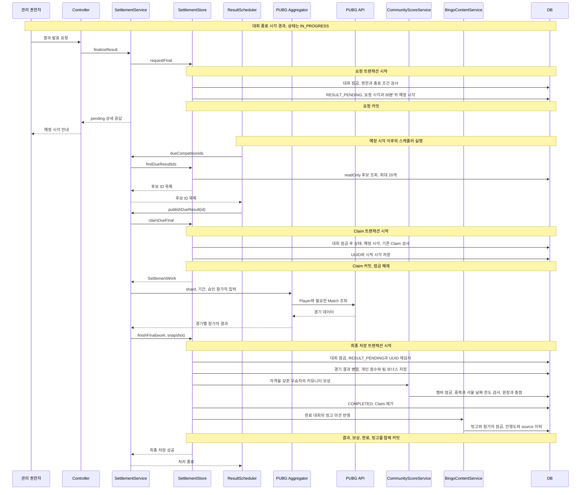
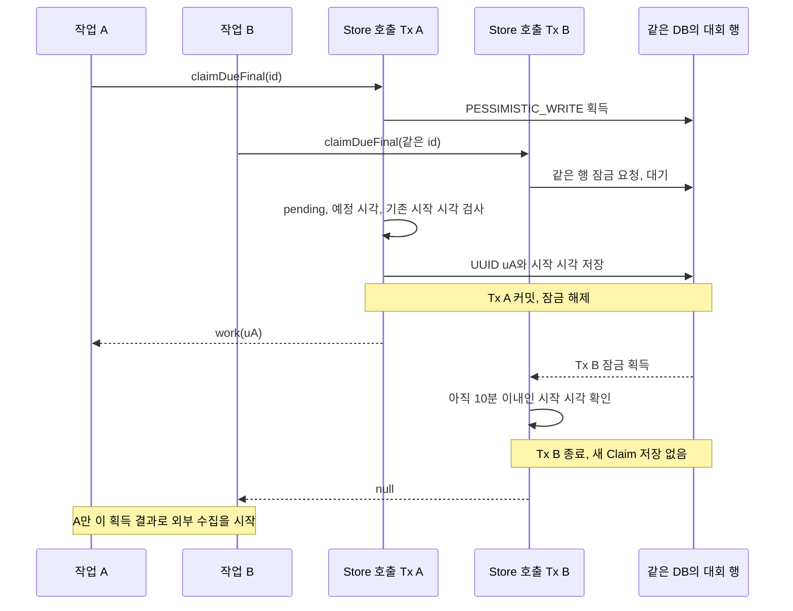
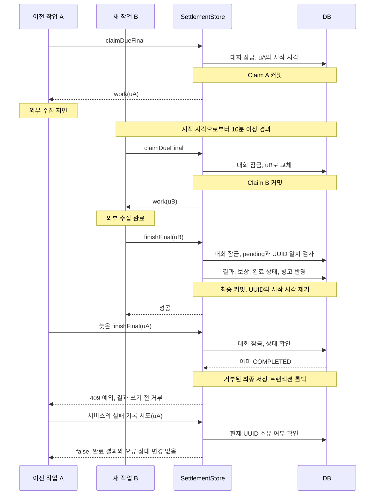

# 킬내기 지연 정산과 UUID 기반 작업 소유권 관리

> 발표 예정 시각과 작업의 식별을 분리하고, DB 행 잠금과 UUID Claim 검증으로 오래된 작업의 결과·보상 반영을 거부하는 사례입니다.

[프로젝트 README](../../README.md) · [빙고 집계 정합성](bingo-consistency.md) · [PUBG 요청 공유와 데이터 재사용](pubg-request-reuse.md)

| 핵심 질문 | 실제 구현에서 확인한 답 |
| --- | --- |
| 경기 종료 직후 결과가 확정되는가? | 종료 이후 관리 권한자의 발표 요청이 필요합니다. 요청 시점부터 30분 뒤를 발표 예정 시각으로 저장하고 스케줄러가 처리합니다. |
| 두 작업이 같은 대회를 수집하면? | Claim 획득은 같은 대회 행 잠금 아래 수행합니다. 유효한 기존 시작 시각이 있으면 새 작업에 work를 주지 않습니다. |
| 느린 작업이 새 작업의 결과를 덮어쓸 수 있는가? | 최종 저장 직전에 대회 행을 다시 잠그고 `RESULT_PENDING`과 UUID 소유권을 검사합니다. |
| 시간 정밀도 차이가 작업 식별에 영향을 주는가? | 최종 정산의 식별은 시각의 완전 동등 비교 대신 UUID를 사용합니다. 시각은 발표·재획득 가능 여부 판단에 사용합니다. |
| 결과·우승 보상·빙고는 따로 확정되는가? | 정상 최종 정산 경로에서는 같은 DB 트랜잭션에 참여합니다. 앞선 Claim 획득과 이후 실패 기록은 별도 경계입니다. |

**분석 기준:** 2026-10-15 로컬 Private 소스와 테스트 코드. 이번 작업에서는 테스트·벤치마크를 실행하지 않았습니다. 아래 assertion과 합성 시각·점수는 작성된 테스트의 기대값이며, 현재 통과 결과·운영 데이터·운영 장애 해결 실적이 아닙니다. 코드로 확인한 동작과 설계상 해석·향후 검증 제안을 구분합니다.

## 1. 기술 개요

GuildUp 킬내기는 대회 기간에 시작한 PUBG 경기의 참가자별 킬·등수를 모아 개인 또는 팀 순위를 계산하고, 조건을 충족한 우승자에게 커뮤니티 보상을 지급합니다. 외부 경기 데이터는 종료 직후 모두 조회된다고 보장할 수 없고, 스케줄러의 중복 실행·재시도·서버 중단으로 수집 작업이 겹칠 수 있습니다.

구현은 작업을 **발표 요청 → Claim 획득 → 외부 수집 → 최종 저장**으로 분리합니다. 외부 수집 동안 대회 잠금을 유지하지 않고, 다시 DB를 변경할 때 현재 작업이 여전히 소유자인지 검사합니다.

| 책임 | 사용하는 값·장치 |
| --- | --- |
| 언제 발표를 시도할 수 있는가? | `resultRequestedAt`, `resultPublishAt`, DB 후보 조회 |
| 새 작업이 재획득해도 되는가? | `finalizationStartedAt`과 10분 timeout |
| 어떤 작업이 최종 반영 자격을 갖는가? | `finalizationClaimToken` UUID 동등 비교 |
| 획득·반영이 동시에 충돌하지 않는가? | 대회 `PESSIMISTIC_WRITE` 잠금과 엔티티 `@Version` |
| 결과·보상이 중복되는가? | 결과 키, 기존 행 갱신·재합산, 보상 멤버 잠금·원장 유일 제약, 빙고 source 이력 |

UUID는 로그인 인증 토큰이나 단조 증가 번호가 아니라 **DB에 기록된 현재 정산 작업을 구분하는 값**입니다. 재시도마다 바뀐 UUID를 비교하여 교체된 작업의 쓰기를 거부합니다. 이 장치만으로 외부 API 호출까지 한 번만 실행되는 것은 아닙니다.

## 2. 문제 정의

| 상황 | 발생 가능한 데이터 오류 | 실제 방어와 범위 |
| --- | --- | --- |
| A. 두 스케줄러가 같은 대회 처리 | 양쪽이 모두 정산 소유자라고 판단 | 후보 조회와 별개로 Claim 획득에서 행 잠금·상태·예정 시각·기존 시작 시각 재검사 |
| B. 이전 작업의 외부 수집이 느림 | 나중에 완료한 오래된 결과가 최신 결과를 덮어씀 | 최종 저장의 상태·현재 UUID 검증. 다른 작업으로 교체됐다면 결과 행 쓰기 전에 거부 |
| C. Claim 시작 후 10분 경과 | 새 수집과 기존 수집이 겹침 | 새로운 UUID 발급이 가능해짐. 기존 HTTP 작업을 취소하는 구현은 아니며, 최종 반영 자격을 분리 |
| D. 실패 후 다른 작업이 재시도 | 실패한 작업이 계속 소유자이거나 즉시 재시도 집중 | 실패를 기록하며 UUID 제거, 시작 시각은 보존해 재획득 대기 기준으로 사용 |
| E. 새 작업 완료 뒤 이전 작업이 저장 시도 | 결과·원장·보상이 다시 저장됨 | 이미 `COMPLETED`이면 상태 검사에서 거부. 새 작업이 아직 pending이면 UUID 불일치로 거부 |
| F. 결과·보상·빙고 저장 중 예외 | 결과만 완료되고 보상 일부 누락 등 부분 반영 | 최종 정산 트랜잭션의 실패를 전파하여 같은 DB 변경을 함께 롤백 |

위 상황은 소스와 테스트를 대조한 경쟁·실패 가능성입니다. 실제 운영에서 발생한 장애와 해결 이력으로 주장하지 않습니다. 특히 F의 중간 실패를 끝까지 주입하는 전용 정산 롤백 테스트는 추가 검증 항목입니다.

## 3. 정산 처리 구조

### 3.1 상태와 시간 조건

`KillCompetitionStatus`에는 다음 여섯 상태가 있습니다. 별도의 `ENDED`, `FINALIZING`, `FAILED` 상태는 확인되지 않았습니다.

| 상태 | 진입·역할 | 주의할 구분 |
| --- | --- | --- |
| `RECRUITING` | 대회 생성 후 모집 | 시작 전 점수 설정·종료 시각 변경 가능 |
| `READY` | 승인 참가자가 있는 모집을 관리 권한자가 마감 | 개인전은 바로 시작 가능하며 팀전은 팀 배정 검사 필요 |
| `IN_PROGRESS` | `start`가 시작 시각·참가 인정 시점을 설정 | 종료 시각이 지나도 곧바로 다른 DB 상태로 전환되는 구조는 아님 |
| `RESULT_PENDING` | 종료 이후 `requestFinal` 성공 | `resultPublishAt = 요청 시각 + 30분`; 정산 중·실패 후에도 이 상태를 사용 |
| `COMPLETED` | 현재 Claim의 최종 저장 성공 | 완료 시각 기록, Claim 시작 시각·UUID·실패 메시지 제거 |
| `CANCELLED` | 허용된 상태에서 관리 권한자가 취소 | `RESULT_PENDING`·`COMPLETED`의 취소는 서비스가 거부 |

자연 종료는 `now >= endsAt`이라는 요청 가능 조건입니다. 수동 `end`는 진행 중이며 아직 종료 전인 대회의 `endsAt`을 현재로 바꾸고 모집을 닫지만, 상태를 `RESULT_PENDING`으로 바꾸지는 않습니다. 이후 별도의 결과 발표 요청이 필요합니다. 따라서 30분 대기는 대회 종료 시각 기준이 아니라 **발표 요청 시각 기준**입니다.

Controller는 로그인 사용자를 확인하고 커뮤니티·게임에 속한 대회를 조회한 뒤 SettlementService로 위임합니다. Store는 행 잠금 아래 생성자 또는 커뮤니티 OWNER/ADMIN의 관리 권한을 다시 확인합니다. 요청 이름에 `finalize`가 있어도 이 HTTP 경로 자체가 PUBG 수집을 수행하는 것은 아닙니다.

### 3.2 호출 순서와 담당 메서드

| 단계 | 실제 호출 | 동작 |
| --- | --- | --- |
| 발표 요청 | `KillCompetitionController.finalizeResult` → `SettlementService.finalizeResult` → `Store.requestFinal` | 상태·종료 시각·권한 검사, pending·요청/예정 시각 저장 |
| 후보 찾기 | `ResultScheduler.publishDueResults` → `dueCompetitionIds` → `Store.findDueResultIds` | pending이고 예정 시각 이하인 ID를 예정 시각·ID 순으로 최대 20개 조회 |
| 소유권 획득 | `SettlementService.publishDueResult` → `Store.claimDueFinal` | 행 잠금 후 자격을 재검사하고 새 UUID·시작 시각을 저장 |
| 수집 | `KillCompetitionPubgAggregator.aggregate` | fresh Player 목록 → 경기 ID 중복 제거 → 공통 fresh Match 조회 → 기간·참가 인정 시점 필터 |
| 최종 저장 | `Store.finishFinal` | 행 잠금·Claim 검사 후 결과 병합, 대회 점수, 커뮤니티 보상, 완료 상태, 빙고 반영 |
| 실패 처리 | `Store.recordFinalFailure` | 아직 같은 UUID 소유자일 때만 실패 메시지 저장·UUID 제거 |

### A. 전체 지연 정산 흐름

아래는 상위 트랜잭션이 없는 정상 HTTP·스케줄러 진입 경로입니다. `IN_PROGRESS` 대회가 이미 종료된 뒤부터 표현합니다. 승인 참가자가 적으면 커뮤니티 보상 단계가 생략될 수 있습니다.



스케줄러는 기본 `fixedDelay` 60,000ms로 실행하며, 한 번의 실행에서 후보들을 순서대로 처리합니다. fixed delay는 이전 호출의 **종료 이후** 다음 시작까지의 간격이므로 “모든 대회가 정확히 매분 확정된다”는 의미가 아닙니다. 설정 override 값과 실제 운영 지연은 확인하지 않았습니다. [Spring Scheduling 문서](https://docs.spring.io/spring-framework/reference/integration/scheduling.html#scheduling-annotation-support-scheduled)

## 4. 작업 소유권과 동시성 제어

### 4.1 실제 필드와 Claim 생애주기

| 필드·메서드 | 실제 역할 |
| --- | --- |
| `finalizationStartedAt` | Claim 획득 시각과 재획득 대기 기준. `now`가 시작 시각 + 10분보다 이르면 active |
| `finalizationClaimToken` | DB의 현재 UUID 소유자. `UUID.randomUUID()`로 생성하여 `beginFinalization`에서 저장 |
| `SettlementWork.claimAt` | 메모리 작업 입력의 시각. 최종 저장의 소유권 동등 비교에는 사용하지 않음 |
| `SettlementWork.finalizationClaimToken` | 준비 시 받은 UUID. 최종 저장과 실패 기록의 소유권 비교에 사용 |
| `ownsFinalizationClaim` | 전달 UUID가 null이 아니고 DB UUID와 같은지 검사 |
| `recordResultFailure` | 현재 UUID 제거, 오류 기록. 시작 시각은 그대로 유지 |
| `complete` | 완료 상태·시각 설정 후 시작 시각·UUID·오류 제거 |

Claim 획득은 `findByIdForUpdate`의 `PESSIMISTIC_WRITE` 안에서 수행합니다. pending·예정 시각·기존 Claim 조건을 잠금 이후에 검사하므로, 스케줄러 둘이 같은 후보 ID를 읽었더라도 획득을 따로 결정하지 않습니다. `@Version`도 선언되어 있지만 작업의 식별을 버전이나 timestamp로 비교하는 것은 아닙니다.

### B. 두 작업이 동시에 Claim을 획득하려는 경우

Tx A와 Tx B는 같은 Store 메서드에 들어온 두 호출의 논리적 트랜잭션을 나타냅니다. 실제 두 서버를 기동했다는 그림은 아닙니다.



### 4.2 만료와 반영 자격은 같은 조건이 아니다

`activeClaim`은 시작 시각이 있고 `now < startedAt + 10분`인지 봅니다. 정확히 10분이 되면 새 Claim 발급이 가능합니다. 이때 새 UUID가 기존 UUID를 교체하여 이전 work의 반영 자격을 없앱니다.

반면 `finishFinal`은 **경과 시간이 10분을 넘었는지 다시 확인하지 않습니다.** pending이고 현재 UUID가 같다면, 10분을 지난 작업도 다른 작업에 의해 교체되거나 실패 처리되지 않은 동안 반영될 수 있습니다. timeout은 기존 스레드를 강제 종료하거나 정확히 그 시각에 DB UUID를 자동 삭제하는 timer가 아닙니다.

따라서 보장할 수 있는 설명은 “새로 Claim을 획득한 작업으로 교체된 이전 작업의 쓰기를 거부한다”입니다. “10분이 지나면 기존 작업의 모든 실행·저장이 무조건 중단된다”는 설명은 코드와 다릅니다.

### C. 새 작업 완료 후 기존 작업의 늦은 반영 시도



이 그림에서 A는 `COMPLETED` 상태 검사에서 먼저 거부되므로 UUID 비교까지 도달할 필요가 없습니다. B의 최종 저장 **이전**에 A가 들어오면 pending 상태는 같아도 `uA != uB`로 거부됩니다. 우선 확인한 stale-worker 테스트는 후자의 순서를 직접 재현하며, “B 완료 후 A의 저장·실패 기록” 전체를 하나의 테스트로 검증한 결과는 아닙니다.

### 4.3 실패 기록도 소유자만 변경한다

외부 수집 또는 최종 저장이 실패하면 SettlementService는 `recordFinalFailure`를 호출합니다. 이 메서드는 다시 대회 행을 잠그고 work UUID가 현재 소유자일 때만 실패를 저장합니다. 이미 교체되거나 완료된 작업의 실패가 새 작업의 Claim이나 완료 상태를 지우지 않도록 한 검사입니다.

실패 메시지 기록에 성공하면 UUID는 null이지만 시작 시각은 남습니다. `activeClaim`은 UUID 존재 여부를 보지 않으므로 다음 획득은 여전히 시작 시각 + 10분을 기다립니다. **실패 시각부터 새로 10분을 기다리는 구현이 아닙니다.** 실패가 이미 오래 걸린 작업에서 발생했다면 다음 poll에서 바로 재획득할 수도 있습니다.

### 4.4 설명용 의사코드

아래는 최종 정산의 핵심 조건을 재작성한 **의사코드**입니다. 원본 Java 코드가 아니며 권한·로그·자료형·세부 점수 로직은 축약했습니다.

```text
transaction claim(id):
    competition = lock competition row
    if not pending or not due or previous start still active:
        return no work
    token = new random UUID
    persist start time and token
    return work with token and collection inputs
commit claim

snapshot = collect external matches outside claim transaction

transaction finish(work, snapshot):
    competition = lock competition row
    require pending
    require work.token is non-null and equals persisted token
    merge per-participant match rows and recalculate totals
    award eligible community winners under member locks
    mark competition completed and clear claim
    apply bingo content and processed-source records
commit all final changes

on runtime failure:
    transaction recordFailure(work):
        lock competition row
        if token still belongs to work:
            persist error and clear token, retain start time
    commit failure record
```

## 5. PostgreSQL 시간 정밀도 문제

### 5.1 시각을 식별자로 사용할 때의 위험

Java `Instant`는 epoch-second와 나노초 부분으로 시각을 표현합니다. 이것이 실제 시스템 Clock이 항상 나노초 정확도로 시간을 측정한다는 뜻은 아닙니다. PostgreSQL timestamp 계열의 해상도는 마이크로초이며 소수 초 정밀도 지정 범위는 0~6입니다. DB를 거친 값과 메모리에 보관한 값의 정밀도가 다르면 같은 작업의 시각도 완전히 같지 않을 수 있습니다. [Java 21 Instant 문서](https://docs.oracle.com/en/java/javase/21/docs/api/java.base/java/time/Instant.html), [PostgreSQL 날짜·시간 타입 문서](https://www.postgresql.org/docs/current/datatype-datetime.html)

| 사용 방식 | 발생 가능한 문제 | 현재 최종 정산 |
| --- | --- | --- |
| Java에서 만든 시작 시각을 작업 ID로 사용하고 DB 값과 `equals` 비교 | 저장·복원 시 정밀도가 바뀌면 정상 소유 작업을 만료 작업으로 오인 | 시작 시각의 동등 비교를 최종 소유권 판단에 사용하지 않음 |
| 시작 시각을 시간 조건으로 사용 | 정밀도·서버 Clock이 재획득 경계 시점에는 영향을 줄 수 있음 | 이 역할은 그대로 시각에 의존하므로 UUID가 시간 관련 문제 전부를 없애지는 않음 |
| UUID를 별도 필드에 저장 | 시간 표현이 달라도 같은 작업의 식별값 비교 가능 | DB와 work의 UUID를 비교하고, 교체 시 UUID도 변경 |

이는 시간 기반 식별의 설계상 위험과 현재 구현을 대조한 설명입니다. 과거 구현의 실제 장애 발생·수정 이력을 별도로 확인한 것은 아닙니다.

### 5.2 PostgreSQL 통합 테스트가 재현하는 내용

`KillCompetitionPostgresClaimIntegrationTests.completesWithUuidClaimAfterPostgresRoundsClaimTimestamp`는 클래스 전체 테스트 트랜잭션 없이 다음 순서를 구성합니다.

1. 합성 Clock을 나노초 부분이 있는 시각으로 설정하고, 대회 생성·참가·시작·발표 요청을 수행합니다.
2. DB에서 읽은 발표 예정 시각에 다시 789ns를 더해 Java 작업 시각과 DB 표현 사이의 차이를 의도적으로 만듭니다.
3. `claimDueFinal`을 호출해 UUID와 작업 시각을 받습니다.
4. JDBC로 저장된 `finalization_started_at`을 `OffsetDateTime`으로 읽고 `Instant`로 변환합니다.
5. 저장 시각이 `work.claimAt`과 **다름**, 저장 시각의 `nano % 1000 == 0`을 검사합니다.
6. 그 work와 빈 합성 경기 snapshot으로 `finishFinal`을 호출합니다.
7. `COMPLETED`, 완료 시각 존재, 시작 시각·UUID null을 검사합니다.

중요한 assertion은 “시각이 달라도 같은 UUID 작업으로 최종 저장할 수 있다”입니다. 테스트 이름은 rounds지만, 정확히 어느 방향으로 반올림·절삭되는지나 특정 나노초 값을 기대하는 assertion은 없습니다. 원장·보상·빙고가 있는 대규모 정산도 이 테스트의 범위 밖입니다.

H2의 `finalClaimTokenSurvivesTimestampPrecisionChangeAcrossTransactions`는 JDBC로 시작 시각을 마이크로초 단위로 맞춰 변경한 뒤 완료를 검사합니다. **H2에서 정밀도 차이를 주입한 테스트와 PostgreSQL의 실제 저장·복원 경로를 사용하는 테스트를 구분**해야 합니다. 두 테스트 모두 이번 작업에서 실행하지 않았습니다.

최종 Claim과 달리 중간 정산은 `interimCalculationStartedAt`과 `work.claimAt`의 시각 동등 비교를 사용합니다. UUID 전환의 보장 범위를 중간 정산까지 확장해 설명하지 않습니다.

## 6. 트랜잭션 및 점수 정합성

### 6.1 정상 호출 경로의 경계

| 단계 / 메서드 | 선언과 실제 경계 |
| --- | --- |
| 생성·마감·시작·수동 종료 | `KillCompetitionService`의 각 변경 메서드에 `@Transactional`; 요청별 DB 변경과 상태 검증 |
| `Store.requestFinal` | `@Transactional`; pending·요청/예정 시각 저장 후 반환 시 커밋 |
| `Store.findDueResultIds` | `@Transactional(readOnly = true)`; 후보 ID 조회 |
| `Store.claimDueFinal` | `@Transactional`; 행 잠금·UUID 발급·입력 생성 후 반환 시 커밋 |
| Scheduler·SettlementService·Aggregator | 해당 오케스트레이션에 `@Transactional` 없음. 정상 진입에서 외부 수집을 감싸는 대회 쓰기 트랜잭션 없음 |
| `Store.finishFinal` | `@Transactional`; Claim 검사부터 결과·점수·완료·빙고까지 하나의 물리 트랜잭션 |
| `CommunityScoreService.addKillCompetitionWinIfEligible` | 별도 Bean의 `@Transactional` 기본 `REQUIRED`; 정상 최종 호출에서는 Store 트랜잭션에 참여 |
| `BingoGuildUpContentService.applyCompletedKillCompetition` | 별도 Bean의 `@Transactional` 기본 `REQUIRED`; 정상 최종 호출에서는 동일 트랜잭션에 참여 |
| `Store.recordFinalFailure` | 최종 저장 예외가 proxy 밖으로 전파된 다음 호출. 상위 트랜잭션 없는 경로에서는 새로운 트랜잭션으로 실패를 저장 |
| 모니터링 이벤트 | 서비스가 별도로 기록 요청. 실제 `MonitoringEventWriter.write`는 `REQUIRES_NEW`; 설정에 따라 executor 사용. 정산 결과의 원자성 범위 밖 |

Store의 메서드들이 `REQUIRES_NEW`인 것은 아닙니다. 현재 Controller·스케줄러 경로처럼 상위 트랜잭션이 없으면 각 proxy 호출에서 물리 트랜잭션이 시작·종료되고, 상위 트랜잭션이 있으면 `REQUIRED`로 참여할 수 있습니다. 같은 객체의 내부 메서드 호출이 추가 트랜잭션을 만든다고 해석하지 않습니다. [Spring 트랜잭션 전파 문서](https://docs.spring.io/spring-framework/reference/data-access/transaction/declarative/tx-propagation.html)

외부 API 응답을 기다리는 동안 DB 잠금을 유지하지 않는 구조는 소스에서 확인됩니다. **기술적 해석:** 이 분리는 네트워크 지연을 긴 대회 잠금으로 전파하지 않는 대신, 결과 저장 직전의 소유권 검사를 요구합니다. 잠금 시간이나 처리량 개선율을 측정한 결과는 없습니다. 최종 저장도 원장·여러 빙고를 갱신하므로 항상 짧다고 단정할 수 없습니다.

### 6.2 결과 저장의 원자성

정상 `finishFinal`의 같은 트랜잭션에는 다음 DB 변경이 포함됩니다.

1. 경기별 참가자 결과의 신규 저장과 기존 행 갱신.
2. 승인 참가자의 최종 킬·경기 수·대회 점수와 팀별 최종 순위 보너스.
3. 지급 자격이 있는 우승자의 커뮤니티 점수 원장과 현재 총점.
4. 대회의 `COMPLETED`·완료 시각·Claim 제거.
5. 관련 빙고 미션의 진행도·줄 완성·처리 source 이력.

결과 계산·점수 저장·빙고 반영에서 전파된 RuntimeException이나 저장 중 DB 제약 위반은 정상 트랜잭션의 롤백 대상입니다. `complete`가 빙고 호출보다 먼저 실행돼도 그 시점에 이미 DB commit이 끝난 것은 아닙니다. JPA dirty checking이나 중간 flush도 최종 커밋과 구분합니다. 커밋 응답을 받는 도중 연결이 끊겨 성공 여부가 불명확한 경우까지 무조건 미반영이라고 단정하지 않으며, 재조회·복구 확인은 별도 검증 대상입니다.

**함께 되돌리지 않는 범위:** 이미 커밋한 발표 요청과 Claim 획득, 외부 API 호출, 메모리 캐시, 별도 모니터링 기록. 최종 저장이 롤백되면 Claim 획득의 DB 상태는 남고, 서비스가 별도 실패 기록을 시도합니다. 실패 기록까지 실패해도 timeout 후 재획득 가능한 시작 시각이 남을 수 있습니다.

이 원자성은 코드와 Spring 전파 설정의 분석입니다. 최종 정산 중 두 번째 보상 또는 빙고 저장을 실패시켜 모든 행이 롤백되는지 직접 확인하는 전용 테스트 결과는 제시하지 않습니다.

### 6.3 경기 결과 병합과 대회 점수

`mergeMatchResults`는 저장된 경기 결과를 먼저 읽고 `(participantId, matchId)`로 Map을 만듭니다. 새 snapshot에 같은 키가 있으면 누적 행을 추가하지 않고 `refresh`하며, 새로운 키만 저장합니다. Entity에는 `(competition_id, match_id, participant_id)` 유일 제약이 있습니다.

`applyTotals`는 축적된 모든 행을 현재 점수 규칙으로 정규화하고 참가자·팀의 총점을 다시 설정합니다. 따라서 이미 저장한 경기의 점수를 기존 총점에 또 더하는 방식이 아닙니다. 최신 Player 응답에서 사라진 기존 결과 행도 보존해 계산합니다. 반대로 외부 원본에서 제거된 행을 자동 삭제하는 일반적인 전체 원본 교정 시스템으로 해석할 수는 없습니다.

Aggregator와 Store는 모두 경기 시작 시각이 `max(대회 시작, 참가자 eligibleFrom)` 이상이고 범위 끝보다 이전인지를 적용합니다. 최종 범위 끝은 대회 `endsAt`이며, 경기의 **종료 시각**으로 자르는 필터가 아닙니다. Store는 snapshot의 요약 totals를 그대로 신뢰하지 않고 `matchKills` 행과 기존 행으로 점수를 다시 계산합니다.

### 6.4 개인전·팀전 점수와 팀 순위 보너스

| 점수 | 실제 계산·저장 |
| --- | --- |
| SOLO 개인 경기 점수 | `킬 × killPoint + 해당 경기 등수 보너스`; 등수 보너스는 설정이 켜진 경우 적용 |
| DUO/SQUAD 개인 경기 점수 | `킬 × killPoint`; 개인 행의 순위 보너스는 0으로 정규화 |
| 팀 경기 보너스 | `(teamId, matchId)`로 결과를 묶고 유효한 양수 등수 중 가장 높은 등수 하나에 대해 보너스 계산 |
| 팀 최종 점수 | 승인 팀원들의 개인 기본 점수 합 + 팀 경기별 보너스 합. 팀 Entity에 보너스를 별도 저장하고 `teamScore`가 합산 |

예를 들어 합성 팀원이 같은 경기에서 각각 5킬, 5킬을 기록하고 킬당 1점·1등 보너스 5점이라면 팀 점수는 **10 + 5 = 15**입니다. 보너스를 각 팀원에게 더해 20점으로 만들지 않습니다. 같은 팀의 등수 누락·불일치가 있으면 양수 등수의 최솟값을 한 번 선택하는 규칙입니다. `Math.addExact`·`multiplyExact`로 정수 overflow를 예외로 처리합니다.

우승자는 단순 킬 수가 아니라 최종 **대회 점수**로 결정합니다. SOLO는 최고 점수 참가자, 팀전은 `teamScore` 최고 팀을 선택하며 동점 우승을 허용합니다. 우승 보상 대상 멤버는 승인 상태이고 최종 인정 경기 수가 1 이상인 참가자입니다.

### 6.5 커뮤니티 랭킹 보상은 별도 점수 체계

대회 내부 점수와 커뮤니티 보상을 혼동하지 않습니다.

| 항목 | 대회 내부 점수 | 커뮤니티 우승 보상 |
| --- | --- | --- |
| 목적 | 대회 순위·우승자 결정 | 커뮤니티 멤버의 랭킹 점수 |
| 규칙 | 킬 가중치와 개인/팀 등수 보너스 | 지급 자격을 충족한 멤버에게 3점 |
| 저장 | 경기 결과, 참가자 최종 점수, 팀 보너스 | `community_score_history`와 `community_member_scores` |
| 조건 | 승인 참가자의 인정 경기 | 대회 승인 참가자 수 4명 이상 + 우승자 조건 + 활성 멤버 + 중복·서울 날짜 한도 통과 |

4명 조건은 **승인 참가자 수** 검사이지 실제 경기 참가자 4명 검사가 아닙니다. `CommunityScoreService.addKillCompetitionWinIfEligible`는 활성 멤버 행을 `PESSIMISTIC_WRITE`로 잠근 뒤 다음을 검사합니다.

- 같은 멤버·`KILL_COMPETITION_WIN`·대회 reference ID의 기존 보상 여부.
- 같은 멤버의 서울 날짜 `[dayStart, nextDayStart)` 안에 이미 우승 보상이 있는지.
- 자격을 통과하면 원장에 3점 기록과 현재 총점 3점 증가를 같은 트랜잭션에서 수행.

날짜 계산에 전달하는 `occurredAt`은 최종 저장의 `completedAt`입니다. 즉, 보상 날짜 한도는 경기 시작·대회 종료 날짜가 아니라 **정산 완료 시각의 서울 날짜** 기준입니다. 같은 날 다른 대회에서 다시 우승해도 보상이 생략될 수 있지만 대회 결과 자체는 완료될 수 있습니다.

활성 멤버 조회 실패는 중복·일일 한도의 `false` 반환과 다릅니다. 보상 호출 대상 우승자가 비활성이면 예외가 발생하므로, 정상 최종 경로에서는 그 대회의 결과·다른 보상·빙고까지 같은 트랜잭션에서 롤백될 수 있습니다. 이 실패를 단순 보상 생략으로 설명하지 않습니다.

원장 Entity에는 `(community_member_id, score_type, reference_type, reference_id)` 유일 제약이 있고, 멤버별 현재 총점 행에도 유일 제약이 있습니다. 같은 날 여러 대회의 중복 보상 제한은 날짜 유일 인덱스가 아니라 **멤버 잠금 아래 조회·지급**으로 구현합니다. Store는 여러 우승자의 멤버 ID를 정렬해 보상 호출을 수행하지만, 모든 연관 작업의 deadlock 부재까지 증명하는 것은 아닙니다. 운영 DB에 제약이 적용됐는지는 직접 조회하지 않았습니다.

### 6.6 관련 빙고 반영

`applyCompletedKillCompetition`은 완료 대회의 우승자에게 같은 커뮤니티·게임과 기간 조건에 맞는 `KILL_BET_WIN` 미션을 적용합니다. 미션의 발생 시각은 늦게 발표한 시각이 아니라 **대회 종료 시각**입니다. 빙고 참가자의 `eligibleFrom`도 검사합니다.

이벤트와 참가자를 잠그고, `(event, participant, sourceType, sourceId)` 처리 이력을 확인한 뒤 진행도와 줄 결과를 갱신합니다. source ID는 대회 ID이며 동일 조합의 유일 제약도 선언되어 있습니다. 반복 확정 요청은 대회 상태에서 먼저 거부되고, 콘텐츠 처리 이력은 별도의 중복 방어입니다.

빙고 호출은 보상용 승인 4명 조건 밖에 있습니다. 따라서 대회가 4명 미만이거나 해당 멤버가 당일 커뮤니티 보상을 이미 받았어도, 빙고의 우승자·기간 조건을 충족하면 미션은 반영될 수 있습니다. 두 규칙을 같은 조건으로 설명하면 부정확합니다.

## 7. 장애 복구와 재시도

| 실패 시점 | 남는 상태 | 다음 처리와 보호 |
| --- | --- | --- |
| 발표 요청 검증 실패 | pending 예약 자체가 성립하지 않음 | 권한·상태·시각 오류 반환. 중복 요청은 새 예약을 만들지 않음 |
| Claim 획득 예외 또는 대회 없음 | work가 없을 수 있음 | 외부 수집을 시작하지 않음. 예외는 서비스/스케줄러 경계에서 관측 |
| 외부 Player/Match 조회 실패·누락 | 기존 결과와 별도 Claim 상태 | 불완전 snapshot을 확정하지 않고 실패 기록 시도 |
| 최종 DB 반영 중 예외 | 해당 최종 트랜잭션 롤백 | 현재 UUID 소유자인 경우에만 실패 메시지·UUID 제거를 별도 저장 |
| 실패 기록도 실패 | Claim 시작 시각·UUID가 이전 상태로 남을 수 있음 | 영구 잠금을 주장하지 않고 timeout 이후 새 UUID 획득 가능성을 유지 |
| 프로세스가 수집 중 종료 | 메모리 작업은 유실, DB Claim은 남음 | 다른 실행에서 시작 시각 + 10분 이후 재획득 가능. 완료된 상태는 후보에서 제외 |
| 새 작업 이후 이전 작업 실패 도착 | 새 UUID 또는 완료 상태 | 이전 UUID로는 실패 기록이 적용되지 않음 |

Aggregator는 요청한 계정이 Player 응답에서 빠지거나 필요한 Match가 응답에서 빠지면 정산을 중단합니다. 범위 밖 경기나 참가 인정 전 경기는 필터링합니다. 다만 Player가 원래 제공한 최근 목록 자체에 없는 과거 경기를 모두 발견할 수 있다는 보장은 없습니다. 킬내기 일반 수집은 공통 Match 캐시를 사용하며, 빙고의 영속 Fact DB를 자동 조회하는 경로와는 다릅니다.

실패 후에는 같은 `RESULT_PENDING`과 원래 예정 시각을 유지합니다. 스케줄러가 다시 후보를 찾고 `claimDueFinal`의 시작 시각 조건을 통과하면 새 UUID를 발급합니다. 별도의 최대 재시도 횟수·지수 backoff·dead-letter queue는 이 정산 계층에서 확인되지 않았습니다. HTTP Client 내부 retry와 이 DB 작업 재시도는 구분합니다.

`KillCompetitionPendingMonitor`는 요청 후 1시간 넘게 pending인 대회를 관측하는 코드입니다. 기본 검사 간격은 15분이고 같은 reference의 이벤트를 일정 시간 중복 억제합니다. 이 모니터 자체가 정산을 완료하거나 Claim을 강제로 교체하는 것은 아닙니다.

## 8. 테스트 및 검증

**테스트 코드 확인일: 2026-10-15. 이번 작업에서는 실행하지 않았습니다.** 아래는 존재하는 테스트의 조건과 assertion이며 현재 통과 결과가 아닙니다. 직접 scheduler/service를 호출하는 테스트와 실제 시간에 맞춰 `@Scheduled`가 실행되는 시험도 구분합니다.

### 8.1 H2 통합: 지연·소유권·재시도

`KillCompetitionFlowTests`는 H2와 실제 Service·Store·Repository를 사용합니다. 클래스 전체에 `@Transactional`이 없으며, mutable Clock과 외부 Aggregator mock으로 시각·결과를 제어합니다. 실제 외부 API나 별도 서버를 호출하지 않습니다.

| 테스트 메서드 | 재현한 상황 | 사전 조건 | 기대 결과 | 실제 assertion | 한계 |
| --- | --- | --- | --- | --- | --- |
| `resultRequestDoesNotCallPubgAndSchedulerPublishesOnlyAfterThirtyMinutes` | 예약 전·후 경계와 반복 발표 | 종료된 SOLO, mock 결과 | 요청은 예약만 수행, 예정 시각 이후 한 번 완료 | pending, 예정=요청+30분, 직전 Aggregator 미호출, 예정 시각과 이후 총 1회 호출, 최종 completed | 실제 `@Scheduled` tick이 아니라 `publishDueResult` 직접 호출 |
| `finalClaimTokenSurvivesTimestampPrecisionChangeAcrossTransactions` | 시각 변경 후 최종 저장 | 나노초 fixture, Claim 후 JDBC로 마이크로초 시각 주입 | UUID 기준 완료 | token non-null; completed·완료 시각 존재·시작/UUID null | H2에서 값을 변경한 재현. 정확히 Java 시각과 달라졌는지의 별도 assertion은 PostgreSQL 테스트에 있음 |
| `staleWorkerCannotFinishAfterAReplacementClaimWasIssued` | 10분 뒤 새 Claim과 이전 작업의 쓰기 | 첫 work 확보 후 Clock +10분 | 이전 UUID 거부, 새 UUID 완료 | UUID 다름, 이전 finish의 409, replacement finish 후 completed | 이전 거부가 새 작업 완료 전에 발생. 새 작업 완료 후 이전 실패 기록까지 한 번에 시험하지 않음 |
| `concurrentWorkersCannotOwnTheSameFinalization` | 두 스레드의 동시에 획득 시도 | due 대회, ready/start latch | work는 한 개 | 두 결과 중 non-null 단일 work, 그 UUID non-null | 같은 JVM·H2. PostgreSQL 또는 네트워크 분리 서버 시험 아님 |
| `finalFailureIsRecordedAndReleasedForRetryAfterBackoff` | 실패 기록 후 즉시/10분 뒤 재획득 | 직접 획득한 work | UUID 제거, 시간 기준 대기, 새 token | failure 기록 true, pending·오류·start 유지·token null, 즉시 claim null, +10분 새 token·오류 제거 | `finishFinal` 저장 도중 실제 DB 오류를 발생시킨 테스트가 아님 |
| `overdueLegacyPendingCompetitionWithoutTokenIsRecoveredAutomatically` | 오래된 시작 시각과 token 없는 DB 상태 | JDBC로 legacy 상태 주입, mock 결과 | 새 Claim으로 복구 완료 | completed, 합성 킬 4, token null | 서비스 직접 실행. 실제 재시작·예약 polling을 실행하지 않음 |
| `fewerThanFourGetsNoScoreAndPubgFailureLeavesResultUnconfirmed` | 적은 참가자와 외부 수집 예외 | 한 명 대회와 실패 대회 | 적은 인원도 결과 완료, 실패는 미확정 | 첫 대회 completed·보상 없음, 실패 대회 pending·경기 결과 empty | 수집 단계 실패. 결과·보상 일부 저장 후 롤백은 별도 검증 필요 |

### 8.2 H2 통합: 대회 점수와 보상

다음도 `KillCompetitionFlowTests`의 메서드입니다. 점수 숫자는 합성 fixture 기대값입니다.

| 테스트 메서드 | 재현한 상황 | 사전 조건 | 기대 결과 | 실제 assertion | 한계 |
| --- | --- | --- | --- | --- | --- |
| `repeatedInterimSettlementDoesNotDuplicatePlacementPointsForTheSameMatch` | 같은 경기 반복 중간 정산 | SOLO 5킬+1등 보너스 5, 쿨다운 경과 | 같은 결과 유지 | 두 번 모두 10점, 저장 결과 단일 행·10점 | 중간 정산 경로의 반복 검증이며 최종 Claim 검증과 별개 |
| `duoRankingAddsPlacementBonusOnceToMembersKillPoints` | 팀 순위 보너스 중복 시 순위 역전 | 한 팀 10킬+보너스 5, 다른 팀 16킬 | 16점 팀이 우승 | 팀 결과가 16점 1위와 15점 2위 | Aggregator mock, 한 fixture |
| `teamPlacementBonusIsIndependentOfSizeAndMatchesInterimAndFinal` | 팀 크기·보너스 설정과 반복 재생 | 크기 1~4, 설정 true/false; 기존 결과 이후 snapshot empty | 인원과 관계없는 팀 보너스, 개인은 킬 점수만 | 팀 25+보너스, 개인/경기 행 보너스 0, 중간·최종 순위 동일, 저장 행 수, 우승 원장 대상 | H2 parameterized test. 생산 규모·모든 팀 조합을 입증하지 않음 |
| `differentSizedTeamsWithSameKillsAndPlacementTie` | 팀 크기가 다른 동점 | 동일 25킬·보너스 10 | 양쪽 공동 우승 | 두 팀 모두 35점·1위·winner, 보상 이력 5개 | 동점 정책 fixture이며 여러 서버의 보상 경쟁은 아님 |
| `soloFinalAwardsThreePointsOnceWithFourParticipantsAndStoresMatchRows` | 최종 확정·발표 반복·재요청 | 승인 4명, 단독 우승 | 결과·보상 중복 없음 | 보상 총점 3, 경기 결과 4행, 재요청 409, 우승자 원장 1행 | 반복 호출은 순차. 원장 저장 중간 실패 주입 없음 |
| `teamFinalAwardsEveryMemberOfWinningTeam` | 팀 우승 보상 | 승인 4명, 2팀 | 우승 팀의 해당 멤버 보상 | 우승 멤버 2명 각 총점 3, 나머지 총점 행 없음 | 동점·일일 한도는 다른 테스트 |
| `tiesAwardAllWinnersButDailyLimitBlocksSecondWinAndResetsNextDay` | 동점·같은 날 재우승·다음 날 | 여러 SOLO 대회와 Clock 변경 | 공동 우승 허용, 일일 보상 제한 | 첫 우승자 2명·순위 1, 같은 날 총점 3, 이후 날짜 총점 6 | 정산 사이의 순차 정책 시험이며 같은 멤버 동시 보상 race는 아님 |

### 8.3 PostgreSQL 통합

| 테스트 클래스·메서드 | 재현한 상황 | 사전 조건 | 기대 결과 | 실제 assertion | 한계 |
| --- | --- | --- | --- | --- | --- |
| `KillCompetitionPostgresClaimIntegrationTests.completesWithUuidClaimAfterPostgresRoundsClaimTimestamp` | Java/DB 시간 정밀도 차이 | 전용 PostgreSQL, 나노초 Clock, JDBC 읽기 | 시각이 달라도 UUID로 완료 | DB 시각≠work 시각, nano%1000=0, completed·완료 시각·Claim 제거 | 빈 snapshot; 보상·빙고·DB 경쟁 전체를 시험하지 않음. 이번 작업 미실행 |
| `KillCompetitionTeamScoringPostgresTests` | FlowTests 시나리오를 PostgreSQL에서 재사용 | 부모 `KillCompetitionFlowTests` 상속 | 부모 assertion을 같은 DB 시나리오로 검사 | 위 부모 테스트의 상태·점수·동시 Claim assertion을 상속 | 조건부 클래스 존재가 통과 기록은 아님. 이번 작업 미실행 |

두 클래스는 `TEST_POSTGRES_URL` 환경변수가 있을 때 활성화되며 `ddl-auto=create-drop`을 사용합니다. 향후 실행은 삭제 가능한 **전용 테스트 DB**에서만 해야 합니다. 테스트 이름의 Postgres가 실제 운영 DB를 사용했다는 뜻은 아닙니다.

### 8.4 단위 테스트·빙고·점수 원장의 보조 근거

| 클래스·메서드 | 재현한 상황 | 사전 조건 | 기대 결과 | 실제 assertion | 한계 |
| --- | --- | --- | --- | --- | --- |
| Aggregator / `deduplicatesMatchesUsesStartTimeWindowAndAggregatesParticipantKills` | 겹치는 ID와 기간 밖 경기 | mock Player/Match | Match ID 공유, 기간 내 결과만 | 참가자 totals 7/1·5/1, 경기 행은 shared 2개, 전달 ID Set 크기 3 | 순수 단위 테스트. DB 중복 행 검증 아님 |
| Aggregator / `appliesEachParticipantsEligibleFromWithoutFetchingMatchTwice` | 서로 다른 참가 인정 시각 | 두 경기 fixture와 두 참가자 | 각자의 인정 기간 적용 | totals 5킬/2경기·5킬/1경기, Match 서비스 1회 호출 | 외부 HTTP 실제 횟수·정산 트랜잭션과 별도 |
| Aggregator / `missingParticipantAccountAbortsTheWholeCalculation` | 계정 누락 | Player가 빈 목록 응답 | 부분 결과 확정 방지 | `PubgApiException`, Match 상호작용 없음 | 데이터가 Player의 최근 목록에 아예 없는 경우의 완전성은 별도 문제 |
| Monitoring / `failedPublicationDoesNotHideOrPreventOtherDueCompetitions` | 첫 대회 처리 예외 | mock 후보 두 개 | 다음 대회 계속 | scheduler 호출이 예외를 던지지 않음, 두 번째 publish 호출, ERROR와 원인 정보 | unit test. 실제 DB 실패·스케줄러 시간 경과 아님 |
| Monitoring / `claimFailureGetsAContextualStackAndCannotEscapeTheSchedulerBoundary` | Claim DB 오류 | mock Store가 예외 반환 | 수집하지 않고 관측 | publish가 예외를 던지지 않음, FINAL_CLAIM 로그 원인 존재, Aggregator 미호출 | mock Claim 실패. DB 원자성 근거 아님 |
| Bingo Flow / `interimDoesNotCountAndCompletedSoloResultCountsTiedWinnersOnlyOnceAndRecalculatesLines` | 중간/최종·재발표 | H2, 동점 우승자·빙고 참가자 | 최종 우승만 한 번 적용 | 중간 진행 0, 우승 진행 1, 패자 0, 줄 8·source 2, 재발표 후 유지 | 반복 publication은 대회 completed에서 생략될 수 있어 source 분기만의 직접 재실행 증거는 아님 |
| Bingo Flow / `completedTeamResultCountsEveryWinningTeamMember` | 팀 보너스·빙고 우승 대상 | H2, 보너스 true/false, 2팀 | 올바른 팀만 빙고 승리 | 패배 팀원 진행 0, 승리 팀원 1 | mock 경기와 팀 fixture |
| Bingo Flow / `usesCompetitionEndTimeEvenWhenResultIsPublishedAfterBingoEndAndIgnoresOtherCommunities` | 발표가 빙고 종료 뒤에 실행 | H2, 같은/다른 커뮤니티 빙고 | 대회 종료 시각으로 해당 커뮤니티만 적용 | 대상 진행 1, 다른 커뮤니티 0, source 1 | 전체 시간 경계 조합은 별도 |
| Score Flow / `monthlyAndQuarterlyAggregateHistoryAtSeoulBoundariesWithoutResetting` | 서울 자정 전후 대회 보상 | H2, 직접 ScoreService 호출 | 같은 대회는 다음 날도 중복 금지, 다른 대회는 새 날짜 가능 | 같은 reference true→false, 새 reference true | 정산 Store 전체를 호출한 race 시험 아님 |
| Score Flow / `attendanceHistoryAndSummaryRollBackTogetherWhenSummaryFails` | 총점 DB 제약 실패 | H2, 출석 경로에서 CHECK 제약 주입 | 출석·원장·총점 함께 롤백 | 저장 예외, 세 count 모두 0 | 출석의 보조 원자성 근거. 킬내기 우승 보상과 빙고 전체의 롤백 검증으로 대체할 수 없음 |

표의 Aggregator는 `KillCompetitionPubgAggregatorTests`, Monitoring은 `KillCompetitionMonitoringTests`, Bingo Flow는 `BingoKillCompetitionFlowTests`, Score Flow는 `CommunityScoreFlowTests`입니다. H2 통합과 mock 기반 단위 검증을 구분하여 해석합니다.

### 8.5 추가로 검증할 시나리오

- 경기 결과 저장 후 원장·총점·두 번째 우승자 보상·빙고 저장의 각 지점에 실패를 주입하고, 결과·점수·완료·Claim·빙고가 같은 최종 트랜잭션 범위로 되돌아가는지 확인.
- B가 완료한 뒤 A가 늦게 finish와 failure 기록을 모두 시도하는 흐름, B가 수집 중일 때 A의 실패가 B의 Claim을 건드리지 않는 흐름.
- 10분 초과 후 replacement가 없는 작업의 finish, 실패 시각과 시작 시각이 다른 backoff, timeout 경계 직전·정확한 경계의 PostgreSQL 동작.
- 실제 두 JVM·공유 DB에서 획득/보상 경쟁, worker 중단·재시작, 서로 다른 서버 Clock 차이와 lock timeout/deadlock.
- 중간 정산의 시간 비교 정밀도 및 최종 정산·완료 상태와 교차하는 중간 작업의 지연 반영.

이는 향후 검증 계획이며 이번 작업에서 테스트를 추가하거나 실행하지 않았습니다. 성능·동시 사용자·운영 성공률·정산 지연 개선 수치도 제시하지 않습니다.

## 9. 기술적 한계

| 코드에서 확인한 범위·한계 | 기술적 해석과 향후 개선 방향 |
| --- | --- |
| fixed delay 기본 60초, 후보 최대 20개, 한 번에 순차 처리 | 실제 발표는 예정 시각 뒤 poll·앞선 대회 수집·DB 대기만큼 늦어질 수 있음. backlog와 단계별 시간 측정 후 실행 방식·batch 크기 검토 |
| 후보 조회가 active Claim을 제외하지 않고 가장 이른 pending부터 반환 | 재획득 불가한 앞쪽 후보가 20개를 차지하면 뒤 대회가 밀릴 가능성. 재시도 가능 조건을 후보 조회에 포함하거나 공정한 batch 정책 검토 |
| timeout은 시작 시각 기준이며 heartbeat·진행 중 요청 취소 없음 | 느린 수집과 새 수집이 겹칠 수 있음. timeout 갱신·작업 deadline·취소 정책을 검토하되 마지막 DB 소유권 검증 유지 |
| finish는 UUID·상태를 검사하고 시간 만료 자체는 검사하지 않음 | 교체되지 않은 오래된 작업의 반영을 허용하는 현재 의미를 문서화. 엄격한 lease deadline이 필요하면 그 요구와 테스트를 별도로 정의 |
| 실패 시 UUID 제거·start 유지, 최대 재시도 횟수·dead-letter 없음 | 장기 실패가 반복 pending으로 남을 수 있음. 횟수·실패 사유·운영 재처리 기준과 알림 정책 검토 |
| 재획득 판단이 각 서버의 Clock에 의존 | UUID는 시간 정밀도와 식별을 분리하지만 서버 간 clock skew를 없애지 않음. 다중 서버 시각 정책·DB 시간 사용 여부 검토 |
| DB에 예정 시각·Claim은 남지만 외부 수집 work는 메모리 | 재시작 후 기존 work를 이어서 실행하지 않고 다시 수집할 수 있음. DB에 저장된 상태의 복구 가능성과 작업 실행 횟수 보장은 구분 |
| 행 잠금·UUID는 같은 DB를 공유하는 쓰기 경계에 적용 | 여러 서버의 최종 반영 제어에 활용 가능한 구조지만 실제 다중 JVM 검증은 별도. 외부 호출·캐시·다른 저장소까지 분산 exactly-once를 주장하지 않음 |
| PUBG 최근 목록과 기존 대회 결과 병합에 의존 | 최초 수집 전 누락 경기 발견과 원본 정정·삭제 동기화는 별도 문제. 지속 수집·누락 감지·명시적 교정 정책 검토 |
| 최종 트랜잭션이 보상과 여러 빙고 쓰기까지 포함 | 부분 반영 방지 대신 잠금 범위와 대기 비용 증가. 잠금 순서·deadlock·저장 지연을 측정. 비동기 분리 시에는 outbox·소비자 멱등성 등 새 정합성 설계 필요 |
| 중간 정산은 UUID가 아닌 시각 동등 비교; `finishInterim`에는 최종과 같은 상태 재검사가 없음 | 최종 Claim 보장을 중간 정산에 확대하지 않음. 중간 작업의 정밀도와 상태 전환 교차 경쟁을 별도 시험하고 식별·상태 정책 개선 검토 |
| 기본 `REQUIRED`는 상위 트랜잭션에 참여 | 새로운 호출자가 정산 전체를 트랜잭션으로 묶으면 경계가 달라질 수 있음. 현재 진입 계약과 proxy 경계에 대한 회귀 검증 유지 |

위 개선 제안은 구현·측정한 성과가 아닙니다. 상태·UUID·중복 키·원장 잠금을 결합한 것은 **중복 실행이 가능한 환경에서 현재 허용된 작업의 DB 반영을 제어**하는 설계입니다. 모든 외부 요청이나 모든 상황의 작업 실행을 정확히 한 번으로 만드는 시스템이라고 표현하지 않습니다.

## 10. 핵심 정리

이 사례에서 설명할 수 있는 기술적 판단은 **시간을 실행 가능성과 재획득 판단에 쓰고, UUID를 현재 작업의 식별에 쓴 것**입니다. DB가 표현하는 시각 정밀도에 작업 ID를 종속시키지 않고, 오래된 작업이 새 작업의 결과나 실패 상태를 덮어쓰지 못하도록 저장 직전 다시 소유권을 검사합니다.

정합성은 UUID 하나로 끝나지 않습니다. 대회 행 잠금이 획득·최종 저장을 직렬화하고, 결과의 복합 키와 재합산이 반복 경기의 누적을 막으며, 멤버 잠금·원장 제약이 커뮤니티 보상을 제어합니다. 팀 보너스는 팀·경기 단위로 한 번 계산하고, 대회 점수와 랭킹 보상·빙고 반영의 조건은 각각 구분합니다.

면접에서 근거와 한계를 다음처럼 나누어 설명할 수 있습니다.

- **확인한 구현:** 지연 예약, DB Claim, UUID 재검증, 상태 전이, 최종 트랜잭션의 결과·보상·빙고 동시 반영, 별도 실패 기록.
- **존재하는 검증 코드:** H2의 동시 획득·교체 Claim 거부·재시도·팀 점수·보상 반복, 조건부 PostgreSQL의 시간 정밀도, 빙고 연동과 mock 실패 격리. 이번 작업에서의 통과 기록은 없음.
- **추가 검증:** 최종 저장 중간 실패의 전체 롤백, 새 작업 완료 후 이전 실패 기록, PostgreSQL·다중 JVM·재시작, 중간 정산과 교차 경쟁, backlog·잠금 대기·정산 지연 측정.

### 소스 근거 위치

다음은 **Private 저장소 기준 상대 경로**입니다. 공개 저장소에 원본 소스가 있다고 오해하지 않도록 소스 링크를 만들지 않았습니다. 원본 전체 코드·Git 이력·운영 데이터는 복사하지 않았습니다.

| 근거 | 상대 경로 / 주요 메서드 |
| --- | --- |
| Claim·결과 확정 | `src/main/java/com/guildup/killcompetition/service/KillCompetitionSettlementStore.java` — `requestFinal`, `findDueResultIds`, `claimDueFinal`, `finishFinal`, `recordFinalFailure`, `activeClaim`, `mergeMatchResults`, `applyTotals` |
| 스케줄러·오케스트레이션 | `src/main/java/com/guildup/killcompetition/service/KillCompetitionResultScheduler.java` — `publishDueResults`; `src/main/java/com/guildup/killcompetition/service/KillCompetitionSettlementService.java` — `finalizeResult`, `publishWithContext` |
| 요청·상태·권한 | `src/main/java/com/guildup/killcompetition/controller/KillCompetitionController.java`; `src/main/java/com/guildup/killcompetition/service/KillCompetitionService.java` — `closeRecruitment`, `start`, `end`, `cancel`; `src/main/java/com/guildup/killcompetition/service/KillCompetitionManagementAccess.java` |
| 대회 점수·우승 판정 | `src/main/java/com/guildup/killcompetition/domain/KillCompetitionScoring.java` — `personalMatchScore`, `calculate`, `teamMatchScores`, `teamScore`; `src/main/java/com/guildup/killcompetition/service/KillCompetitionWinnerResolver.java`; `src/main/java/com/guildup/killcompetition/service/KillCompetitionPubgAggregator.java` — `aggregate` |
| 상태·Claim·점수 Entity | `src/main/java/com/guildup/killcompetition/domain/KillCompetition.java`; `src/main/java/com/guildup/killcompetition/domain/KillCompetitionStatus.java`; `src/main/java/com/guildup/killcompetition/domain/KillCompetitionParticipant.java`; `src/main/java/com/guildup/killcompetition/domain/KillCompetitionTeam.java`; `src/main/java/com/guildup/killcompetition/domain/KillCompetitionMatchResult.java` |
| 잠금·후보·결과 조회 | `src/main/java/com/guildup/killcompetition/repository/KillCompetitionRepository.java`; `src/main/java/com/guildup/killcompetition/repository/KillCompetitionMatchResultRepository.java`; `src/main/java/com/guildup/community/repository/CommunityMemberRepository.java` |
| 보상·원장 | `src/main/java/com/guildup/community/service/CommunityScoreService.java` — `addKillCompetitionWinIfEligible`; `src/main/java/com/guildup/community/domain/CommunityScoreHistory.java`; `src/main/java/com/guildup/community/domain/CommunityMemberScore.java`; `src/main/java/com/guildup/community/repository/CommunityScoreHistoryRepository.java` |
| 빙고·관측 | `src/main/java/com/guildup/bingo/service/BingoGuildUpContentService.java` — `applyCompletedKillCompetition`; `src/main/java/com/guildup/bingo/domain/BingoProcessedSource.java`; `src/main/java/com/guildup/killcompetition/service/KillCompetitionPendingMonitor.java`; `src/main/java/com/guildup/monitoring/service/MonitoringEventWriter.java` |
| 핵심 통합 테스트 | `src/test/java/com/guildup/killcompetition/KillCompetitionFlowTests.java`; `src/test/java/com/guildup/killcompetition/KillCompetitionPostgresClaimIntegrationTests.java`; `src/test/java/com/guildup/killcompetition/KillCompetitionTeamScoringPostgresTests.java` |
| 보조 테스트 | `src/test/java/com/guildup/killcompetition/KillCompetitionPubgAggregatorTests.java`; `src/test/java/com/guildup/killcompetition/service/KillCompetitionMonitoringTests.java`; `src/test/java/com/guildup/bingo/BingoKillCompetitionFlowTests.java`; `src/test/java/com/guildup/community/CommunityScoreFlowTests.java` |

다이어그램과 의사코드는 실제 제어 순서를 설명하기 위해 재작성했습니다. 인증값·실제 사용자·운영 DB 데이터·운영 로그·서버 접속 정보는 포함하지 않습니다.
