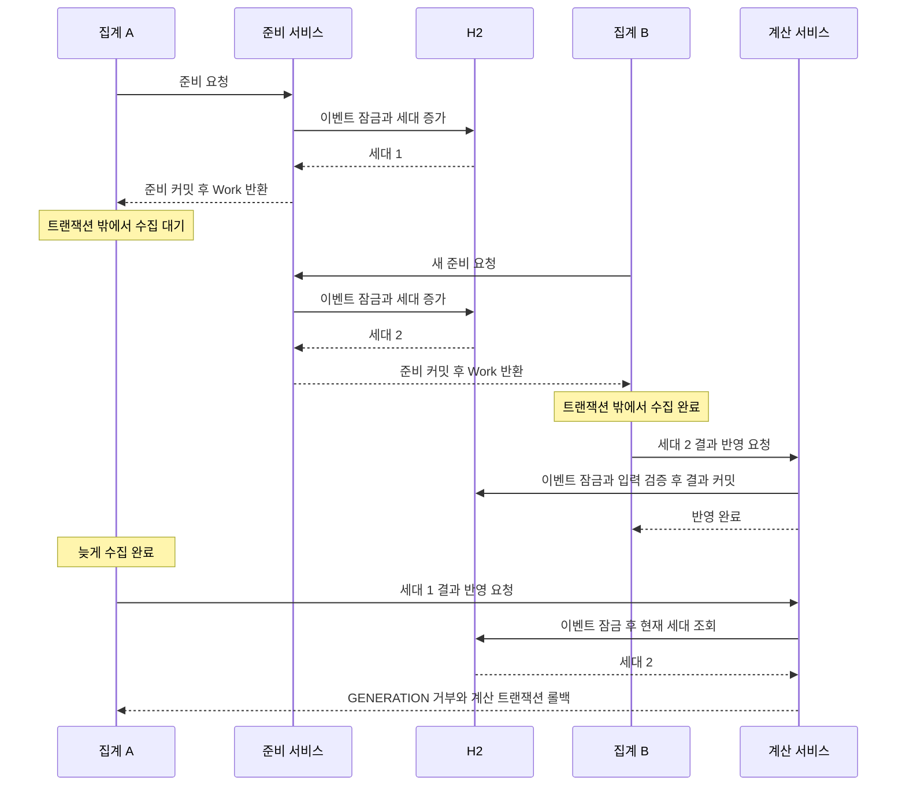

# 빙고 집계의 트랜잭션·동시성 제어

외부 데이터를 기다리던 집계 A보다 새로운 집계 B가 먼저 완료되면, **A의 늦은 결과를 DB에 반영하지 않는 방법**을 실행 가능한 테스트로 확인합니다.

Java 21 · Spring Boot 4.1.1 · Spring Data JPA · Hibernate · H2 · JUnit

[포트폴리오 README](../../README.md) · [GuildUp 빙고 설계 사례](../../docs/cases/bingo-consistency.md)

> GuildUp의 운영 설계를 참고해 새로 구성한 독립 예제입니다. 운영 소스 전체, 실제 PUBG API, Discord, 운영 데이터는 포함하지 않습니다. 여기서 검증하는 것은 H2와 아래에 기록한 라이브러리 조합의 동작입니다.

## 1. 목적과 최소 아키텍처

빙고판과 미션 엔진 대신 `킬 수 × 이벤트 정책 배수`를 참가자 진행도에 누적합니다. 계산식은 단순하게 두고, 작업이 수집한 입력이 아직 유효한지와 결과가 원자적으로 저장되는지에 집중합니다.

```text
AggregationService                  상위 DB 트랜잭션을 허용하지 않는 조정자
  → PreparationService             준비 트랜잭션: 이벤트 잠금, 세대 확보, 입력 복사
  → MatchCollector                 트랜잭션 밖: 합성 경기 수집
  → CalculationService             계산 트랜잭션: 재검증, 진행도와 처리 이력 저장
```

| 구성 | 역할 | 코드 |
|---|---|---|
| 조정자 | 준비·수집·계산을 서로 다른 Spring 빈으로 호출 | [AggregationService](src/main/java/io/github/heun0180/portfolio/bingo/AggregationService.java) |
| 준비·검증 | 이벤트 잠금, 버전 증가, 불변 입력 스냅샷과 작업 생성 | [PreparationService](src/main/java/io/github/heun0180/portfolio/bingo/PreparationService.java), [AggregationGuard](src/main/java/io/github/heun0180/portfolio/bingo/AggregationGuard.java) |
| 수집 | 실제 네트워크 없이 경기별 합성 킬 수 반환 | [MatchCollector](src/main/java/io/github/heun0180/portfolio/bingo/MatchCollector.java), [SyntheticMatchCollector](src/main/java/io/github/heun0180/portfolio/bingo/SyntheticMatchCollector.java) |
| 계산 | 오래된 입력·불완전한 수집 거부, 중복 제외 후 저장 | [CalculationService](src/main/java/io/github/heun0180/portfolio/bingo/CalculationService.java) |
| 데이터 | 불변 작업/경기 DTO, 이벤트, 참가자, 처리 경기 이력 | [AggregationData](src/main/java/io/github/heun0180/portfolio/bingo/AggregationData.java), [BingoEvent](src/main/java/io/github/heun0180/portfolio/bingo/BingoEvent.java), [BingoParticipant](src/main/java/io/github/heun0180/portfolio/bingo/BingoParticipant.java), [ProcessedMatch](src/main/java/io/github/heun0180/portfolio/bingo/ProcessedMatch.java) |

세 개의 테이블만 사용합니다.

| 테이블 | 핵심 값과 제약 |
|---|---|
| `bingo_event` | 정책 배수, `@Version` 작업 세대 |
| `bingo_participant` | 이벤트 FK, 합성 계정 코드, 진행도. `(event_id, account_code)` 유일 제약 |
| `processed_match` | 이벤트·참가자 FK, 경기 ID. `(event_id, participant_id, match_id)` 유일 제약 |

경기 하나는 여러 참가자에게 각각 기여할 수 있습니다. 중복 방지의 단위도 경기 단독이 아닌 **이벤트·참가자·경기**입니다.

## 2. 트랜잭션 경계와 잠금 순서

| 단계 | 트랜잭션 | 실제 순서 | 종료 후 상태 |
|---|---|---|---|
| 진입 | `Propagation.NEVER` | 이미 활성화된 상위 트랜잭션이 있으면 준비 전에 거부 | 수집을 감싸는 외부 트랜잭션 차단 |
| 준비 | `@Transactional`, 기본 `REQUIRED` | 이벤트 `PESSIMISTIC_WRITE` → `flush` → 이벤트 `refresh` → `PESSIMISTIC_FORCE_INCREMENT` → 입력 복사 | 작업 세대 증가가 커밋되고 이벤트 잠금 해제 |
| 수집 | 없음 | 불변 `Work`로 합성 경기 수집 | DB 잠금을 유지하지 않음 |
| 계산 | 별도 `@Transactional`, 기본 `REQUIRED` | 이벤트 `PESSIMISTIC_WRITE` → 세대·스냅샷·수집 완전성 검증 → 참가자 ID 오름차순으로 `PESSIMISTIC_WRITE` 및 `refresh` → 기존 처리 경기 조회 → 진행도·이력 저장 | 모두 커밋하거나 모두 롤백 |

준비와 계산은 별도 빈의 프록시를 통과합니다. 조정자에 활성 트랜잭션이 없으므로 두 `REQUIRED` 호출은 각각 새 트랜잭션을 시작하고 메서드 반환 시 종료합니다. `REQUIRES_NEW`나 같은 객체 내부 호출에 의존한 구조가 아닙니다. 직접 준비·계산 서비스를 다른 트랜잭션 안에서 호출하면 `REQUIRED`가 합류하므로, 예제의 집계 진입점은 `AggregationService`입니다.

참가자 입력을 변경하는 테스트도 **이벤트 → 참가자** 순서로 잠급니다. 스냅샷을 읽는 동안 이벤트 잠금이 참가자 행을 자동으로 잠그는 것은 아닙니다. 동일 이벤트의 입력 변경과 계산이 이 잠금 규약에 협력해야 합니다.

외부 호출을 전체 DB 트랜잭션으로 묶으면 응답을 기다리는 동안 커넥션과 잠금의 점유 시간이 길어질 수 있습니다. 이 예제는 잠금을 짧은 두 구간에서 사용하고, 그 사이의 입력 변경을 계산 직전에 검출합니다. 이는 설계상의 이유이며 운영 성능 측정 결과는 아닙니다.

### 세대와 스냅샷은 서로 다른 변경을 검출한다

- **세대 비교:** 이벤트의 `@Version`과 `Work.generation`을 명시적으로 비교합니다. 새 집계의 준비만 커밋돼도 `PESSIMISTIC_FORCE_INCREMENT`로 이전 작업이 무효화됩니다. 이벤트 정책 변경 역시 엔티티 업데이트로 버전을 증가시킵니다.
- **입력 비교:** 정책 배수와 ID 순으로 정렬된 참가자 `(id, accountCode)` 목록 전체를 비교합니다. 참가자 계정 변경처럼 이벤트 버전 자체가 바뀌지 않는 입력 변경을 잡습니다. 진행도는 계산의 출력이므로 스냅샷에 넣지 않습니다.
- **잠금:** 계산 중 이벤트를 다시 잠가 새 준비·정책 변경과 최종 반영이 겹치지 않게 합니다. 참가자 잠금 이후 최신 진행도를 읽어 처리 이력과 함께 갱신합니다.

낙관적 버전 **비교**와 비관적 **잠금**을 조합합니다. `@Version`만 선언하고 모든 경쟁을 자동 해결한다고 가정하지 않습니다. 단순 `PESSIMISTIC_WRITE` 조회만으로는 이 예제의 이벤트 버전이 증가하지 않습니다. 준비에서 강제 증가시키며, 이벤트 필드를 바꾸지 않는 계산은 세대를 다시 증가시키지 않습니다.

현재 Hibernate/H2 조합에서 강제 증가 후 읽은 버전이 커밋된 세대와 일치하는지는 테스트로 확인합니다. 다른 JPA 제공자나 DB로 바꿀 때에는 버전 증가·관측 시점도 다시 검증해야 합니다.

## 3. 오래된 작업 거부



텍스트로 읽으면 **A 준비 커밋 → A 수집 대기 → B 준비·수집·계산 커밋 → A 수집 완료 → A 세대 불일치로 거부**입니다. Mermaid 표시가 제한된 환경에서도 이 순서가 테스트의 실행 순서입니다.

전체 집계와 개인 집계는 모두 이벤트 하나의 세대를 공유합니다. 개인 집계의 새 준비도 이전 전체 집계를 무효화하며, 반대 방향도 같습니다. 개인 계산은 지정 참가자만 쓰지만 입력 스냅샷에는 전체 참가자를 포함합니다. 참가자별 병렬 처리보다 이벤트 단위의 일관성을 우선한 예제입니다.

새 작업이 준비된 뒤 계산에 실패하더라도 이전 작업을 되살리지는 않습니다. 별도의 새 집계가 필요합니다. 세대는 실행 취소나 작업 완료 여부를 의미하는 값이 아닙니다.

## 4. 중복과 부분 실패 처리

아래는 흐름을 줄인 **설명용 의사코드**입니다. 전체 구현은 연결된 Java 파일에 있습니다.

```text
준비 트랜잭션:
    이벤트 잠금 → 세대 강제 증가 → 입력 스냅샷 복사 → 커밋
트랜잭션 밖:
    요청 경기 ID, 성공한 경기, 실패한 경기 ID 수집
계산 트랜잭션:
    이벤트 잠금
    세대와 스냅샷이 다르면 거부
    수집이 불완전하면 거부
    동일 경기 입력을 한 번으로 합침
    참가자를 ID 순서대로 잠금
    아직 처리하지 않은 경기만 진행도와 처리 이력에 추가
    모두 성공하면 커밋, 예외가 발생하면 전체 롤백
```

- 같은 배치의 동일 경기 입력은 한 번으로 합칩니다. 같은 ID에 다른 내용이 들어오면 충돌로 거부합니다.
- 이전 집계에서 처리한 경기는 DB 이력 조회로 제외합니다. 추가로 유일 제약이 중복 이력 삽입을 막습니다. 제약 위반 예외를 무시하고 진행도만 커밋하지 않습니다.
- 진행도와 처리 이력은 하나의 계산 트랜잭션에 속합니다. 예제는 참가자마다 `flush()`하여 SQL 실행 뒤의 예외도 롤백되는지 관측할 수 있게 했습니다. `flush`는 커밋이 아닙니다.
- `failedIds`가 비어 있고 반환된 경기 ID 집합이 `requestedIds`와 같을 때만 완전한 배치로 봅니다. 불완전하면 일부 성공 경기까지 모두 보류하고 기존 진행도와 이력을 유지합니다. 수집 실패를 빈 경기 목록이나 진행도 0으로 덮어쓰지 않습니다.

완전성 판정은 수집기가 알고 있는 요청 ID 집합에 대한 검사입니다. 애초에 발견하지 못한 경기나 경기 안의 참가자 데이터 누락까지 증명하지는 않습니다. 합성 경기 맵에 계정이 없으면 해당 경기에 참여하지 않은 것으로 간주합니다.

## 5. 실행과 테스트

JDK 21과 Maven 3.9 이상을 사용합니다. 실제 API나 별도 DB 설정은 필요하지 않습니다. 기본 설정은 자동 생성된 이름의 **인메모리 H2**이며 시작·종료 시 스키마를 생성·삭제합니다. 애플리케이션 프로세스를 종료하면 데이터도 사라집니다.

```bash
cd examples/bingo-concurrency
mvn clean verify
java -jar target/bingo-concurrency-1.0.0.jar
```

JAR은 합성 참가자 두 명을 만들고 같은 경기를 두 번 집계한 결과를 출력한 뒤 종료합니다. 첫 집계에서 각 진행도는 2, 두 번째에도 2입니다. 처리 이력은 두 행을 유지하고 작업 세대만 새 준비에 따라 증가합니다. HTTP 서버는 실행하지 않습니다.

동시성 태그만 20회 반복하려면 다음 명령을 사용합니다. 한 번이라도 실패하면 루프가 중단됩니다.

```bash
for run in $(seq 1 20); do
  mvn -q -Dgroups=concurrency test || exit 1
done
```

Surefire 기본 결과는 `target/surefire-reports/`에 있고, 다음 실행에서 덮어써집니다. 이번 작업의 반복 검증에서는 매 실행의 XML과 로그를 별도로 보존했습니다. `target/` 전체는 Git 제외 대상입니다.

## 6. 테스트가 검증하는 것

[BingoConcurrencyTest.java](src/test/java/io/github/heun0180/portfolio/bingo/BingoConcurrencyTest.java)는 실제 Spring 프록시, JPA/H2, `TransactionTemplate`을 사용합니다. 테스트 클래스와 테스트 메서드에 `@Transactional`을 붙이지 않았습니다. 준비·계산은 실제로 커밋하며, 결과는 서비스의 새 읽기 트랜잭션에서 조회합니다.

수집기의 `CountDownLatch`로 A를 멈춘 상태에서 B의 커밋을 기다린 뒤 A를 재개합니다. 수집기 안에서는 트랜잭션 비활성도 확인합니다. `Thread.sleep`은 사용하지 않고 대기와 Future 조회에 제한 시간을 둡니다.

| 시나리오 · 메서드 | 재현과 실제 검증 |
|---|---|
| A 정상 집계 · `normalAggregationCommitsAndCollectionRunsWithoutTransaction` | 진행도 `3/4`, 이력 두 행, 세대 1 증가. 수집 중 활성 트랜잭션 없음. 상위 트랜잭션 안에서 조정자를 호출하면 준비 전에 거부되고 세대도 유지됨 |
| B 경기 중복 · `repeatedMatchAndDuplicateInputCannotAccumulateTwice` | 배치 안의 중복과 재실행 모두 진행도 `3/4`, 이력 두 행 유지. SQL로 같은 키를 직접 삽입하면 `DataIntegrityViolationException` 발생 |
| C 늦은 작업 · `olderWorkCannotApplyAfterNewerFullAggregationCompletes` | A 수집 대기 중 B가 커밋. A Future의 원인이 `GENERATION` 거부인지 확인. B의 `9/11`과 새 경기 이력만 유지 |
| D 전체·개인 경쟁 · `fullAndPersonalAggregationsShareEventGeneration` | 두 방향을 매개변수화한 2회. A 거부, 새 전체 집계는 `7/9`, 새 개인 집계는 `7/0`. 개인 계산의 대상 밖 참가자는 쓰지 않음 |
| E 정책 변경 · `policyChangeDuringCollectionRejectsOldWork` | 별도 트랜잭션에서 이벤트 잠금 후 배수를 2로 변경. A는 `GENERATION` 거부. 진행도·이력은 쓰지 않음 |
| F 계산 실패 · `calculationFailureRollsBackFlushedProgressAndHistoryTogether` | 첫 참가자 진행도 5와 이력 한 행이 현재 트랜잭션의 SQL 조회에 보이는 것을 확인한 뒤 두 번째 참가자 계산에서 예외. 새 트랜잭션에서는 진행도 `0/0`, 이력 없음. 준비 세대는 유지. 다시 시도하면 `5/6`과 이력 두 행 커밋 |
| G 불완전한 수집 · `incompleteCollectionPreservesPreviouslyCommittedProgress` | 성공 경기 없음/일부 성공 두 경우 모두 `INCOMPLETE` 거부. 기존 `5/6`과 이력 유지. 누락 경기를 포함해 다시 요청하면 `13/15`와 총 이력 여섯 행 |
| 입력 스냅샷 · `participantInputChangeIsRejectedEvenWithoutEventVersionChange` | 이벤트→참가자 잠금으로 합성 계정만 변경. 이벤트 세대가 같음을 확인하고도 `INPUTS` 거부. 버전 비교와 별개인 스냅샷 방어 검증 |
| 준비만 완료된 새 작업 · `newPreparationWithoutResultWritesInvalidatesOlderWork` | B는 결과를 쓰지 않고 준비만 커밋. 세대가 정확히 1 증가하고 A가 거부됨. 결과 변경에 의한 우연한 거부가 아님을 검증 |
| 동시 준비 · `concurrentPreparationsGetDistinctCommittedGenerations` | 두 스레드를 함께 출발시켜 같은 이벤트를 준비. 반환된 커밋 세대가 `이전+1`, `이전+2`로 구분되고 결과는 쓰지 않음 |

전체는 매개변수 호출을 포함해 **12개**입니다. `concurrency` 태그는 C·D·E·스냅샷·준비 무효화·동시 준비로 **실행당 7개**입니다. 태그 반복에는 F·G가 포함되지 않으며, 해당 시나리오는 전체 테스트에서 검증합니다.

별도 스레드가 서로 잠금을 기다리는 모든 가능한 순서를 탐색하는 테스트는 아닙니다. 동시 준비의 테스트도 최종 세대 구분을 검증하며 잠금 대기 시간을 측정하지 않습니다. Mock 호출 횟수나 처리량을 운영 성과로 제시하지 않습니다.

### 실행 기록

**검증일: 2026-10-21, Asia/Seoul.** 실행 환경은 Eclipse Temurin 21.0.12.1, Maven 3.9.16, macOS 27.0.1/aarch64입니다. 해석된 주요 의존성은 Hibernate 7.4.5.Final, Spring Data JPA 4.1.1, H2 2.4.240, JUnit Jupiter 6.0.3입니다.

| 실행 | 실제 결과 |
|---|---|
| `mvn clean verify` | 컴파일·테스트·실행 JAR 생성 성공. 전체 12개, 실패 0, 오류 0, 건너뜀 0 |
| `mvn -q -Dgroups=concurrency test` 20회 | 실행당 7개, 총 140개 성공. 실패 0, 오류 0, 건너뜀 0 |
| 실행 JAR | 같은 합성 경기 재집계 후 진행도 `2/2`, 처리 이력 두 행 유지 확인 |
| 보호 로직 대조 실험 | 세대 비교 조건만 일시적으로 비활성화하고 C 테스트를 실행하자, 기대한 거부 예외가 발생하지 않아 1개 테스트가 예상대로 실패 |
| 대조 실험 원복 | 원본 바이트와 동일하게 복원한 뒤 `mvn clean verify`에서 전체 12개 재통과. 반복 20회도 복원된 코드로 실행 |

대조 실험은 **세대 검증을 빠뜨리면 이 회귀 테스트가 오류를 감지한다**는 근거입니다. 모든 방어 로직에 대한 변이 테스트나 운영 장애 재현을 의미하지 않습니다. 일시적으로 비활성화한 조건은 공개 소스에 남아 있지 않습니다.

로컬 반복 실행의 회차별 XML·로그와 환경·집계 기록은 `target/verification/`에 보관했습니다. 이 경로는 Git에 포함되지 않으며 `mvn clean` 시 삭제됩니다. 성능 개선률이나 PostgreSQL 테스트 결과는 측정·실행하지 않았습니다.

## 7. 실제 GuildUp 설계와의 관계

원본의 `BingoAggregationPreparationService`, `BingoAggregationGuard`, `BingoAggregationCalculationService`와 호출 경로·Repository·Entity를 읽어 잠금과 검증 순서를 확인했습니다. 원본 코드를 그대로 옮기지 않고 예제용 모델과 인터페이스로 다시 작성했습니다.

| 항목 | 원본에서 확인한 설계 | 이 예제의 범위 |
|---|---|---|
| 트랜잭션 분리 | 준비 서비스 → 외부 수집 및 Fact 조회 → 계산 서비스 | 준비 → 합성 수집 → 계산. 조정자의 `NEVER`로 상위 트랜잭션도 명시적으로 차단 |
| 작업 세대 | 이벤트 잠금 후 `flush/refresh`, `PESSIMISTIC_FORCE_INCREMENT`, 이벤트 버전을 포함한 입력 비교 | 이벤트 버전을 별도로 비교해 거부 이유를 구분. 새 준비의 강제 증가 유지 |
| 입력 스냅샷 | 이벤트 정책·기간·미션·계정·참가자 버전과 상태 등 비교 | 정책 배수와 참가자 ID·계정 목록만 비교. 참가자 `@Version`은 생략 |
| 계산 순서 | 이벤트 잠금·검증 후 참가자 ID 순서 잠금, 진행도와 처리 이력 갱신 | 같은 순서 유지. SQL 롤백 관측을 위한 참가자별 명시적 `flush` 추가 |
| 중복 방지 | 이벤트·참가자·경기 처리 이력의 유일 키 | 같은 단위의 조회와 유일 제약, 배치 내 중복 합치기 |
| 완전한 수집 | 저장된 Fact를 재사용해 전체 재계산, 결과 감소·완료 취소도 가능 | 미처리 경기의 단순 누적만 지원. 과거 점수 정정·감소·재계산 없음 |
| 불완전한 수집 | 안전한 신규 데이터의 증분 반영과 완전한 재계산·확정 보류를 구분 | 배치 전체를 거부해 기존 결과 보존. 일부 성공분도 저장하지 않음 |
| 나머지 운영 기능 | 경기 Fact·Telemetry·보류 재수집, 권한, 커뮤니티, 쿨다운, 빙고판·완료 보상 등 | 포함하지 않음 |

원본 `BingoAggregationConcurrencyFlowTests`에서는 별도 스레드·트랜잭션과 수집 시점 제어를 확인했습니다. `BingoAggregationConsistencyFlowTests`의 재계산·부분 실패 시나리오도 참고했지만, 이 원본 테스트 클래스에는 테스트용 `@Transactional`이 있으므로 모든 항목을 독립 커밋의 증거로 해석하지 않았습니다. **이번에 실행한 테스트는 이 예제의 테스트이며, Private 테스트는 실행하지 않았습니다.**

## 8. H2의 검증 범위와 한계

이 예제의 반복 성공은 선택한 Hibernate/H2 환경에서 위 시나리오가 관측됐다는 증거입니다. PostgreSQL의 잠금·MVCC·격리 수준·교착·잠금 시간 제한·제약 동작까지 같은 결과라고 주장하지 않습니다. PostgreSQL 모방 모드도 사용하지 않습니다.

공개 후 PostgreSQL 검증을 추가한다면 운영 DB가 아닌 폐기 가능한 별도 DB에서 같은 시나리오를 실행해야 합니다. 특히 두 커넥션의 실제 잠금 대기, 동시 정책/참가자 변경, 강제 버전 증가의 반환·커밋 시점, 실패 후 연결 재사용과 롤백을 확인해야 합니다. 현재 예제에는 시간 필드가 없어 PostgreSQL timestamp 정밀도 문제도 검증하지 않습니다.

| 확인된 제약 | 의미와 추가 검증 방향 |
|---|---|
| 이벤트 단위 직렬화 | 다른 참가자의 개인 집계도 같은 이벤트 잠금을 사용. 처리량·대기 시간은 미측정 |
| 새 준비가 이전 작업 무효화 | 새 작업 실패 시 자동으로 이전 결과를 채택하지 않음. 호출자가 새 작업으로 재시도해야 함 |
| 실행 중단·재시도 저장소 없음 | 거부된 작업도 수집 자체는 끝까지 수행할 수 있음. 취소·작업 큐·자동 재시도·타임아웃 정책은 포함하지 않음 |
| 협력적 잠금 규약 | 입력 변경자가 이벤트 잠금을 건너뛰면 검증 직후 참가자 변경과 경합할 수 있음. 모든 쓰기 경로의 잠금 규약 검토 필요 |
| 단순 증분 모델 | 정책 변경 전의 누적분은 새 배수로 재계산하지 않음. 경기 정정과 계정 교체 후 과거 이력 재해석도 지원하지 않음 |
| 제한된 완전성 모델 | 알려진 요청 경기 ID만 검사. 경기 발견 누락·참가자별 필드 누락·실제 API 오류 분류는 검증하지 않음 |
| 재시작·다중 프로세스 | Work는 메모리에 있고 기본 DB도 휘발성. 재시작 복구나 다중 JVM·다중 서버 테스트는 없음 |
| 보장 범위 | 중복 외부 요청을 막는 예제가 아님. 결과 반영의 검증과 중복 누적 방지가 대상이며 exactly-once 실행을 주장하지 않음 |

프레임워크 동작의 참고 자료: [Spring 트랜잭션 프록시](https://docs.spring.io/spring-framework/reference/data-access/transaction/declarative/annotations.html), [트랜잭션 전파](https://docs.spring.io/spring-framework/reference/data-access/transaction/declarative/tx-propagation.html), [JPA 잠금 모드](https://jakarta.ee/specifications/persistence/3.2/apidocs/jakarta.persistence/jakarta/persistence/LockModeType.html), [H2 잠금](https://h2database.com/html/features.html#locking).

## 9. 공개 범위

합성 계정 코드와 경기 ID만 사용합니다. 기본 설정에 외부 DB 주소나 자격증명은 없으며 네트워크 API를 호출하지 않습니다. `target/`, IDE 설정, 캐시는 [`.gitignore`](.gitignore)로 제외합니다. 환경별 빌드 산출물과 테스트 로그는 공개 소스에 포함하지 않습니다.

이 예제를 통해 확인할 핵심은 **DB 트랜잭션 밖에서 수집하되, 반영 직전에 이벤트 잠금·세대·입력을 다시 확인하고 진행도와 중복 방지 이력을 하나의 트랜잭션으로 저장하는 구조**입니다.
