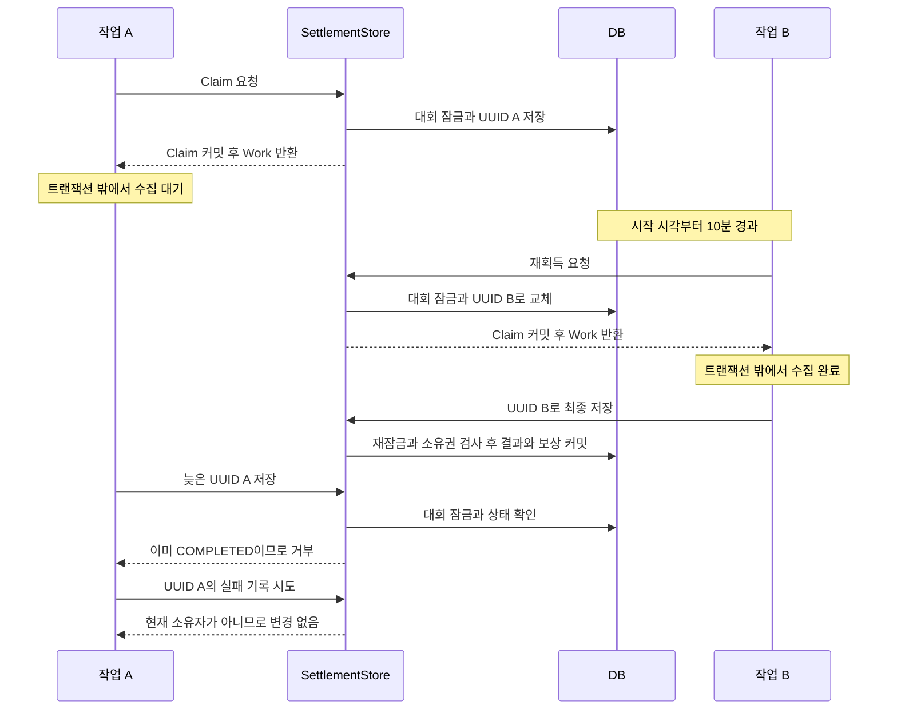

# 지연 정산과 UUID 기반 작업 소유권

외부 수집이 늦어진 작업 A의 Claim을 작업 B가 교체했다면, **A의 늦은 저장·실패 기록이 B의 소유권이나 결과를 바꾸지 못하게 하는 구조**를 실행합니다. 결과·보상 원장·합계·완료 상태의 원자적 저장도 실제 DB 트랜잭션으로 검증합니다.

Java 21 · Spring Boot 4.1.1 · Spring Data JPA · H2 · JUnit · 선택적 PostgreSQL 검증

[포트폴리오 README](../../README.md) · [GuildUp 정산 설계 사례](../../docs/cases/settlement-claim.md)

> GuildUp 운영 설계의 핵심을 새 모델로 재구성한 독립 예제입니다. 운영 소스 전체·운영 데이터·PUBG/Discord API는 포함하지 않습니다. 기본 실행은 인메모리 H2와 합성 시계를 사용합니다.

## 1. 문제 정의

발표 예정 시각, 작업의 시작 시각, 현재 작업의 식별값은 서로 다른 책임을 갖습니다. 하나의 timestamp로 이 책임들을 처리하면 재시도 후 늦게 완료된 작업을 구분하기 어렵고, DB 저장 정밀도 차이로 정상 작업을 잘못 거부할 수도 있습니다.

| 경쟁·실패 상황 | 보호 방법 |
|---|---|
| 같은 후보를 두 poller가 선택 | 대회 행을 잠근 뒤 Claim 가능 조건 재검사 |
| 기존 수집이 느려 새 작업이 재획득 | 새 UUID로 교체, 최종 저장 직전에 현재 UUID 재검사 |
| 이전 작업이 늦게 실패 | 실패 기록에서도 현재 UUID 검사 |
| 결과만 저장되고 보상이 실패 | 결과·보상 원장·보상 잔액·대회 총점·완료 상태를 같은 트랜잭션으로 묶음 |
| 시작 시각의 저장 정밀도가 달라짐 | 시각 동등 비교 대신 UUID로 작업 식별 |

이것은 실패 가능성과 재현 테스트이며 실제 운영 장애 발생 이력이나 처리량 개선 수치를 의미하지 않습니다.

## 2. 상태와 작업 소유권 구조

```text
IN_PROGRESS
  └─ 종료 이후 발표 요청 → RESULT_PENDING
       ├─ 예정 시각 이후 Claim → 합성 수집 → 최종 저장 → COMPLETED
       └─ 실패 기록 → RESULT_PENDING 유지 → 시작 시각 기준 재획득
```

| 필드 | 책임 |
|---|---|
| `resultRequestedAt` | 결과 발표 요청 시각 |
| `resultPublishAt` | 요청 시각 + 30분. Claim을 시도할 수 있는 시각 |
| `finalizationStartedAt` | 직전 Claim 시작 시각. 재획득 대기 기준 |
| `finalizationClaimToken` | 현재 작업의 UUID. 완료·실패 기록의 소유권 검사 |
| `completedAt`, `resultLastError` | 완료 시각 또는 정제된 실패 메시지 |
| `@Version` | JPA 엔티티 버전. Work의 소유권 식별값으로 쓰지 않음 |

**10분은 재획득 가능 기준이며 기존 작업의 절대 저장 마감 시각이 아닙니다.**

- `now < finalizationStartedAt + 10분`이면 다른 작업의 획득을 거부합니다.
- 정확히 10분이면 새 UUID로 교체할 수 있습니다.
- 10분을 넘었어도 교체되지 않았다면 현재 UUID로 완료할 수 있습니다.
- Claim 시간을 지났다는 이유만으로 UUID를 자동 삭제하거나 실행 중 수집을 취소하지 않습니다.

## 3. 발표 요청부터 완료까지

```text
SettlementWorker.request
  → SettlementStore.request: 대회 잠금, pending·요청/예정 시각 커밋
SettlementPoller.tick
  → 예정 시각 순 후보 ID 최대 20개 조회
  → SettlementWorker.publish
      → SettlementStore.claim: 대회 잠금, UUID·시작 시각 커밋
      → ResultCollector.collect: 트랜잭션 밖의 합성 수집
      → SettlementStore.finish: 대회 재잠금, 소유권 검사, 결과·보상·완료 커밋
      → 예외면 SettlementStore.recordFailure: 별도 트랜잭션으로 실패 기록
```

후보 조회가 작업 소유권을 확보하지는 않습니다. Claim 트랜잭션이 상태·예정 시각·직전 시작 시각을 다시 확인합니다. 여러 poller가 같은 후보를 읽어도 한 대회의 획득 판단은 행 잠금 아래에서 수행합니다.

예제의 `tick()`은 운영 스케줄러의 **한 차례 poll**을 모델링합니다. 자동 주기 타이머는 생략했고 데모와 테스트에서 명시적으로 호출합니다. 데모의 `AdjustableClock`도 실제 시간 대신 논리 시간을 이동시킵니다. 30분을 실제로 기다릴 필요가 없습니다.

## 4. 트랜잭션 경계와 잠금

| 구간 | 선언·실제 경계 | 잠금과 쓰기 |
|---|---|---|
| Worker·Poller | `Propagation.NEVER` | 활성 상위 트랜잭션이 있으면 진입 전 거부 |
| 발표 요청 | Store의 `@Transactional`, 기본 `REQUIRED` | 대회 `PESSIMISTIC_WRITE` → 조건 검사 → pending·시각 커밋 |
| 후보 조회 | `@Transactional(readOnly = true)` | ID 조회. 소유권 없음 |
| Claim 획득 | 별도 Store 프록시의 `@Transactional` | 대회 잠금 → 조건 검사 → UUID·시작 시각 커밋 |
| 합성 수집 | 없음 | DB 행 잠금·트랜잭션을 유지하지 않음 |
| 최종 저장 | 별도 Store 프록시의 `@Transactional` | 대회 잠금 → 상태·UUID 검사 → 결과 저장 → 보상 계정 잠금 → 원장·잔액 → 대회 총점·완료 → 커밋 |
| 실패 기록 | 최종 저장이 롤백된 후 새 Store 호출 | 대회 잠금 → UUID 검사 → 오류·UUID 제거 커밋 |

Store가 `REQUIRES_NEW`를 사용하는 구조는 아닙니다. Worker에 상위 트랜잭션이 없으므로 각 Store 프록시 호출이 독립 물리 트랜잭션을 시작·종료합니다. 반면 별도 빈의 `RewardService.credit`는 `REQUIRED`로 최종 저장에 참여합니다. 직접 Store를 다른 트랜잭션 안에서 호출하면 합류하므로, 외부 수집의 진입점은 Worker입니다. 같은 객체의 내부 호출로 트랜잭션을 분리한다고 가정하지 않습니다. [Spring 트랜잭션 프록시 문서](https://docs.spring.io/spring-framework/reference/data-access/transaction/declarative/annotations.html)

잠금 순서는 **대회 → 보상 계정**입니다. 외부 수집은 그 사이에 어떤 대회 잠금도 유지하지 않습니다. 지연된 수집 테스트에서는 다른 스레드가 같은 행을 잠가 이미 커밋된 UUID를 조회할 수 있는지도 확인합니다.

### 교체 후 오래된 작업의 저장



텍스트 순서는 **A Claim 커밋 → A 수집 대기 → 10분 후 B 재획득·완료 → A 저장 거부 → A 실패 기록도 변경 없음**입니다. B가 아직 pending일 때 A가 들어오면 상태 대신 UUID 불일치로 거부됩니다. 두 경우를 각각 테스트합니다.

## 5. UUID와 timestamp의 역할 차이

Java `Instant`는 나노초 부분을 표현하지만 PostgreSQL timestamp 계열의 해상도는 마이크로초입니다. 메모리 Work의 시작 시각과 저장 후 읽은 시작 시각이 달라질 수 있습니다. [Java 21 Instant](https://docs.oracle.com/en/java/javase/21/docs/api/java.base/java/time/Instant.html), [PostgreSQL 16 날짜·시간 타입](https://www.postgresql.org/docs/16/datatype-datetime.html)

최종 저장은 다음 **설명용 의사코드**와 같은 조건을 사용합니다.

```text
대회 행 잠금
require 상태 == RESULT_PENDING
require work.uuid != null
require work.uuid == DB의 현재 UUID
결과와 보상을 저장하고 COMPLETED로 변경
commit
```

여기에 `work.claimAt == 저장 시각`이나 `now < claimAt + 10분` 조건은 없습니다. `Work.claimAt`은 재시도 설명과 테스트에 쓰며 소유권 식별에 사용하지 않습니다.

UUID도 시간 관련 문제 전부를 제거하지는 않습니다. 발표·재획득 조건은 여전히 Clock과 DB 시각에 의존합니다. 경계 테스트의 Claim 시작 시각은 마이크로초로 정확히 표현되는 값으로 구성합니다. 나노초 단위의 모든 경계나 서버 간 시계 편차까지 보장하지 않습니다.

## 6. 실패·재시도와 원자성

현재 UUID와 일치하는 작업만 `recordFailure`로 다음을 커밋할 수 있습니다.

1. UUID 제거.
2. 정제된 고정 실패 메시지 저장. 원본 예외 문자열은 저장하지 않음.
3. 기존 Claim 시작 시각 보존.
4. `RESULT_PENDING` 유지.

예를 들어 12:00에 Claim을 얻고 12:09에 실패했다면, 재획득 가능 시점은 12:10입니다. 12:19가 아닙니다. 12:11에 실패했다면 시작 시각 기준 대기가 끝났으므로 곧바로 새 Claim을 얻을 수 있습니다.

최종 저장은 다음 다섯 종류의 DB 변경을 함께 커밋합니다.

- `match_result`: 경기별 합성 대회 점수. `(competition_id, match_id)` 유일 제약.
- `competition.totalPoints`: 경기 점수의 합계.
- `reward_entry`: 한 대회의 합성 수상자에게 주는 보상 원장. `competition_id` 유일 제약.
- `reward_account.balance`: 고정 보상 3의 누적 잔액. 대회 점수와 다른 값.
- `competition`: `COMPLETED`, 완료 시각, Claim·오류 제거.

배치 내 동일 경기 입력은 한 번으로 합치고, 같은 경기 ID에 상충하는 점수가 있으면 거부합니다. 완료 상태 검사, 계정 잠금 안의 기존 원장 조회, DB 유일 제약을 조합해 반복 보상을 막습니다. 유일 제약 위반을 삼키고 잔액만 커밋하지 않습니다.

`FinishCheckpoint`는 정상 실행에서 아무 일도 하지 않습니다. 테스트는 모든 SQL을 `flush`한 후 이 관측점에서 실패를 주입합니다. 같은 트랜잭션의 SQL 조회에는 완료 상태·결과·원장·잔액이 보였어도, 예외가 프록시 밖으로 전파되면 함께 롤백됩니다. 이후 실패 기록은 별도 커밋입니다. 앞서 커밋한 발표 요청·Claim 획득과 외부 수집은 최종 저장 롤백의 대상이 아닙니다.

## 7. 운영 구현과 예제의 차이

원본의 `KillCompetitionSettlementStore`, `KillCompetitionSettlementService`, `KillCompetitionResultScheduler`, `KillCompetition`, 관련 Repository·보상 서비스와 테스트를 읽어 확인했습니다. Public 기술 문서의 30분 지연, 10분 재획득, UUID 검증, 실패 시 시작 시각 보존 설명은 현재 원본과 일치했습니다. 원본 테스트는 이번에 실행하지 않았습니다.

| 항목 | 운영 원본에서 확인한 구조 | 공개 예제 |
|---|---|---|
| 상태 | 모집·준비·진행·발표 대기·완료·취소 | 진행·발표 대기·완료만 구현 |
| 수집 | PUBG 경기·승인 참가자·기간 필터 | 합성 경기 ID와 점수 목록 |
| 결과 계산 | 참가자별 기존 경기 병합·재합산, 팀 순위 보너스 | 한 번의 최종 snapshot을 경기별로 저장·합산. 중간 정산·기존 경기 정정 병합 없음 |
| Claim 정책 | 행 잠금, 10분 재획득, UUID 비교 | 같은 핵심 조건. 엄격한 lease 만료 조건을 추가하지 않음 |
| 보상 | 자격·최소 참가자·팀/개인 우승·일일 제한, 멤버 잠금 | 미리 정한 합성 수상자 한 명에게 고정 3. 원장 키도 대회 하나로 단순화 |
| 원자성 | 결과·개인/팀 점수·커뮤니티 보상·완료·빙고 | 결과·대회 총점·보상 원장·잔액·완료만 포함 |
| 실행 경계 | 상위 트랜잭션 없는 정상 경로의 Store `REQUIRED` | Worker·Poller의 `NEVER`로 상위 트랜잭션 유입도 명시적으로 거부 |
| 스케줄러 | 기본 fixed delay 60초, 후보 최대 20개 | 최대 20개를 처리하는 명시적 `tick()`. 자동 타이머 없음 |
| 실패 전파 | 정산 서비스가 실패를 기록·로그/모니터링 후 처리 종료 | Worker는 기록 후 예외를 호출자에 전달. Poller는 실패 수를 집계하고 다음 후보 처리 |

권한·커뮤니티 격리·팀 배정·보상 일일 정책·빙고·모니터링·외부 요청 공유는 포함하지 않았습니다. 원본 중간 정산의 timestamp 동등 비교도 이 UUID 예제의 보장 범위가 아닙니다.

## 8. 실행과 테스트

### 기본 H2 실행

JDK 21, Maven 3.9 이상이 필요합니다. 외부 DB·API 설정 없이 실행합니다.

```bash
cd examples/settlement-claim
mvn clean verify
java -jar target/settlement-claim-1.0.0.jar
```

데모는 발표 요청 직후 poll에서는 정산하지 않고, 논리 시계를 30분 이동한 다음 완료합니다. 대회 점수 7과 보상 잔액 3, 원장 한 건을 출력하고 종료합니다. 재차 poll해도 보상을 다시 지급하지 않습니다. HTTP 서버는 없습니다.

### 선택적 PostgreSQL 실행

Python 3과 로컬 PostgreSQL의 `initdb`, `pg_ctl`, `psql`, Maven이 필요합니다. Docker와 기존 서버 접속 정보는 사용하지 않습니다.

```bash
python3 scripts/verify-postgres.py
```

Maven이 PATH에 없다면 `SETTLEMENT_MAVEN`에 Maven 실행 파일 경로를 지정할 수 있습니다. 스크립트는 `target/` 아래 새 클러스터를 초기화하고, 임의 loopback 포트·고유 DB 이름으로 `mvn -Ppostgres verify`를 실행합니다. 종료 시 직접 만든 클러스터만 정지·삭제합니다. 운영 DB URL을 받지 않습니다. 폐기용 로컬 클러스터는 테스트 전용 계정과 trust 인증을 사용합니다.

실행 중인 클러스터도 `target/`에 있으므로 **이 스크립트와 동시에 `mvn clean`을 실행하지 마세요.** 실패했더라도 정지·정리 절차를 수행하며, 정지에 실패하면 실행 중 디렉터리를 삭제하지 않습니다.

기본 빌드는 H2의 `SettlementFlowTest`만 실행합니다. `PostgresClaimIT`는 `postgres` 프로필의 Failsafe가 선택합니다. 프로필만 단독 실행해 전용 스크립트의 환경이 없으면 실패하도록 했습니다. PostgreSQL을 실행하지 않은 기본 빌드가 PostgreSQL 통과를 의미하지는 않습니다.

### 검증 시나리오

[공통 계약 테스트](src/test/java/io/github/heun0180/portfolio/settlement/SettlementContract.java)는 테스트용 `@Transactional` 없이 실제 서비스 프록시·DB를 사용합니다. H2와 PostgreSQL에서 같은 계약을 재사용합니다. `CountDownLatch`로 수집 중 작업을 멈추고 새 Claim·커밋 후 재개합니다. `Thread.sleep`은 사용하지 않으며 대기 시간에 상한을 둡니다.

| 범위 | 테스트 메서드 | 주요 assertion |
|---|---|---|
| A 발표 지연 | `publicationWaitsThirtyMinutesAndPollsOnce` | 요청+30분 예정 시각, 직전에는 수집 0회, 예정 시각에 완료, 재poll 시 추가 보상 없음 |
| 요청 조건 | `resultRequestRejectsBeforeEndAndDuplicateRequest` | 종료 전·중복 요청 거부, 상태 보존 |
| B 동시 획득 | `simultaneousClaimsHaveOneOwner` | 두 별도 스레드 중 Work 한 개, DB UUID와 일치 |
| C 재획득 제한 | `claimIsBlockedUntilTenMinutes` | 10분 직전 새 Claim null, 기존 UUID 유지 |
| D 경계 교체 | `exactTenMinutesReplacesUuid` | 정확히 10분에 새 UUID와 시작 시각 저장 |
| E 교체 후 저장 | `oldWorkerIsRejectedWhileReplacementIsPending` | 늦은 A의 `OWNERSHIP` 거부, B Claim 유지, 결과·보상 쓰기 없음 |
| F 완료 후 저장 | `completedReplacementRejectsOldSaveAndLateFailure` | A의 `STATE` 거부, B 결과·보상·완료 유지, 늦은 실패로 오류 추가 없음 |
| G 늦은 실패 | `lateCollectionFailureCannotRemoveReplacementClaim` | A 수집 실패 후 B UUID·시작 시각 유지, 오류 미기록 |
| H 교체 없는 장시간 작업 | `tenMinutesWithoutReplacementStillAllowsFinish` | 11분 경과해도 현재 UUID로 완료 |
| I 실패 재시도 | `failureRetryUsesClaimStartInsteadOfFailureTime` | 시작+9분 실패 후 UUID 제거·시작 보존. 시작+10분 재획득 가능 |
| 오래 걸린 실패 | `failureAfterReclaimWindowAllowsImmediateNewClaim` | 시작+11분 실패 후 즉시 새 UUID 획득 |
| J SQL 반영 후 롤백 | `finalSaveRollsBackResultsRewardsTotalAndCompletedState` | flush 후 SQL에서 결과·원장·합계·완료 관측, 예외 후 새 읽기 트랜잭션에서 모두 원복. 이전 Claim은 유지 |
| 롤백 이후 실패 기록 | `workerRecordsFailureAfterRollbackAndRetryCommits` | Worker 실패 시 결과·보상은 0, 오류·시작은 커밋. 재획득 후 완료 |
| 수집 실패 | `collectionFailureCommitsFailureWithoutAnyResultOrReward` | 수집에 트랜잭션 없음. 현재 소유자의 오류 커밋, 결과·보상 없음 |
| K 중복 보상 | `repeatedFinishAndDatabaseConstraintsPreventDuplicateRewards` | 반복 완료 거부, 원장·결과 직접 중복 INSERT도 유일 제약으로 거부, 잔액 3 유지 |
| L 시간 표현 변경 | `uuidIdentitySurvivesExplicitTimestampPrecisionChange` | JDBC로 마이크로초 단위 시각 주입 후 Work 시각과 다름, UUID 일치, 완료 가능 |
| null·다른 UUID | `nullAndWrongUuidCannotSavePendingResult` | UUID null·불일치 거부, 실패 기록도 null 소유권으로 변경 불가 |
| 입력 중복 | `duplicateInputMatchesAreCountedOnce` | 배치 내 같은 경기 두 번이어도 결과 한 행·대회 점수 7 |
| 동시 최종 저장 | `concurrentFinishesCommitOneResultAndOneReward` | 같은 Work의 두 저장 중 하나 완료·하나 거부, 원장 한 건 |
| 상위 트랜잭션 | `ambientTransactionIsRejectedBeforeRequestOrClaim` | 상위 트랜잭션 유입 시 요청/Claim 전에 거부, DB·수집 변화 없음 |

[PostgresClaimIT](src/test/java/io/github/heun0180/portfolio/settlement/PostgresClaimIT.java)는 위 공통 계약에 `postgresRoundsTimestampButUuidStillOwnsWork`를 추가합니다. 나노초가 있는 Claim을 실제 PostgreSQL에 저장한 뒤 JDBC로 읽어 **Work 시각과 다름**, **nano가 1000의 배수**, **UUID 일치**를 확인하고 결과·보상까지 완료합니다. 정확한 반올림 방향을 모든 입력에 일반화하는 검증은 아닙니다.

동시성 태그는 B·E·F·G·동시 최종 저장의 실행당 5개입니다.

```bash
for run in $(seq 1 20); do
  mvn -q -Dgroups=concurrency test || exit 1
done
```

### 실제 실행 결과

**검증일: 2026-10-21, Asia/Seoul.** Eclipse Temurin 21.0.12.1, Maven 3.9.16, macOS 27.0.1/aarch64에서 실행했습니다. 주요 의존성은 Hibernate 7.4.5.Final, Spring Data JPA 4.1.1, H2 2.4.240, JUnit Jupiter 6.0.3이며, PostgreSQL 프로필의 JDBC 드라이버는 42.7.13입니다.

| 실행 | 테스트 수 | 실패 | 오류 | 건너뜀 | 결과 |
|---|---:|---:|---:|---:|---|
| `mvn clean verify`, H2 | 20 | 0 | 0 | 0 | 컴파일·실행 JAR 생성까지 성공 |
| H2 동시성 태그 20회 | 5 × 20 = 100 | 0 | 0 | 0 | 매 실행의 XML로 수와 결과 확인 |
| 폐기용 PostgreSQL 16.15 | 21 | 0 | 0 | 0 | 공통 계약 20개 + 실제 저장 정밀도 1개 |
| PostgreSQL 검증 빌드의 H2 단계 | 20 | 0 | 0 | 0 | 같은 프로필 빌드에서도 기본 계약 성공 |
| UUID 보호 로직 대조 실험 | 1 | 1 | 0 | 0 | 예상한 실패. 오래된 작업이 거부되지 않음을 감지 |
| 대조 실험 원복 후 `clean verify` | 20 | 0 | 0 | 0 | 정상 코드 재빌드. 이후 PostgreSQL·반복 실행도 복원된 코드로 수행 |

대조 실험은 `finish`의 UUID 소유권 검사만 잠시 비활성화했습니다. `oldWorkerIsRejectedWhileReplacementIsPending`가 기대한 거부 예외를 받지 못해 실패했고, 파일을 원래 바이트로 복원했습니다. 이 결과는 해당 회귀 테스트가 UUID 검사 누락을 감지한다는 근거이며 모든 오류를 탐지한다는 보장은 아닙니다.

PostgreSQL 전용 테스트에서는 합성 입력 `2030-01-01T00:30:00.123456789Z`가 저장 후 `2030-01-01T00:30:00.123457Z`로 읽혔고, UUID 일치로 최종 저장이 성공했습니다. 시간값은 테스트 데이터입니다. 폐기용 서버는 검증 후 정지했고 클러스터 디렉터리도 삭제했습니다. 실행 JAR에서도 30분 전 미처리, 30분 후 대회 점수 7·보상 잔액 3·원장 한 건, 중복 poll 미처리를 확인했습니다.

로컬 증거는 `target/verification/`의 전체 XML, 회차별 로그/XML, `repetitions.json`, `postgres-summary.json`, 대조 실험 기록에 있습니다. Git에는 포함하지 않으며 `mvn clean` 시 삭제됩니다. 위 결과는 운영 소스 테스트나 성능 벤치마크 결과가 아닙니다. Mermaid 1개는 로컬 파서 11.12.0으로 문법을 검증했고, 아직 GitHub에 게시하지 않아 GitHub 화면 검증은 수행하지 않았습니다.

## 9. 동시성·복구의 한계

| 현재 범위 | 추가 검증·개선 대상 |
|---|---|
| Claim 교체는 늦은 쓰기를 막음 | 이전 네트워크 작업 취소·중복 수집 방지는 하지 않음. exactly-once 실행 보장이 아님 |
| 한 대회 최종 저장 직렬화 | 대회 잠금·보상 계정 잠금의 대기 비용과 대량 결과 처리량은 미측정 |
| 실패 기록이 성공한 경우 | 실패 기록 자체의 DB 장애, 커밋 응답 유실·성공 여부 불명확 상황은 별도 장애 주입 필요 |
| Claim은 DB에 남음 | Work·수집 결과는 메모리. 프로세스 중단 뒤 새 poll과 재획득이 필요. 기본 H2는 재시작 시 데이터도 사라짐 |
| 동일 JVM의 여러 스레드 | 다중 JVM·서버 재시작·Clock 편차·DB 장애 조합은 미검증 |
| 모든 쓰기 경로의 협력 | 예제의 Worker→Store→보상 서비스 경로가 기준. 우회 SQL·외부 보상 서비스까지 원자성을 확장하지 않음 |
| 합성 결과를 완전한 입력으로 간주 | 실제 PUBG의 최근 경기 누락·부분 수집·외부 결과 정정·보상 취소는 모델링하지 않음 |

H2 성공만으로 PostgreSQL의 MVCC·잠금·시간 타입 동작을 주장하지 않습니다. PostgreSQL 실행 결과도 기록된 단일 로컬 버전과 테스트 시나리오에 한정됩니다.

## 10. 파일과 공개 범위

- `pom.xml`, `.gitignore`, `src/main/resources/application.properties`: 독립 빌드·인메모리 H2 설정·산출물 제외.
- `src/main/java/io/github/heun0180/portfolio/settlement/`: 모델 4개, Repository 4개, DTO·시계·예외·수집/관측 인터페이스와 구현, Store·Worker·Poller·보상 서비스·데모 지원을 포함한 Java 파일 20개.
- `src/test/java/io/github/heun0180/portfolio/settlement/`: `SettlementContract.java`, `SettlementFlowTest.java`, `PostgresClaimIT.java`.
- `scripts/verify-postgres.py`: 새로 생성한 로컬 폐기용 클러스터만 사용하는 검증 실행기.
- `README.md`: 구조·차이·검증 범위 설명.

주요 Java 파일 목록은 다음과 같습니다. 공통 경로는 `src/main/java/io/github/heun0180/portfolio/settlement/`입니다.

| 구분 | 파일 (`.java`) |
|---|---|
| 실행·합성 데이터 | `SettlementExampleApplication`, `AdjustableClock`, `ExampleDatabase` |
| 엔티티 | `Competition`, `MatchResultEntity`, `RewardEntry`, `RewardAccount` |
| Repository | `CompetitionRepository`, `MatchResultRepository`, `RewardEntryRepository`, `RewardAccountRepository` |
| 처리 경로 | `SettlementStore`, `SettlementWorker`, `SettlementPoller`, `RewardService` |
| 수집·관측 | `ResultCollector`, `SyntheticCollector`, `FinishCheckpoint` |
| 입력·거부 표현 | `SettlementData`, `RejectedClaim` |

운영 주소·자격증명·실제 사용자 정보는 포함하지 않습니다. UUID는 합성 작업 식별값이며 인증 토큰이 아닙니다. `target/`의 빌드 결과물, 테스트 기록, 폐기용 DB와 로그는 모두 Git 제외 대상입니다.
